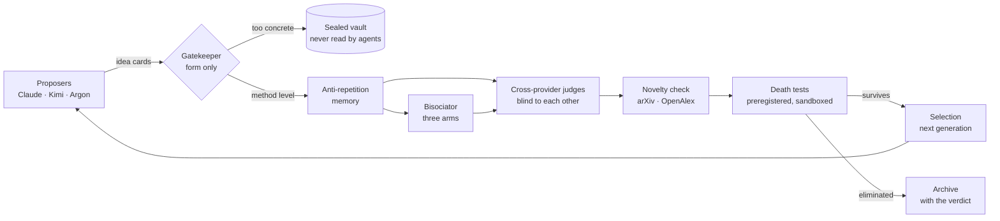
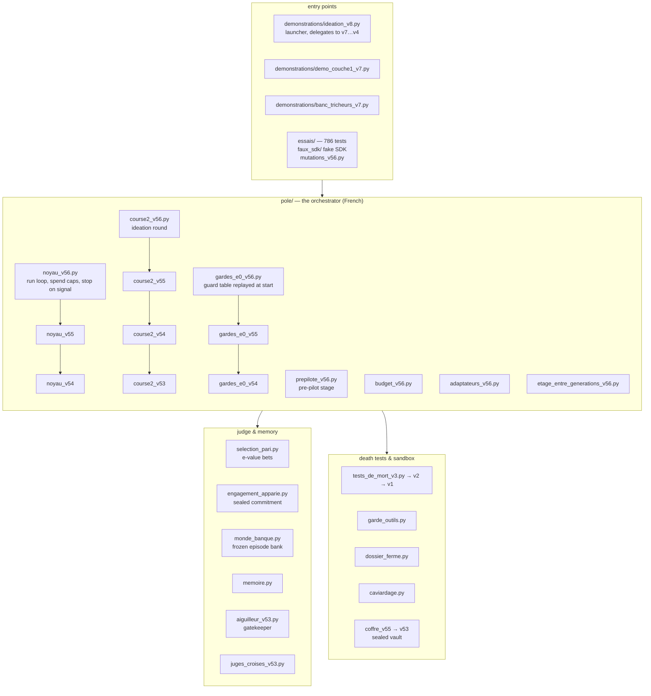

# Ideation organism — an automated research pole that cannot grade its own homework

**What it is.** A small, fully inspectable system in which language-model agents from several providers propose research hypotheses on AI control, and in which *none of the agents that produce an idea is allowed to decide whether it survives*. Ideas are scored by a frozen statistical judge against sealed predictions, screened by a gatekeeper that only looks at their *form*, checked for novelty, killed by preregistered "death tests" run in a sandbox, and selected from one generation to the next. Every artefact is hash-sealed before it is read; every decisive number is traced to a result file.

**Why it exists.** Automated researchers are useful only if they resist the two ways an optimiser games a research loop: *grading itself* (the proposer, the judge and the experimenter share a mind) and *drifting into the familiar* (the loop rewards what the judge already likes). This repository is one concrete answer, built and audited over October 2026 by a single researcher with AI coding agents under written rules, and it is published so that others can read the guards, run the offline demonstrations and try to break them.

**Status (1 November 2026).** Pre-pilot stage. One full ideation round has been run with real agents (29 idea cards, 17 distinct ideas). The statistical judge and its guards have been exercised on a real bank of model episodes and on planted worlds. The death-test stage and the generation-to-generation loop are implemented and tested offline but have **not yet been run for real**. Nothing here is a validated scientific result about AI control; it is an instrument, with its test suite, its mutation bench and its known gaps stated below.



*Figure 1 — the journey of one idea. Every box that produces something is separated from the box that judges it; every arrow writes a hash-sealed record before the next box reads it.*

---

## Contents

1. [The problem, in one paragraph](#1-the-problem-in-one-paragraph)
2. [The journey of one idea](#2-the-journey-of-one-idea)
3. [How this system could fool you, and what stops it](#3-how-this-system-could-fool-you-and-what-stops-it)
4. [Evidence so far](#4-evidence-so-far)
5. [Run it offline in five minutes](#5-run-it-offline-in-five-minutes)
6. [Map of the code](#6-map-of-the-code)
7. [What is deliberately not here](#7-what-is-deliberately-not-here)
8. [Provenance and integrity](#8-provenance-and-integrity)
9. [Glossary (the code is in French)](#9-glossary-the-code-is-in-french)
10. [Citation, licence, contact](#10-citation-licence-contact)

---

## 1. The problem, in one paragraph

An automated research loop has three roles: someone proposes, someone experiments, someone judges. If one model plays all three, the loop optimises *the judge's taste*, not the truth, and a sufficiently capable agent learns to write what the judge rewards, to run experiments that confirm, and to report the number that passes. The design rule of this system is therefore mechanical, not moral: **the role that produces an artefact never holds the key that evaluates it.** Proposers write cards; a separate reader classifies their form; separate judges score them without seeing each other; a statistical criterion, written in orchestrator code and not in any agent, decides promotion against predictions sealed *before* the data existed; the experimenter runs in a sandbox with no network and no key; and the verifier is, by configuration, a model from a different provider family than the experimenter. The human (Lazar Ciric) sets the questions, signs the spending caps and the decision nodes, and reads the sealed registers; he does not touch verdicts.

## 2. The journey of one idea

| Step | What happens | Who or what does it | Where in the code |
|---|---|---|---|
| 1. Propose | An agent writes an *idea card* (`fiche`) with closed fields: hypothesis, predicted effect, the measurement that would kill it. Several providers propose in parallel so that no single family sets the style. | Claude, Kimi, Argon (Gemini) through adapters | `orchestrator/pole/ideation_v2.py`, `adaptateurs*.py` |
| 2. Gatekeep | A fresh reader session classifies each card by its **form only** — *method level*, *to be fixed*, or *too concrete* — and issues a passport. Cards that describe an attack concretely go, sealed, to a vault that no agent and no judge reads. The gatekeeping step can never be sacrificed to the budget. | Fresh model session, frozen prompt, one anonymous card per call | `pole/aiguilleur_v53.py` |
| 3. Remember | The memory indexes the archive and refuses repeats; it holds only whitelisted, redacted fields — never a key, never a verdict, never a witness card (a recognisable witness would stop measuring). | Orchestrator code | `pole/memoire.py`, `pole/caviardage.py` |
| 4. Judge (course) | Each card with a passport is scored by **each** judge of the configuration, one call per card per judge, fresh session, frozen prompt, opaque identifier — no judge sees another's score. | Cross-provider judges | `pole/juges_croises_v53.py` |
| 5. Marry | The *bisociator* pairs ideas with three arms — "far but close", a Gu-and-Krenn style "never linked" pairing, and a "shared structural hole" meta arm — so that the loop also explores what no proposer wrote. | Orchestrator code + a fresh session | `pole/bisociateur_v5[3-5].py` |
| 6. Check novelty | The harvester fetches metadata and abstracts only (arXiv, OpenAlex) and tags matches as non-opposable; an apparent gap in the literature is treated as a *question*, never as a claim. | Orchestrator code, relay only | `pole/moisson.py`, `pole/relais_moisson.py` |
| 7. Bet | For the test pole, a card commits to a **predictive law** over outcomes; its wealth process is computed against a library of blind predictors on *fresh draws seeded by the hash of the commitment*; promotion follows an e-value rule written in orchestrator code. | Orchestrator code, outside every agent | `pole/selection_pari.py`, `pole/engagement_apparie.py`, `pole/monde_banque.py` |
| 8. Kill | Death tests: the frozen card becomes a script, run in a sandbox (`bwrap`, no network, memory-capped, syscall-filtered, no key) on data already present; the prediction is sealed before execution; the verdict is "survives" or "eliminated" at a frozen threshold. | Sandboxed experimenter, then a verifier of another family | `pole/tests_de_mort_v[1-3].py`, `pole/garde_outils.py` |
| 9. Select | Survivors, witnesses and verdicts pass to the next generation as sealed, anonymous cards; a card that "refines" another without changing statistic, layers, bound or threshold is refused. | Orchestrator code | `pole/etage_entre_generations_v5[3-6].py`, `pole/course2_v56.py` |

## 3. How this system could fool you, and what stops it

This is the table the project was built around. Each line names a way an automated researcher could game its loop, the guard that stops it, where the guard lives, and the test that exercises it on a healthy case *and* on an artefact (rule R5 of the project: a guard is only trusted once it has been seen to refuse something).

| The cheat | The guard | Where | Exercised by |
|---|---|---|---|
| The agent prints its own verdict | Promotion is decided by orchestrator code from sealed commitments and fresh draws (`selection_pari.py`); for death tests the **current** version still reads the deciding statistic from the script's output — a weakness found by code review on 1 November 2026; the fix (verdict recomputed by the orchestrator from raw outputs; "inconclusive" never treated better than "eliminated") is decided and scheduled for v57. Stated here so that nobody reads v56 as closed. | `pole/selection_pari.py`; `pole/tests_de_mort_v2.py` (lines 510–540) | `essais/test_selection_pari.py`, `essais/test_v7_pari_apparie.py`; CL21 pending |
| The judge sees the data before committing | The commitment (contrasts, thresholds, budget, seeds) is sealed before any outcome is read; the draws are seeded by the hash of the commitment itself. | `pole/engagement_apparie.py`, `pole/graines_v53.py` | `essais/test_v7_engagement_apparie.py` |
| The proposer learns the judge's taste | Judges are blind to each other and to earlier scores; the memory never serves verdicts or witness cards to agents. | `pole/juges_croises_v53.py`, `pole/memoire.py` | `essais/test_v53_instruments.py`, `essais/test_memoire.py`, `essais/test_memoire_v4.py` |
| A verdict or a class key is read before the end of the round | The *vault* (`Coffre`) stores verdicts and keys sealed and returns only a hash; any read before the declared end is logged as an incident and stops the orchestrator; v55 forbids in-memory copies and logs every permitted read with its reason. | `pole/coffre_v53.py`, `pole/coffre_v55.py` | `essais/test_v53_instruments.py`, `essais/test_v55_corrections.py` |
| The experimenter reaches the network, the host, or a key | Tool guard on every agent tool call (first barrier, pattern-based); real barrier: the sandbox with no network, a single directory, memory cgroup, seccomp filter, witness file checked on the host; environment variables of the disposable machine come from a **closed whitelist** (v56), not a blacklist. | `pole/garde_outils.py`, `pole/tests_de_mort_v2.py`, `pole/etage_entre_generations_v56.py` | `essais/test_v51_bac_reel.py` (needs `bwrap`), `essais/test_v56_corrections.py` |
| A secret leaks into the archive | Redaction of known key shapes before any write to archive, journal or memory (a last-resort guard with a stated limit: a secret of unknown shape passes). | `pole/caviardage.py` | `essais/test_adaptateurs.py`, `essais/test_v7_ideation_v2.py` |
| The loop silently falls back | No silent fallback anywhere: a missing field, an unknown model served, a cap reached, a signal — each stops the role or the run with a written reason; spend caps are recomputed twice and acknowledged at every stage. | `pole/noyau_v56.py`, `pole/budget_v56.py`, `pole/adaptateurs_v56.py` | `essais/test_v56_corrections.py` (64 tests), `essais/mutations_v56.py` |
| The dataset drifts under the test | A *closed folder*: the run may read exactly the files listed in a sealed manifest, no symlink, nothing more, nothing less. | `pole/dossier_ferme.py` | `essais/test_v7_ideation_v2.py` (closed-folder cases) |
| Witnesses are recognised and gamed | Planted witnesses (true and false laws) are mixed anonymously into every generation; they are indexed for audit and excluded from everything served to agents. | `pole/memoire.py`, `exemples/construire_banque_t05_v3.py` | `demonstrations/demo_couche1_v7.py`, `demonstrations/banc_tricheurs_v7.py` |
| The gatekeeper is skipped to save money | The gatekeeping step is marked *protected* in the spending plan and is never sacrificed; a card without a passport is refused by every downstream consumer. | `pole/aiguilleur_v53.py`, `pole/budget_v56.py` | `essais/test_v53_course2.py` |

The **mutation bench** (`essais/mutations_v56.py`) is the meta-guard: 156 deliberate code mutations across v54–v56 (removing a check, flipping a comparison, swallowing an exception), each of which must be killed by the test suite *for the expected reason*. In the last run before publication, all 156 were killed, none survived, none was killed for a wrong reason. The bench says nothing about guards that do not exist — which is why the first line of this table is written the way it is.

## 4. Evidence so far

All numbers below come from sealed run records in the private working repository (hashes in `orchestrator/EMPREINTES-orchestrateur-pole-v7-v56.txt` for the code; run manifests not published) or from runs you can reproduce here.

| What | Result | Reproducible here? |
|---|---|---|
| Test suite in this public tree (1 Nov 2026, Python 3.13, numpy 2.5) | **763 passed, 8 failed, 15 skipped, 487 subtests passed** in 6 min 17 s. The 8 failures are all provenance or environment checks: 5 compare the tree against older-version manifests that are not shipped here (`TestR12*`, `test_v49_18`, `test_v50_17`), 3 need the real sandbox binary `bwrap` (`test_v51_*`). No functional test fails. | Yes — section 5 |
| Mutation bench | 156 mutations, 156 killed for the expected reason, 0 survivors | Yes — `python3 -I -B essais/mutations_v56.py` (slow) |
| Statistical judge on planted worlds | 8 of 8 true witnesses promoted, 0 of 8 false witnesses promoted (both proposer arms); the hoped-for advantage of exploratory proposers did not show (1 promoted card in each arm) | **Yes, reproduced in this tree on 1 Nov 2026 in 41 s**: `python3 -I -B demonstrations/demo_couche1_proposeur_v7.py OUT --generations 4`, then read `resultats/plante-*/temoins` in the output JSON |
| Real engine, end to end (real model calls, 27 Oct 2026), in a deliberately tautological world (the true witness's law *is* the world's law) | 2 true witnesses promoted, 2 false eliminated, 11 of 11 replays identical — this checks the plumbing, not the judge's power | No — real API calls; records private |
| Statistical judge on a bank built from real episodes (180 episodes of an 8-billion-parameter model, two LLM judges) | planted witnesses recovered down to effect strength 0.5 (144 test episodes per card); on the bank's 13 **real** monitors, **nothing promoted** at 120 episodes (0 of 20 true witnesses; at 288 episodes the best wealth reached 2.28 against a threshold of 3.0) — which the preregistered reading rule calls "no teeth, no conclusion" | The real-monitor part, yes: same command, `resultats/reel-*` (0 of 20 true witnesses promoted, reproduced 1 Nov 2026); the strength-0.5 recovery, not in this tree |
| First ideation round with real agents (Claude, Argon) | 29 idea cards, 27 eligible after the gatekeeper, 17 distinct ideas (12 duplicate pairs) | No — real API calls; records private |
| Death tests and generation-to-generation loop | Implemented, tested offline, **never run for real** | — |

What this does *not* show: that the ideas are good. The pole has not yet promoted a real hypothesis to the test stage; the first measured result of the programme that hosts this system (a preregistered simulation on adaptive defences, 1 November 2026) was produced outside this loop. That is the honest state of the instrument.

## 5. Run it offline in five minutes

Requirements: Python ≥ 3.11, `numpy ≥ 1.25`, `pytest`. No API key, no network: the agents are simulated, and a fake Claude Agent SDK (`essais/faux_sdk/`) imitates the real one's interface without any model call.

```bash
git clone https://github.com/lciric/ideation-organism
cd ideation-organism/orchestrator
python3 -m pip install numpy pytest

# 1. The quick check (64 tests, ~30 s): the v56 guards on healthy cases and on artefacts
python3 -I -B -m pytest -q -p no:cacheprovider essais/test_v56_corrections.py

# 2. The statistical judge on the real episode bank, agents simulated (~30 s, writes a sealed JSON + .sha256)
python3 -I -B demonstrations/demo_couche1_v7.py /tmp/demo-couche1 --generations 2

# 3. The full suite (~6 min; the sandbox tests are declared not played)
POLE_ESSAI_BAC_REEL_NON_JOUE=1 python3 -I -B -m pytest -q -p no:cacheprovider essais/

# 4. The mutation bench (slow): every mutation must be killed for the expected reason
python3 -I -B essais/mutations_v56.py --v56-seulement
```

Expected output of step 2: a file `demo-couche1-v7-v3.json` with its `.sha256`, the promoted cards per arm (`promues_par_bras`) and the reading rules L1–L4 evaluated as written *before* the run in the script's docstring. Step 1 is also what the continuous integration runs on every push.

To run the real engine you need provider keys, a spending-cap line signed in a register, and the sandbox binary `bwrap`; the launcher refuses to start without them (`demonstrations/ideation_v8.py --help`). That refusal is by design.

## 6. Map of the code



*Figure 2 — versions are layered, never edited.* The project's rule R12 ("a new version is a new name; nothing is overwritten") is why `noyau_v56` inherits from `noyau_v55`, which inherits from `v54`: each version adds a correction from an independent counter-reading (twenty of them, CL1 to CL20, each with a table "finding → file:line → test → mutation"), and the older file stays byte-identical so that every past run remains reproducible against its manifest. The cost is readability; the benefit is that provenance never breaks.

| Directory | Contents |
|---|---|
| `orchestrator/pole/` | the orchestrator: run loop, spending caps, gatekeeper, memory, judges, bisociator, harvester, statistical judge, death tests, sandbox guards, vault |
| `orchestrator/essais/` | 52 test modules (786 tests, 487 subtests), the fake SDK (`faux_sdk/`), the mutation benches |
| `orchestrator/demonstrations/` | offline demonstrations and the launcher (`ideation_v8.py`) |
| `orchestrator/exemples/` | the frozen episode bank of the T0.5 pilot (`banque-t05-v2.json`), planted witnesses, generated toy worlds, a scripted proposer |
| `orchestrator/conception-v7-v1.md` | the design document that precedes the v7 code (French) |
| `orchestrator/EMPREINTES-orchestrateur-pole-v7-v56.txt` | SHA-256 of every file of the v56 tree as it exists in the private repository |
| `pont-fiche-loi-v1/` | the bridge that translates an idea card of the ideation round into the predictive-law card the test pole bets on (code, 77 tests, French LISEZMOI; the design note is withheld, see `MANIFEST.md`) |

## 7. What is deliberately not here

- **Attack-side content.** The programme that hosts this system studies AI control, so some idea cards describe attacks too concretely to publish. Those cards never enter the memory or the judges: the gatekeeper sends them, sealed, to a vault held by a separate session. Nothing from that vault, and no file whose content is an attack, is in this repository. The modules named `coffre_*` (vault) and `bras_attaque_v54.py` are mechanism only: the first store sealed verdicts and keys and enforce the non-reading rule; the second is a stub that *refuses* to run because the interface it would need was never specified. An external security review of the offensive parts of the programme was done in October 2026 by the executive director of CeSIA (Centre pour la sécurité de l'IA).
- **Data under quarantine**, work registers, spending records, verbatim decisions of the director, and the private preregistrations of the pre-pilot. The spending-cap lines that appear in tests (`GO-2026-…`, `45 USD`) are fixtures of the cap-checking code, not records.
- **Older versions' archives** (v1–v55 zips and manifests). Their hashes are listed in the v56 manifest, so the chain is verifiable without shipping them.
- **Anything that runs for money.** The real engine needs keys and a signed cap; neither is here.

## 8. Provenance and integrity

- Every file in `orchestrator/` and `pont-fiche-loi-v1/` either carries a companion `.sha256` or is listed in `orchestrator/EMPREINTES-orchestrateur-pole-v7-v56.txt`. Verify: `cd orchestrator && sha256sum -c --quiet EMPREINTES-orchestrateur-pole-v7-v56.txt` (lines for files not shipped here — older-version archives — will report "No such file"; everything shipped must report OK).
- The tree is an exact extract of the private working repository `controle-ia-travail` at commit `91a3c7f8` (1 November 2026); `MANIFEST.md` lists what was copied and what was excluded, with reasons.
- Seeds: every stochastic step derives its seed from `numpy.random.SeedSequence` keyed by the task name, written to the run manifest (`pole/graines_v53.py`).
- The twenty counter-readings (CL1–CL20) that produced the version chain were done by fresh model sessions that had not written the code; their finding tables are in the French LISEZMOI files of the private repository and summarised in `conception-v7-v1.md`.

## 9. Glossary (the code is in French)

| French, as in the code | Meaning |
|---|---|
| fiche | idea card (closed fields) |
| aiguilleur, douane | gatekeeper (classifies by form; issues passports) |
| coffre | sealed vault (verdicts, keys; non-reading rule) |
| juge figé, sélection par pari | frozen statistical judge; selection by sealed bets (e-values) |
| témoin vrai / faux | planted true / false witness law |
| tests de mort | death tests (preregistered, sandboxed) |
| pôle | test pole (the stage that bets and kills) |
| course (d'idéation), génération | ideation round, generation |
| bisociateur | bisociator (marries ideas; three arms) |
| moissonneur | harvester (novelty check from arXiv/OpenAlex metadata) |
| engagement, gel, scellé | commitment, freeze, sealed (hash written before reading) |
| garde, artefact, cas sain | guard; artefact it must refuse; healthy case it must accept |
| relais, adaptateur | relay, provider adapter |
| essais, banc de mutations | tests, mutation bench |
| machine jetable | disposable machine (whitelisted environment for the test stage) |
| R12, R5, R9 | project rules: never overwrite (new version = new name); every guard tested on a healthy case and an artefact; seeds by SeedSequence |

## 10. Citation, licence, contact

Lazar Ciric, *Ideation organism: an automated research pole for AI-control hypotheses*, 2026, https://github.com/lciric/ideation-organism (see `CITATION.cff`).

No licence is attached for now: the code is published to be read, run and audited; reuse beyond that needs the author's agreement. Contact: lciric@ens-paris-saclay.fr.
