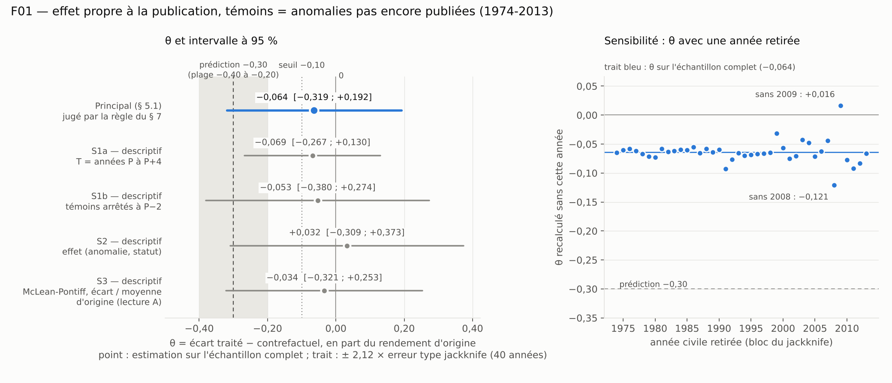

# F01 — Rapport de l'expérimentateur

Rôle : exécuter la préinscription scellée (`preenregistrement.md`, sha256 `b795ddbb…7f305`, vérifié avant et après).
Ce rapport donne des nombres. Il ne rend pas de verdict : celui-ci est calculé par `verdict.py` à partir des nombres du
vérificateur. Les miens (`temoin.json`) ne sont qu'un témoin.

## 1. Ce qui a été fait

| Étape | Fichier | Contenu |
|---|---|---|
| Téléchargement | `donnees/` + `donnees/PROVENANCE.md` | Les deux fichiers nommés et les notes de version, HTTP 200 au premier essai, tailles identiques aux tailles préinscrites (183 100 et 1 439 671 octets) |
| Construction | `construire.py` → `panel.csv` (+ `construction.json`, `construire.log`) | Reconstruit le fichier d'analyse à partir de `donnees/` seul, puis refait les dix contrôles de schéma sur le fichier relu |
| Analyse | `analyse.py` → `temoin.json`, `resultats.json`, `figure.png`, `analyse.log` | Statistique principale, jackknife par année civile, garde `t_avance`, trois analyses secondaires. Aucun tirage aléatoire, aucune graine (comme préinscrit) |

Commandes : `python3 -I construire.py` (4 s) puis `python3 -I analyse.py` (70 s). Python 3.13.18, numpy 2.5.3, pandas 3.0.5,
scipy 1.18.1, pyarrow 26.0.1, matplotlib 3.11.2.

`panel.csv` : 175 529 lignes, 10 colonnes, sha256 `0337dddecdbe9064ed4a22442cf74b7e9c310f034d05f6c92f183e4eb2e1af7a`.
`ret` et `moy_origine` sont écrits avec tous leurs chiffres (représentation exacte du flottant, 15 à 17 chiffres significatifs).

**Calcul.** Les moindres carrés de l'étape 1 sont résolus par les équations normales sur une matrice creuse
d'indicatrices (anomalies, mois sauf le premier, `attente`). Deux contrôles numériques : (i) pour chaque analyse, la même
régression sur l'échantillon complet refaite par décomposition directe de la matrice dense — écart maximal 9 × 10⁻¹⁴ ;
(ii) une seconde écriture indépendante (`controle_independant.py`, projections alternées, sans indicatrices), jackknife compris, pour la statistique
principale et la garde — mêmes nombres à 10⁻¹³ près. La matrice de l'étape 1 est de plein rang colonne sur l'échantillon
complet (686 colonnes, rang 686) **et** dans chacune des 40 répliques du jackknife, pour toutes les analyses.

## 2. Échantillon obtenu à chaque filtre

| Filtre | Obtenu | Attendu par la préinscription |
|---|---|---|
| Lignes de `SignalDoc.csv` | 331 | — |
| … dont `Cat.Signal == "Predictor"` | 212 (114 `Placebo`, 5 `Drop` écartés) | 212 |
| Prédicteurs avec colonne dans le Parquet et trois années renseignées | 212 | 212 |
| Cases anomalie × mois du Parquet (212 × 1 200) | 254 400 | — |
| … rendement absent (pas de ligne) | 78 871 | — |
| **Lignes de `panel.csv`** | **175 529** (212 anomalies, 1926-01 à 2025-12) | « environ 150 000 » |
| … par statut, toutes dates | `avant` 36 843 ; `origine` 74 384 ; `attente` 9 024 ; `annee_pub` 2 532 ; `publie` 12 546 ; `apres` 40 200 | — |
| Lignes `dans_fenetre = 1` (1974-2013) | 94 573 : `avant` 3 509 ; `origine` 56 379 ; `attente` 8 856 ; `annee_pub` 2 340 ; `publie` 10 302 ; `apres` 13 187 | — |
| K : anomalies avec au moins 60 lignes `origine` | 208 (quatre exclues : `AnalystRevision` 58, `ConsRecomm` 50, `DownRecomm` 49, `UpRecomm` 49) | — |
| **U** : fenêtre, `origine` ou `attente`, anomalie dans K | **64 885** lignes = 56 173 `origine` + **8 712 `attente`** ; 206 anomalies ; 480 mois ; au moins 14 anomalies chaque mois | 57 204 + 8 904 ; 210 anomalies |
| Lignes `publie` dans la fenêtre | 10 302 (191 anomalies) | — |
| … retirées : anomalie sans ligne dans U | 360 (les quatre exclues de K, plus `Beta` et `Price`, publiées en 1973, sans ligne `origine`/`attente` dans la fenêtre) | — |
| … retirées : mois sans ligne dans U | 0 | — |
| **T** | **9 942 lignes, 185 anomalies** | 10 296 lignes, 189 anomalies |
| Blocs du jackknife (années avec une ligne dans U ou T) | 40 | 40 |

**D'où viennent les écarts d'effectifs.** J'ai refait le calcul « sur les années seules » de la préinscription : il redonne
exactement 57 204, 8 904, 10 296, 189 et 210. En retirant les quatre anomalies hors K, il donne 56 664, 8 760, 10 056, 185
et 206. Le reste — 491 lignes `origine`, 48 `attente`, 114 `publie`, soit 653 lignes ou 0,9 % — vient de rendements
mensuels absents dans la fenêtre : `ProbInformedTrading` 120, `ChangeInRecommendation` 107, `AgeIPO` 72, `Activism1` 55,
`Activism2` 55, `PatentsRD` 54, `PredictedFE` 54, `Governance` 31, puis vingt anomalies à 18 lignes ou moins.

Répartition de T dans le temps : 2005-2013 portent 6 618 des 9 942 lignes traitées (67 %). Nombre effectif de blocs,
(somme des effectifs traités par année)² / somme des carrés : 16,8 (la préinscription annonçait 17).

**Contrôles de schéma (§ 4)** : les dix passent ; `n_violations_schema` = 0. Médiane de |`ret`| : 1,646 % par mois.

## 3. Statistique principale (§ 5.1 et 5.2) — nombres du témoin

| Champ | Valeur |
|---|---|
| `theta` | **−0,06392** |
| `se_theta` (jackknife, 40 années) | 0,12055 |
| `borne_basse_ic95` = theta − 2,12 × se | −0,31948 |
| `borne_haute_ic95` = theta + 2,12 × se | +0,19165 |
| `marge_ambiguite` = min(borne haute, −0,30 − borne basse) | +0,01948 |
| `tau_bar` | −0,04435 % par mois (−4,4 pb) |
| `m_bar` | 0,69384 % par mois (69,4 pb) |
| `b_attente` | −0,22571 % par mois (−22,6 pb) |
| `t_avance` | −1,148 |
| `n_lignes_traitees` | 9 942 |
| `n_anomalies_traitees` | 185 |
| `n_lignes_attente` | 8 712 |
| `n_blocs` | 40 |
| `n_violations_schema` | 0 |

Compléments (hors témoin) : `theta_point` (moyenne des 40 `theta_g`) = −0,06393. Les 40 valeurs `theta_g` vont de −0,121
(année 2008 retirée) à +0,016 (année 2009 retirée) ; les 38 autres sont entre −0,093 et −0,032. Chaque réplique garde au
moins 8 946 lignes traitées et 177 anomalies.

Lecture des unités, sans conclusion : l'estimation ponctuelle vaut −6,4 % du rendement d'origine ; l'intervalle va de −31,9 %
à +19,2 % ; il contient 0 et il contient −0,30, de 0,019 pour cette seconde borne (`marge_ambiguite` = +0,019). L'erreur
type obtenue (0,121) est au centre de la fourchette annoncée au § 6 (0,09 à 0,16, centre 0,12).

## 4. Garde de validité (§ 5.3)

Coefficient d'avance d̂ = −0,1162 % par mois ; `se_d` (jackknife, mêmes 40 blocs) = 0,1012 ; **`t_avance` = −1,148**
(seuil préinscrit : |t| ≥ 2,12). 2 388 lignes `attente` portent l'indicatrice d'avance (année P−1). Dans cette régression
le coefficient `attente` vaut −0,1965.

## 5. Analyses secondaires — DESCRIPTIF, sans effet sur le verdict

Erreurs types : jackknife par année civile, même formule que le § 5.2. Intervalles : ± 2,12 × erreur type, donnés pour
lecture seulement.

| Analyse (descriptif) | Estimation | Erreur type | Intervalle indicatif | Effectifs |
|---|---|---|---|---|
| **S1(a)** — T = années P à P+4, U inchangé | theta = −0,0686 (tau_bar −0,0476 ; m_bar 0,6945) | 0,0938 | [−0,267 ; +0,130] | T : 10 446 lignes, 191 anomalies |
| **S1(b)** — T inchangé, lignes `attente` de l'année P−1 retirées de U | theta = −0,0533 (tau_bar −0,0370 ; m_bar 0,6938 ; b̂ = −0,1820) | 0,1543 | [−0,380 ; +0,274] | U : 62 497 lignes dont 6 324 `attente` ; T : 9 942 lignes, 185 anomalies |
| **S2** — effet fixe par (anomalie, statut), prédiction avec l'effet (anomalie, `attente`) | theta = +0,0319 (tau_bar +0,0221 ; m_bar 0,6938) | 0,1610 | [−0,309 ; +0,373] | T : 9 942 lignes, 185 anomalies (la restriction ne retire rien) ; 886 colonnes, plein rang |
| **S3** — spécification de McLean et Pontiff, mêmes données (87 594 lignes, 208 anomalies : `origine` 56 173, `attente` 8 712, `publie` 10 062, `apres` 12 647) | coefficient `attente` −0,2410 ; coefficient « publiée » −0,2643 ; différence (publiée − attente) −0,0233 % par mois ; **différence / moyenne des `moy_origine` = −0,0340** | 0,0642 ; 0,1332 ; 0,0929 ; 0,1355 | rapport : [−0,321 ; +0,253] | dénominateur : 0,6859 (une valeur par anomalie) |

Pour S3, deux points de la préinscription sont ambigus (dénominateur ; application de la règle des 60 lignes) : les
nombres des autres lectures sont dans `ecarts.md` (rapport entre −0,033 et −0,050 selon la lecture, erreur type 0,13 à 0,14).

**Descriptif complémentaire — baisse entre fin d'échantillon et publication** (première prédiction de la fiche, « rapportée à
titre descriptif ») : `b_attente` = −0,2257 % par mois, erreur type jackknife 0,0694. Rapporté à la moyenne des
`moy_origine` : −0,325 (sur les lignes de T, c'est-à-dire `m_bar`), −0,339 (sur les lignes `attente` de U), −0,331 (une
valeur par anomalie de U). La fiche annonçait −10 % à −25 %. La formule de ce rapport n'est pas fixée par la préinscription
(voir `ecarts.md`, point 7).

## 6. Figure

`figure.png`. À gauche : `theta` (point) et ± 2,12 × erreur type jackknife (trait) pour la statistique principale, en bleu,
et, en gris, les analyses secondaires étiquetées « descriptif » ; repères à 0, au seuil −0,10 et à la prédiction −0,30
(bande grise : plage prédite −0,40 à −0,20). À droite : les 40 valeurs `theta_g` du jackknife, une par année civile
retirée, sur la même grandeur — c'est la dispersion dont l'erreur type est tirée.

## 7. Difficultés et points d'attention

1. **`marge_ambiguite` est proche de zéro** : +0,0195, pour une tolérance préinscrite de 0,015 sur ce champ. Son signe
   tient à la borne basse (−0,3195 contre −0,30) : il s'inverserait pour une erreur type inférieure à 0,1114 (obtenue :
   0,1205), ou pour un `theta` supérieur de 0,0195. Mes deux écritures indépendantes donnent le même nombre à 10⁻¹³ près ;
   je le signale parce que tout désaccord de lecture entre expérimentateur et vérificateur pèserait sur ce champ.
2. **Deux années pèsent sur le jackknife** : retirer 2008 donne −0,121, retirer 2009 donne +0,016. L'erreur type vient en
   grande partie de ces deux blocs (2008-2013 portent près de la moitié des lignes traitées, comme annoncé au § 6).
3. **Quatre anomalies sous le seuil de 60 lignes `origine`** (`AnalystRevision`, `ConsRecomm`, `DownRecomm`, `UpRecomm`) :
   leurs rendements commencent tard dans leur échantillon d'origine. Elles restent dans `panel.csv`, sortent de
   l'estimation ; 185 anomalies traitées au lieu de 189, au-dessus du minimum préinscrit de 170.
4. **Fins de série** : `PatentsRD` s'arrête en 2008-06 et `ProbInformedTrading` en 2013-12 dans le Parquet, plus tard que ce
   que disent les notes de version (2006, 2012). Règle appliquée telle qu'écrite : une ligne là où le rendement existe.
5. **`panel.csv` a 175 529 lignes**, pas « environ 150 000 » : aucune règle n'est en cause, c'est le nombre de rendements
   présents dans le Parquet pour les 212 prédicteurs.
6. **Ambiguïtés de la préinscription** : six points, tous hors statistique principale ou sans effet numérique ; détail et
   nombres des deux lectures dans `ecarts.md`.
7. **Exécution** : `pyarrow` installé par `pip` ; scripts lancés en mode isolé (`python3 -I`), `analyse.py` ajoutant
   lui-même son dossier au chemin d'import pour réutiliser les contrôles de `construire.py`. Aucun échec de réseau.

## 8. Fichiers livrés

`donnees/` (trois fichiers bruts + `PROVENANCE.md`), `construire.py`, `panel.csv`, `analyse.py`, `temoin.json`,
`rapport-experimentateur.md`, `figure.png`, `ecarts.md` ; en plus : `construction.json`, `construire.log`, `analyse.log`,
`resultats.json`, `controle_independant.py`. Je n'ai écrit ni `verdict.json` ni `verification.json`.
