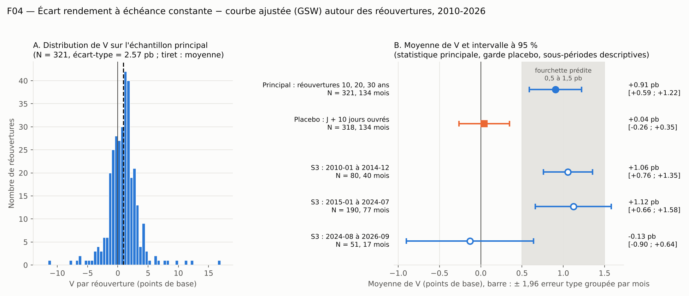

# F04 — Rapport de l'expérimentateur

Rédigé le 2026-11-12. Ce rapport donne des nombres. Il ne contient pas de verdict : le verdict est calculé ailleurs, à partir
des nombres du vérificateur. Les nombres ci-dessous sont un témoin.

## 1. Nombres du témoin (`temoin.json`)

| Champ | Valeur |
|---|---|
| `schema_ok` | 1 |
| `n_adjudications` | 321 |
| `n_grappes` | 134 |
| `v_moyen_pb` | 0,906106 |
| `erreur_type_pb` | 0,161353 |
| `t_stat` | 5,615676 |
| `borne_sup_95_pb` | 1,222358 |
| `marge_zone_grise` | −3,615676 |
| `n_placebo` | 318 |
| `t_placebo_abs` | 0,270997 |

La moyenne de V sur les 321 réouvertures est de +0,91 pb, avec une erreur type groupée par mois de 0,16 pb. L'intervalle
V̄ ± 1,96 × ET va de +0,59 à +1,22 pb (la borne basse n'est pas un champ préinscrit). Sur les 318 placebos, la moyenne est de
+0,04 pb, avec une erreur type de 0,16 pb.

Lecture de la figure. Panneau A : les 321 valeurs de V, par tranches de 0,5 pb ; le trait plein est zéro, le tiret la moyenne.
Panneau B : moyenne et intervalle à 95 % (± 1,96 erreur type groupée par mois) pour la statistique principale, le placebo et
les trois sous-périodes de S3 (descriptives) ; la bande grise est la fourchette prédite de 0,5 à 1,5 pb.

## 2. Ce qui a été fait

1. **Téléchargement.** Les trois sources nommées (D1 : une requête à l'API du Trésor ; D2 : sept séries FRED ; D3 : le fichier
   de la Réserve fédérale) ont été téléchargées le 2026-11-12 entre 15 h 53 min 02 s et 15 h 53 min 18 s UTC. Chacune a
   répondu HTTP 200 au premier essai. Fichiers non modifiés dans `donnees/` ; URL, heure, sha256 et nombre de lignes dans
   `donnees/PROVENANCE.md`.
2. **Construction.** `construire.py` lit `donnees/` seul et écrit `F04_analyse.csv` (1 606 lignes, 21 colonnes). Il s'arrête
   sans écrire le fichier si une source manque ou si ses colonnes diffèrent. Il exécute les huit contrôles de schéma de la
   section 5 : tous passent.
3. **Analyse.** `analyse.py` lit `F04_analyse.csv` seul, refait les huit contrôles de schéma, calcule la statistique
   principale, la garde placebo et les analyses S1 à S3 avec les formules de la section 6, puis écrit `temoin.json`,
   `resultats_analyse.json` (détail) et `figure.png`. Le calcul est déterministe.
4. **Recoupement.** La moyenne et l'erreur type ont été recalculées par une seconde voie (pandas, puis `statsmodels` avec
   covariance groupée sans correction, multipliée par racine de G/(G − 1)) : mêmes nombres à 10⁻¹⁵ près.

La préinscription et son fichier `.sha256` n'ont pas été modifiés (empreinte vérifiée après le travail :
`99e82a4c…52c6fc`, identique).

## 3. Échantillon à chaque filtre

**D1, adjudications.**

| Étape | Lignes | Attendu |
|---|---|---|
| Réponse de l'API (une page) | 1 639 | 1 639 |
| `inflation_index_security` = "No" et `floating_rate` = "No" | 1 285 | 1 285 |
| `security_term` hors tableau (lignes écartées) | 0 | — |
| Lignes `reelle` | 1 285 | 1 285 |
| dont réouvertures à 10, 20, 30 ans (`principal` = 1) | 321 | 321 |
| dont `reopening` = "Yes" dans l'API (contrôle de construction) | 321 sur 321 | 321 |

Les treize valeurs de `security_term` ont exactement les effectifs du tableau de la préinscription (201 pour 2, 3, 5 et 7 ans ;
67, 26, 67 pour 10, 20, 30 ans ; 67 + 68, 25 + 27, 67 + 67 pour les réouvertures). Toutes les dates d'adjudication sont dans
le calendrier C (16 199 dates, de 1962-01-02 à 2026-11-09).

**Échantillon principal P.**

| Filtre | Lignes |
|---|---|
| `type_ligne` = `reelle` | 1 285 |
| et `principal` = 1 | 321 |
| et `complet` = 1 | 321 |
| et `fenetre_propre` = 1 | **321** (10 ans : 135 ; 20 ans : 52 ; 30 ans : 134) |
| Mois distincts | **134** (82 mois à 2 lignes, 51 à 3 lignes, 1 à 4 lignes) |

**Placebo.**

| Filtre | Lignes |
|---|---|
| `type_ligne` = `placebo` | 321 |
| et `complet` = 1 | 321 |
| et `fenetre_propre` = 1 | **318** |
| Mois distincts | 134 |

Aucune ligne du fichier n'est incomplète : les six rendements sont présents pour les 1 606 lignes. Les trois placebos écartés
ont une autre adjudication de la même échéance dans leur fenêtre : `9128286T2_2019-06-12`, `9128286T2_2019-06-21` et
`912810TC2_2021-12-02`. Tous trois tiennent aux deux réouvertures de 25 millions de dollars décrites en section 6.

Les minimums préinscrits sont 290 réouvertures, 120 mois et 250 placebos.

## 4. Statistique principale et garde placebo

| | N | G | Moyenne (pb) | Erreur type (pb) | t | Moyenne ± 1,96 ET (pb) |
|---|---|---|---|---|---|---|
| Principal (P) | 321 | 134 | +0,9061 | 0,1614 | 5,616 | +0,590 à +1,222 |
| Placebo | 318 | 134 | +0,0421 | 0,1553 | 0,271 | −0,262 à +0,346 |

`marge_zone_grise` = min(2 − 5,616 ; 1,222 − 0,5) = −3,616.

**Écart-type de V sur P** (demandé par la section 6) : 2,573 pb (dénominateur n − 1 ; 2,569 pb avec n). La préinscription
supposait entre 2 et 5 pb, 3 pb au centre. L'erreur type obtenue, 0,161 pb, est à comparer aux trois cas de la section 7 :
0,11 pb (favorable), 0,21 pb (central), 0,43 pb (défavorable). L'erreur type sans groupement serait de 0,144 pb : le
groupement par mois la relève de 12 %.

Autres descriptifs de V sur P (hors préinscription) : médiane +1,01 pb ; quartiles −0,41 et +1,95 pb ; minimum −11,41 pb
(30 ans, 2023-03-09) ; maximum +16,90 pb (30 ans, 2023-09-13) ; 68 % des valeurs sont positives. Écart-type de V sur les
placebos : 2,289 pb.

## 5. Analyses secondaires — descriptives, sans effet sur le verdict

### S1. Hors échantillon strict, rendement brut de la courbe ajustée (août 2024 à septembre 2026)

Lignes `reelle`, toutes échéances, `date_adjudication` ≥ 2024-08-01, trois valeurs `gsw` présentes : 182 lignes, 26 mois
(attendu : 182 ; 26). Aucune ligne perdue pour valeur manquante.

| | N | G | Moyenne de V brut (pb) | Erreur type groupée (pb) | t |
|---|---|---|---|---|---|
| Toutes échéances | 182 | 26 | +1,459 | 1,555 | 0,938 |

Écart-type de V brut : 15,30 pb (la préinscription supposait environ 19 pb et une erreur type d'environ 2,4 pb).

Moyenne par échéance, sans erreur type (26 lignes chacune) :

| 2 ans | 3 ans | 5 ans | 7 ans | 10 ans | 20 ans | 30 ans |
|---|---|---|---|---|---|---|
| +2,53 | −2,75 | +2,71 | −0,17 | +1,21 | +3,22 | +3,46 |

À lire à côté des 1,2 pb (10 ans) et 2,6 pb (5 ans) publiés. Avec une erreur type de 1,6 pb, l'intervalle à 95 % va de −1,59
à +4,51 pb : il contient zéro et les deux chiffres publiés.

### S2. Taille

Sur P : r manque pour 24 lignes (moins de 12 lignes de référence dans les 1 096 jours précédents : début 2010 pour 10 et
30 ans, première année du 20 ans). Régression sur 297 lignes (10 ans : 127 ; 20 ans : 44 ; 30 ans : 126), 126 mois.

- r : moyenne 0,974 ; écart-type 0,165 ; minimum 0,0011 ; maximum 1,50. z : de −5,89 à +3,18.
- **Pente sur z : −0,013 pb par écart-type de r ; erreur type groupée par mois 0,190 pb** (t = −0,07).
- Indicatrices d'échéance : 10 ans +1,222 pb (erreur type 0,198) ; 20 ans −0,436 pb (0,306) ; 30 ans +1,098 pb (0,286).

Les deux valeurs de r proches de zéro sont les deux réouvertures de 25 millions de dollars (section 6). Hors préinscription, à
titre d'information : sans ces deux lignes (295 lignes, z recalculé), la pente est de +0,159 pb, erreur type 0,153 pb
(t = 1,04). Dans les deux cas la pente ne se distingue pas de zéro, et la préinscription prévient que cette pente compare une
poignée de sous-périodes.

### S3. Sous-périodes (mêmes formules que la statistique principale, sur P)

| Période | N | G | Attendu (N ; G) | Moyenne (pb) | Erreur type (pb) | t | Moyenne ± 1,96 ET (pb) |
|---|---|---|---|---|---|---|---|
| 2010-01-01 à 2014-12-31 | 80 | 40 | 80 ; 40 | +1,056 | 0,152 | 6,95 | +0,758 à +1,354 |
| 2015-01-01 à 2024-07-31 | 190 | 77 | 190 ; 77 | +1,122 | 0,235 | 4,78 | +0,662 à +1,581 |
| 2024-08-01 à 2026-09-30 | 51 | 17 | 51 ; 17 | −0,132 | 0,393 | −0,34 | −0,902 à +0,638 |

Les 51 réouvertures postérieures à l'échantillon publié ont une moyenne de −0,13 pb, avec une erreur type de 0,39 pb sur
17 mois. Cette sous-période est descriptive et n'entre pas dans le verdict.

### Complément hors préinscription : moyenne de V sur P par échéance, sans erreur type

| 10 ans (135 lignes) | 20 ans (52 lignes) | 30 ans (134 lignes) |
|---|---|---|
| +1,171 pb | −0,129 pb | +1,041 pb |

Les réouvertures à 20 ans n'existent que depuis 2020 ; leur moyenne est négative, comme celle de la dernière sous-période.

## 6. Difficultés et constats

1. **Deux réouvertures de 25 millions de dollars.** D1 contient deux lignes de réouverture au montant mille fois plus petit que
   les autres : `9128286T2` le 2019-06-21 (10 ans) et `912810TC2` le 2021-12-02 (20 ans), 0,025 milliard chacune. Elles ont
   `reopening` = "Yes" et un `security_term` du tableau : la préinscription les compte dans les 321, et le calcul préinscrit
   les garde. Conséquences :
   - elles sont dans P (V = +1,16 pb et +6,82 pb) ;
   - elles rendent non propres trois fenêtres de placebo (d'où 318 et non 321) ;
   - dans S2, elles donnent deux valeurs de r proches de zéro, très éloignées des autres.

   Hors préinscription, à titre d'information : sans ces deux lignes, la statistique principale vaut +0,887 pb, erreur type
   0,161 pb, t = 5,52, sur 319 lignes et 134 mois. Les nombres de `temoin.json` sont ceux des 321 lignes.
2. **Précision de D3.** La préinscription annonce quatre décimales ; les lignes d'avant octobre 2020 en portent jusqu'à 15.
   Les valeurs sont recopiées sans arrondi, comme l'écrit la section 5. Arrondir à quatre décimales change la moyenne de moins
   de 0,000001 pb (voir `ecarts.md`, E2).
3. **Indicateur `reopening` de l'API sur les échéances courtes.** Dix-neuf lignes à 2, 3 et 5 ans (10, 1 et 8) ont
   `reopening` = "Yes" dans l'API. La préinscription définit `reouverture` par `security_term` seul : ces lignes ont
   `reouverture` = 0 et `principal` = 0, comme prévu par le tableau D1. Elles n'entrent que dans S1.
4. **Valeurs extrêmes de V.** Deux réouvertures à 30 ans dépassent 11 pb en valeur absolue (+16,90 pb le 2023-09-13,
   −11,41 pb le 2023-03-09). Aucun filtre ni écrêtage n'est préinscrit ; aucun n'a été appliqué. L'écart-type de V à 30 ans
   (3,10 pb) dépasse celui à 10 ans (1,99 pb) et à 20 ans (2,19 pb).
5. **Dates de fin des sources.** FRED s'arrête au 2026-11-09 et D3 au 2026-11-06. La dernière date utilisée par le fichier
   d'analyse est le 2026-10-06 (`date_jp5` du dernier placebo) : aucune fenêtre ne dépasse les données.
6. **Réseau.** Aucun échec, aucune reprise. FRED a répondu avec l'agent utilisateur par défaut de `curl`.
7. **Ce que le test ne mesure pas** (rappel des limites de la préinscription, non vérifiées ici) : l'écart à la courbe ne
   capte que la part de pression propre au titre adjugé ; rien sur les échéances de 2 à 7 ans ni sur les nouvelles émissions.

## 7. Fichiers livrés

| Fichier | Contenu |
|---|---|
| `donnees/` et `donnees/PROVENANCE.md` | neuf fichiers bruts, non modifiés ; provenance |
| `construire.py` | construit `F04_analyse.csv` à partir de `donnees/` seul |
| `F04_analyse.csv` | fichier d'analyse préinscrit, 1 606 lignes |
| `analyse.py` | statistique principale, placebo, S1 à S3, figure |
| `temoin.json` | les dix champs de vérification |
| `figure.png` | distribution de V et moyennes avec intervalles à 95 % |
| `ecarts.md` | six écarts ou points de lecture, tous sans effet sur le témoin |
| `construire_journal.json`, `resultats_analyse.json` | sorties détaillées des deux scripts (non demandées) |

Pour refaire : `python3 -I construire.py` puis `python3 -I analyse.py`, depuis ce dossier.
