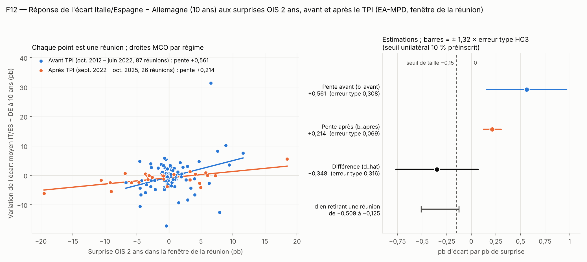
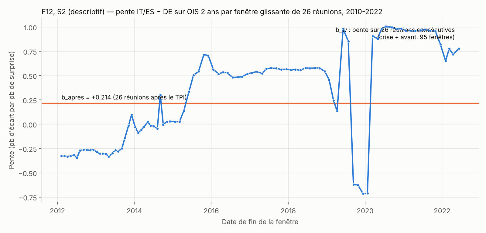

# F12 — Compte rendu de l'expérimentateur

Test de mort de la fiche « L'instrument de protection de la transmission (TPI) a-t-il coupé le lien entre surprises de la
BCE et écarts souverains ? ». Exécuté le 2026-11-12 selon la préinscription scellée
(sha256 `b52884058d99eab33841ddd20f6978791e7a88f4ed63b40c8884ca74c5f24a7c`, inchangée). Ce compte rendu donne des nombres ;
il ne contient pas de verdict. Les nombres de `temoin.json` ne sont qu'un témoin : le vérificateur recalcule tout.

Dans le texte la virgule est décimale ; dans les fichiers, c'est le point.

## 1. Ce qui a été fait

1. **Téléchargement** (curl, agent par défaut) de la base EA-MPD et des quatre séries journalières de la Riksbank dans
   `donnees/`. Cinq réponses HTTP 200 au premier essai. Empreinte d'EA-MPD identique à celle de la préinscription.
   Détail : `donnees/PROVENANCE.md`.
2. **`construire.py`** reconstruit `analyse_F12.csv` à partir de `donnees/` seulement (aucun accès réseau), puis refait les
   dix contrôles de schéma du § 5. Journal : `construire.log`.
3. **`analyse.py`** lit uniquement `analyse_F12.csv` ; il calcule la statistique principale (§ 6.1), les analyses
   secondaires S1 à S3 (§ 6.2), écrit `temoin.json` et `resultats_analyse.json`, trace `figure.png` et `figure_S2.png`.
   Journal : `analyse.log`.
4. Les deux scripts ont été relancés une seconde fois : `analyse_F12.csv` et `temoin.json` sont identiques à l'octet près.

Commandes : `python3 -I construire.py` puis `python3 -I analyse.py`, depuis `tests-de-mort/F12/`.

## 2. Échantillon obtenu à chaque filtre

| Étape | Effectif |
|---|---|
| Lignes datées de la feuille `Monetary Event Window` (1999-01-07 à 2025-10-30) | 315 |
| dont dates Excel / dates en texte `jj/mm/aaaa` | 299 / 16 |
| Réunions du 2010-01-14 au 2025-10-30 inclus | **147** |
| `crise` (2010-01-14 à 2012-09-06) | 33 |
| `avant` (2012-10-04 à 2022-06-09) | **87** |
| `annonce` (2022-07-21) | 1 |
| `apres` (2022-09-08 à 2025-10-30) | **26** |
| Cellules vides ou non numériques dans `OIS_2Y`, `DE10Y`, `IT10Y`, `ES10Y`, `FR10Y` sur ces 147 réunions | 0 |
| Lignes du fichier d'analyse (147 × 6) | **882** |
| Échantillon principal (`EAMPD`, `IT` et `ES`, `avant` + `apres`) | 87 + 26 = 113 réunions, 226 lignes |
| Lignes `RIKSBANK` renseignées, par pays : `crise` / `avant` / `annonce` / `apres` | 32 / **85** / 1 / **25** |
| Réunions sans variation journalière Riksbank (jours fériés suédois) | 4 : 2012-06-06, 2013-06-06, 2019-06-06, 2024-06-06 |
| S3, surprises restrictives (`d_ois2y_pb > 0`) : `avant` / `apres` | 39 / 10 |

La veille de la réunion du 2013-05-02 manque bien (1er mai) : le jour de référence est le 30 avril, à deux jours, donc la
variation est retenue, comme prévu. Aucune surprise OIS n'est exactement nulle dans l'échantillon principal.

**Contrôles de schéma (§ 5)** : les dix passent ; `violations_schema = 0`.

## 3. Statistique principale (§ 6.1)

`x` = surprise OIS à 2 ans (pb) ; `y` = moyenne des variations d'écart Italie-Allemagne et Espagne-Allemagne à 10 ans (pb),
fenêtre de la réunion. Pentes MCO par régime, variance HC3 en formule fermée.

| Champ de `temoin.json` | Valeur |
|---|---|
| `n_avant` | 87 |
| `n_apres` | 26 |
| `b_avant` | 0,561434 |
| `b_apres` | 0,213549 |
| `d_hat` | −0,347885 |
| `se_d` | 0,315870 |
| `d_borne_haute` (`d_hat + 1,32 × se_d`) | 0,069063 |
| `d_borne_basse` (`d_hat − 1,32 × se_d`) | −0,764834 |
| `t_b_avant` | 1,821028 |
| `d_max_sans_une` | −0,125328 |
| `non_informatif` | 1 |
| `violations_schema` | 0 |

Nombres intermédiaires : `se_b_avant` = 0,308306 ; `se_b_apres` = 0,068709.

**Les nombres en regard des seuils préinscrits** (constat chiffré ; le verdict est calculé ailleurs, sur les nombres du vérificateur) :

| Quantité | Valeur | Seuil préinscrit | Inégalité vraie ? |
|---|---|---|---|
| `n_avant` ; `n_apres` | 87 ; 26 | ≥ 87 ; ≥ 26 | oui ; oui |
| `violations_schema` | 0 | = 0 | oui |
| `se_d` | 0,3159 | > 0,16 (clause de précision) | oui |
| `d_borne_haute` | 0,0691 | ≥ 0 (clause de précision) | oui |
| `d_borne_basse` | −0,7648 | ≤ −0,15 (clause de précision) | oui |
| → `non_informatif` | 1 | | |
| `d_hat` | −0,3479 | ≤ −0,15 | oui |
| `d_borne_haute` | 0,0691 | < 0 | non |
| `t_b_avant` | 1,8210 | ≥ 1,66 | oui |
| `d_max_sans_une` | −0,1253 | < 0 | oui |

**Retrait d'une réunion** (113 retraits) : `d` va de −0,5087 (sans le 2019-09-12, `avant`) à −0,1253 (sans le 2020-03-12,
`avant`) ; il reste négatif dans les 113 cas.

**D'où vient l'incertitude** (descriptif, non préinscrit, mêmes régressions) :

| | `avant` (87) | `apres` (26) | Supposé au § 7 |
|---|---|---|---|
| Écart type de la surprise `x` (pb) | 3,11 | 7,32 | 3 à 4 ; 5 à 7 |
| Écart type du résidu (pb) | 5,24 | 1,81 | 3,5 à 5 ; 2,5 à 3,5 |
| Erreur type HC3 de la pente | 0,308 | 0,069 | 0,11 à 0,18 ; 0,08 à 0,14 |
| Nombre effectif pour la pente, `(Σx²)²/Σx⁴` | 16,0 | 6,1 | « peut tomber sous dix » après |
| Levier maximal (réunion) | 0,162 (2015-12-03) | 0,321 (2022-12-15) | — |

L'erreur type de `d` (0,316) dépasse la fourchette supposée au § 7 (0,13 à 0,22), et elle vient presque entièrement de la
période d'**avant** (0,308), non des 26 réunions d'après (0,069). Une seule réunion y pèse lourd : le 2020-03-12
(`x` = +6,56 pb, `y` = +31,4 pb ; Italie +45,8 pb, Espagne +17,0 pb). Sans elle, `d` vaut −0,125 ; sans le 2019-09-12
(`x` = +7,89 pb, `y` = −12,6 pb), `d` vaut −0,509. Après le TPI, deux réunions portent l'essentiel de la variance de la
surprise : 2022-10-27 (`x` = −19,5 pb) et 2022-12-15 (`x` = +18,4 pb).

Contre-épreuve logicielle : `statsmodels` (HC3) donne les mêmes pentes et erreurs types à la sixième décimale.

### Figure

`figure.png` — à gauche, une réunion par point et les deux droites MCO ; à droite, les deux pentes et leur différence avec
des barres de ± 1,32 × erreur type HC3 (le seuil unilatéral à 10 % de la préinscription), le zéro, le seuil de taille −0,15
et l'étendue de `d` quand on retire une réunion. La barre de la différence coupe à la fois −0,15 et 0.

## 4. Analyses secondaires — **descriptives**, sans effet sur le verdict

### S1 — Placebo pays peu endettés (journalier, Riksbank) — descriptif

- **(a) Calage.** Pente de la variation journalière du rendement allemand (Riksbank) sur sa variation intrajournalière
  (EA-MPD), 110 réunions : `kappa` = 1,0596 (erreur type HC3 0,1082 ; R² = 0,601). `kappa ≥ 0,5` : le placebo n'est pas
  déclaré non informatif.
- **(b) Placebo Pays-Bas/Finlande.** 85 réunions avant, 25 après. `b_avant` = 0,1016 (0,0424) ; `b_apres` = 0,0194 (0,0353) ;
  **`d_placebo` = −0,0823**, **`se_placebo` = 0,0552**, `d_placebo ± 1,32 × se_placebo` = [−0,1551 ; −0,0094].
  Pour mémoire, la préinscription prédisait une variation entre −0,05 et +0,05.
- **(c) Pont France.** Journalier (Riksbank, 85/25) : `d` = −0,2962 (erreur type 0,2181). Intrajournalier (EA-MPD, 87/26) :
  `d` = −0,1920 (erreur type 0,1193) ; sur les mêmes dates que la Riksbank (85/25) : −0,1928 (0,1248). Le passage à la
  mesure journalière déplace l'estimation de −0,10 et multiplie l'erreur type par 1,8 environ. (Ambiguïté d'échantillon
  consignée dans `ecarts.md`, E2.)
- **Lecture fixée par la préinscription** : `d_placebo + 1,32 × se_placebo` = −0,0094 < 0, donc la baisse de pente
  **s'observe aussi** pour des pays que le TPI ne vise pas. Le placebo est mesuré en journalier, plus bruité que la mesure
  principale ; la baisse y est environ quatre fois plus petite en valeur (−0,08 contre −0,35) et la borne haute est à
  moins d'un centième de zéro.

### S2 — Stabilité de la pente avant le TPI (fenêtres glissantes) — descriptif

120 réunions `crise` + `avant`, 95 fenêtres de 26 réunions consécutives, pente MCO de `y` sur `x` :

| | Valeur |
|---|---|
| Minimum des `b_w` | −0,7143 (fenêtre du 2016-10-20 au 2019-12-12) |
| Médiane | 0,4839 |
| Maximum | 1,0049 (fenêtre du 2017-06-08 au 2020-07-16) |
| Fenêtres où `b_w ≤ b_apres` (0,2135) | 42 sur 95 |
| **`part_fenetres_basses`** | **0,4421** |

**Lecture fixée par la préinscription** : `part_fenetres_basses` = 0,44 > 0,10, donc une pente aussi basse que celle
d'après TPI **existait déjà** avant l'instrument. Les 95 pentes sont dans `S2_fenetres.csv`.

`figure_S2.png` — `b_w` selon la date de fin de fenêtre, `b_apres` en trait horizontal. Les deux plus grands sauts
coïncident avec l'entrée dans la fenêtre de la réunion du 2019-09-12 (la pente tombe à −0,62) puis de celle du 2020-03-12
(elle remonte à +0,91).

### S3 — Surprises restrictives seulement — descriptif

39 réunions avant, 10 après. `b_avant` = 0,7412 (0,4760) ; `b_apres` = 0,3698 (0,4773) ;
**`d_restrictif` = −0,3714**, erreur type **0,6741**. Nombre donné tel quel, sans conclusion, comme préinscrit.

## 5. Difficultés et points d'attention

1. **Nom du dossier des données brutes** : la préinscription dit `brut/`, la consigne de l'orchestrateur `donnees/`.
   Les fichiers sont dans `donnees/` ; `brut` est un lien symbolique (`ecarts.md`, E1).
2. **Ambiguïté de S1 (c)** sur l'échantillon de la mesure intrajournalière de la France : les deux lectures sont données (E2).
3. **Bruit de virgule flottante** dans EA-MPD (valeurs comme −19,5000171661) : valeurs écrites à dix décimales (E3).
4. **Dates en texte** dans EA-MPD à partir du 2023-12-14 (16 lignes) : lues au format `jj/mm/aaaa`, comme annoncé au § 4.1.
5. **Précision très inférieure à ce que supposait le § 7** : `se_d` = 0,316 contre 0,13 à 0,22 supposé. La cause est une
   réunion d'avant le TPI (2020-03-12), non l'effectif d'après. Je le signale sans rien changer : aucun écrêtage, aucune
   exclusion, aucune analyse supplémentaire n'a été faite.
6. **Aucune panne de source** : ni la BCE ni la Riksbank n'ont exigé de nouvel essai. Les sources FRED et l'interface de
   données de la BCE ne sont pas utilisées par ce test.
7. **Aucune donnée manquante** dans l'échantillon principal ; les quatre réunions manquantes de S1 sont celles prévues.

## 6. Fichiers produits

| Fichier | Contenu |
|---|---|
| `donnees/` (et lien `brut`) | cinq fichiers bruts et `PROVENANCE.md` |
| `construire.py`, `controles_schema.py`, `construire.log` | construction et contrôles du fichier d'analyse |
| `analyse_F12.csv` | fichier d'analyse (882 lignes, 9 colonnes), sha256 `39798f9a0e91f1614448eca1ca85547947bd9ccd907b1963d81e918595b9ade5` |
| `analyse.py`, `analyse.log` | statistique principale et analyses secondaires |
| `temoin.json` | les douze champs de `champs_verification` (témoin) |
| `resultats_analyse.json`, `S2_fenetres.csv` | nombres des analyses secondaires |
| `figure.png`, `figure_S2.png` | figure principale ; graphique de S2 |
| `ecarts.md` | cinq écarts ou lectures consignés |
