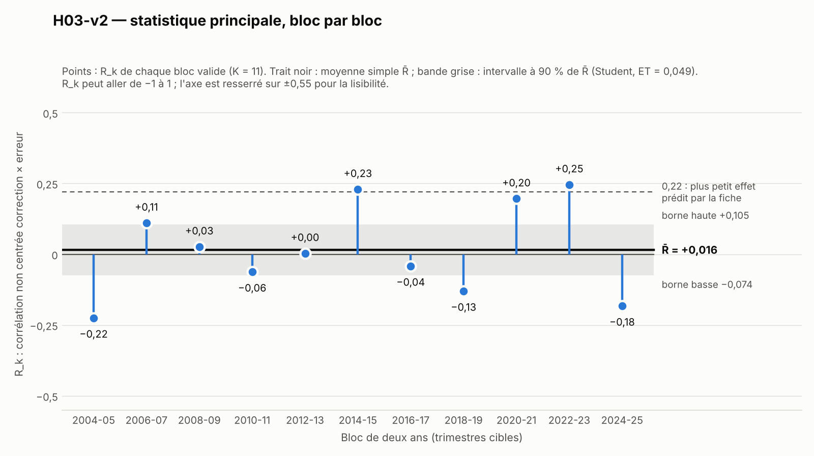

# H03-v2 — Rapport de l'expérimentateur

Écrit le 2026-11-12. Ce rapport donne des nombres. Il ne contient pas de verdict : le verdict est calculé par
`verdict.py` à partir des chiffres du vérificateur. Les nombres de `temoin.json` ne sont qu'un témoin.

Préinscription exécutée : `preenregistrement.md`, sha256 `ca1b8345…0f6d6d`, conforme à son `.sha256` avant et après la
course. Écarts : voir `ecarts.md` (sept points, aucun n'a d'effet sur un nombre ; aucune affirmation de la préinscription
sur les données ne s'est révélée fausse).

## 1. Résultat principal

Sur les 352 lignes évaluées (cibles 2004-Q1 à 2025-Q4, horizons 1 à 4), réparties en 11 blocs valides de deux ans :

| Champ | Valeur |
|---|---|
| `r_moyen` (R̄, moyenne simple des 11 R_k) | **0,0156** |
| `et_r_moyen` | 0,0493 |
| `borne_basse_ic90` | −0,0738 |
| `borne_haute_ic90` | 0,1050 |
| `marge_indecision` | −0,1150 |
| `r_hors_episode` (9 blocs, sans 2020-2021 ni 2022-2023) | −0,0300 |
| `rapport_eqm_geo` | 1,0972 |
| `conflit_gardes` | 0 |
| `n_violations_schema` | 0 |
| `n_obs_evaluees` | 352 |
| `n_blocs` | 11 |

Pour situer ces nombres par rapport aux repères écrits dans la préinscription : l'intervalle à 90 % de R̄ va de −0,074 à
0,105 ; il contient 0 et sa borne haute est sous 0,22.

*Figure (`figure.png`). Un point par bloc : R_k, corrélation non centrée entre la correction annoncée et l'erreur
réalisée. Trait noir : R̄. Bande grise : intervalle à 90 % de R̄ (Student à 10 degrés de liberté, quantile 1,8125).
Pointillé : 0,22. L'axe vertical est resserré sur ±0,55 ; R_k peut aller de −1 à 1.*

Détail par bloc (32 lignes évaluées dans chaque bloc) :

| Bloc | Cibles | R_k | Q_k = Σ(e − c)² / Σe² | Σe² | Part des pentes b > 0 |
|---|---|---|---|---|---|
| 0 | 2004-2005 | −0,2245 | 1,2185 | 5,32 | 28 % |
| 1 | 2006-2007 | 0,1104 | 1,0210 | 6,59 | 3 % |
| 2 | 2008-2009 | 0,0265 | 1,0148 | 53,74 | 9 % |
| 3 | 2010-2011 | −0,0618 | 1,1141 | 12,70 | 66 % |
| 4 | 2012-2013 | 0,0032 | 1,0396 | 7,10 | 75 % |
| 5 | 2014-2015 | 0,2292 | 0,9607 | 17,95 | 75 % |
| 6 | 2016-2017 | −0,0413 | 1,0625 | 13,50 | 75 % |
| 7 | 2018-2019 | −0,1297 | 1,1180 | 4,58 | 75 % |
| 8 | 2020-2021 | 0,1961 | 0,9705 | 44,38 | 75 % |
| 9 | 2022-2023 | 0,2457 | 0,9451 | 461,84 | 78 % |
| 10 | 2024-2025 | −0,1822 | 1,8119 | 3,85 | 100 % |

Six blocs ont un R_k positif, cinq un R_k négatif. Trois blocs ont un Q_k sous 1, huit au-dessus.
Éléments de l'étape 5 : g0 = 0,02675 ; g1 = −0,00583, donc max(g1, 0) = 0 et la correction de voisinage n'élargit pas
l'intervalle ; ET = racine(g0 / 11) = 0,0493.

## 2. Ce qui a été fait

1. **Téléchargement** (`telecharger.py`). Les 111 séries `MPD.Q.U2.HIC.A.<MILLÉSIME>.0000` et la liste des clés, par
   l'API de la BCE, le 2026-11-12 entre 19:21:41 et 19:31:25 UTC, avec 1,5 seconde de pause entre deux requêtes. Règle de
   reprise programmée comme préinscrit (10 essais espacés de 10 secondes) ; elle n'a pas servi : 112 réponses HTTP 200 au
   premier essai. Chaque réponse est écrite telle quelle dans `donnees/`. Journal : `construire_journal.json`.
   Table : `donnees/PROVENANCE.md`. **Rien n'a été copié ni lu dans le dossier de la course annulée.**
2. **Contrôle de la liste.** 6 206 clés dans la base ; 111 clés `Q.U2.HIC.A.*.0000`, exactement la liste figée ; pas de
   `A26`.
3. **Construction** (`construire.py`). Lit `donnees/` seul, vérifie le sha256 de chaque fichier contre le journal, écrit
   `H03-v2_analyse.csv` (444 lignes, 15 colonnes, sha256 `6e5eb252…60f4d5`) et refait les 11 contrôles sur le fichier écrit.
4. **Analyse** (`analyse.py`). Lit le fichier d'analyse seul. Étapes 1 à 6, puis S1, S2, S3, en double précision, sans
   arrondi intermédiaire, sans tirage aléatoire. Écrit `temoin.json`, `analyse_detail.json`, `lignes_evaluees.csv` et
   `figure.png`.
5. **Recalcul de contrôle.** La statistique principale, la garde hors épisode, le placebo et S1 ont été recalculés par un
   second code écrit séparément (boucles Python simples, sans pandas) à partir du fichier d'analyse : mêmes nombres à
   10⁻¹⁵ près. Ce n'est pas la vérification du protocole, qui revient au vérificateur.

Environnement : Python 3.13.18, numpy 2.5.3, pandas 3.0.5, scipy 1.18.1, matplotlib 3.11.2, requests 2.34.2.
Pour refaire : `python3 construire.py && python3 analyse.py` (quelques secondes ; `telecharger.py` ne redemande pas un
fichier déjà présent).

## 3. Échantillon obtenu à chaque filtre

| Étape | Nombre |
|---|---|
| Millésimes de la liste figée, fichiers obtenus | 111 sur 111 |
| Lignes du fichier d'analyse (111 millésimes × 4 horizons) | 444 |
| `projection` présente (statut `F` au trimestre cible) | 444 |
| `projection_precedente` présente | 440 (manquent les 4 lignes de `W99`, sans prédécesseur) |
| `realise` présent | 426 (manquent les 18 lignes de cible postérieure à 2026-Q1) |
| `revision` présente | 440 |
| `erreur` présente | 426 |
| Lignes complètes (étape 1 : `revision` et `erreur` présentes) | 422 |
| Lignes complètes de cible entre 8016 et 8103 (2004-Q1 à 2025-Q4) | 352 sur 352 possibles |
| Lignes évaluées (n_A ≥ 8 et S_rr > 10⁻¹²) | 352 (88 par horizon) |
| Blocs valides | 11 sur 11, 32 lignes chacun |

Autres faits de structure :
- trimestres cibles ayant une valeur réalisée : 108 (1999-Q2 à 2026-Q1) ; les 426 valeurs sont lues au numéro cible + 2,
  aucune au repli + 3 ou + 4 ;
- `mois_titre` rempli sur 444 lignes ; `t_premier_F` rempli sur 444 lignes et égal à `t_millesime` sur les 444 ;
- taille de l'ensemble d'apprentissage n_A : de 10 (première ligne évaluée à l'horizon 4) à 103 ;
- les 70 lignes complètes hors de la plage des cibles (cibles avant 2004-Q1, ou 2026-Q1) ne sont pas évaluées mais
  servent à l'apprentissage, comme le texte le prévoit.

Contrôles de schéma, refaits sur le fichier : les 11 sont respectés (`n_violations_schema` = 0). Le contrôle n° 4 porte
sur 444 lignes (aucun `mois_titre` vide), le n° 5 sur 444 lignes, le n° 11 sur 333 lignes d'horizon ≤ 3.

## 4. Analyses secondaires — descriptives, hors verdict

Aucune de ces analyses n'entre dans la règle de verdict.

**S1 — le test de la fiche tel qu'elle l'avait écrit (descriptif).** Horizon 4, millésimes de 2020-Q1 (`W20`) à 2025-Q1
(`W25`), n = 21.

| Champ | Valeur |
|---|---|
| `n_obs_h4_2020` | 21 |
| `rapport_eqm_h4_2020` | 1,0102 |
| `p_dm_hln_h4_2020` | 0,9106 |

Intermédiaires : d̄ = −0,1216 (la projection corrigée a une erreur quadratique moyenne plus grande que la projection
publiée) ; V = 0,005284 ; DM = −1,673 ; DM* = −1,393.

**S2 — lecture en clair (descriptif).**

| Champ | Valeur |
|---|---|
| `rapport_eqm_global` | 0,9698 |
| `rapport_eqm_hors_2021_2022` (320 lignes) | 1,0962 |
| `taux_amelioration` | 0,4481 (138 lignes améliorées, 170 dégradées, 44 inchangées à 10⁻⁹ près) |
| `part_b_positif` | 0,5994 |
| `r_moyen_h1` | 0,1452 |
| `r_moyen_h2` | 0,1277 |
| `r_moyen_h3` | 0,1105 |
| `r_moyen_h4` | −0,0867 |

Le rapport global est sous 1 et le rapport hors cibles 2021-2022 est au-dessus de 1 : sur l'ensemble, la somme des
erreurs quadratiques est portée par le bloc 2022-2023 (Σe² = 461,84 sur un total de 631,55). Pentes par horizon
(médiane des b_i, part positive) : h1 0,14 (74 %) ; h2 0,17 (72 %) ; h3 0,33 (81 %) ; h4 −0,48 (14 %). R_k par
horizon et par bloc (8 lignes par cellule) :

| Horizon | 04-05 | 06-07 | 08-09 | 10-11 | 12-13 | 14-15 | 16-17 | 18-19 | 20-21 | 22-23 | 24-25 |
|---|---|---|---|---|---|---|---|---|---|---|---|
| 1 | 0,28 | 0,07 | −0,55 | 0,38 | 0,34 | 0,20 | −0,06 | −0,02 | 0,48 | 0,35 | 0,13 |
| 2 | −0,30 | 0,23 | −0,17 | 0,34 | 0,65 | 0,16 | 0,05 | 0,07 | 0,47 | 0,36 | −0,43 |
| 3 | −0,17 | 0,22 | −0,11 | 0,52 | 0,35 | 0,48 | −0,09 | −0,31 | 0,14 | 0,40 | −0,22 |
| 4 | −0,49 | 0,06 | 0,24 | −0,24 | −0,23 | −0,07 | −0,04 | 0,20 | −0,09 | −0,27 | −0,03 |

**S3 — placebo (descriptif).** Révision vieille de deux ans (même horizon, `t_millesime` − 8). 390 lignes complètes pour
le placebo, 340 évaluées, 11 blocs valides (20 lignes dans le bloc 2004-2005, 32 dans les autres).

| Champ | Valeur |
|---|---|
| `r_moyen_placebo` | 0,0747 |
| `et_r_placebo` | 0,0625 |
| `n_blocs_placebo` | 11 |

Lecture écrite d'avance dans la préinscription : la phrase sur le « biais lent » s'écrit si `r_moyen_placebo` dépasse
1,8 × `et_r_placebo`. Ici 1,8 × 0,0625 = 0,1124 et `r_moyen_placebo` = 0,0747 (soit 1,20 fois l'écart-type) : la
condition n'est pas remplie, la phrase ne s'écrit pas. R_k du placebo par bloc : 0,06 ; −0,05 ; 0,13 ; −0,28 ; 0,30 ;
0,20 ; −0,24 ; 0,20 ; −0,06 ; 0,24 ; 0,32.

## 5. Difficultés et remarques

1. **API.** Aucune difficulté : 112 réponses HTTP 200 au premier essai. L'intermittence annoncée ne s'est pas produite
   pendant la fenêtre de téléchargement.
2. **Requête d'essai sur `W21`.** Une requête de test a précédé le script ; sa réponse est identique à l'octet près au
   fichier gardé (`ecarts.md`, point 7).
3. **Points où le texte laissait un choix** (« en-tête conforme », lecture du mois dans le titre, écriture « 2 » ou
   « 2.0 », blocs par horizon de S2) : lecture la plus littérale prise à chaque fois ; l'autre lecture donne les mêmes
   nombres (`ecarts.md`, points 2, 4, 5, 6).
4. **Titres depuis 2025.** Les titres des millésimes `G25` à `S26` portent une saison devant le mois (« Spring/June »,
   « Summer/September », « Autumn/December », « Winter/March ») et deux espaces après l'année. Un seul nom de mois par
   titre : `mois_titre` reste sans ambiguïté.
5. **Longueur des fichiers anciens.** Les millésimes de 1999 à 2003 ont entre 12 et 33 lignes (historique court), mais
   chacun contient les trimestres projetés nécessaires aux horizons 1 à 5 : aucune projection ne manque. La crainte de la
   limite n° 8 de la préinscription (anciens fichiers sans statut `F` ou sans détail trimestriel) ne s'est pas réalisée.
6. **Écart-type observé et écart-type attendu.** La section 7 de la préinscription attendait un écart-type de R̄ de 0,09
   (scénario optimiste) à 0,15 (pessimiste). L'écart-type calculé selon la formule préinscrite vaut 0,049 ; l'écart-type
   des R_k entre blocs vaut 0,164, contre environ 0,35 attendu dans le scénario central. C'est un constat, rapporté sans
   interprétation ; la formule a été appliquée telle qu'écrite.
7. **Poids du bloc 2022-2023 dans les rapports globaux.** Voir S2 : ce bloc porte 73 % de la somme des erreurs
   quadratiques. La statistique principale, elle, donne le même poids à chaque bloc.
8. **Chiffre « 1,07 » de la section 7.** Refait sans donnée : 1,13, comme l'a signalé le rédacteur de la v2. Sans effet.

## 6. Fichiers livrés

| Fichier | Contenu |
|---|---|
| `donnees/` | 111 séries brutes + la liste des clés, telles que reçues ; `PROVENANCE.md` |
| `telecharger.py` | téléchargement avec la règle de reprise ; écrit `construire_journal.json` et `donnees/PROVENANCE.md` |
| `construire.py` | reconstruit `H03-v2_analyse.csv` à partir de `donnees/` seul |
| `controles_schema.py` | les 11 contrôles de schéma |
| `H03-v2_analyse.csv` | fichier d'analyse (444 lignes, 15 colonnes) |
| `analyse.py` | statistique principale, gardes, S1, S2, S3, figure |
| `temoin.json` | les 25 champs de `champs_verification`, nombres seulement |
| `analyse_detail.json`, `lignes_evaluees.csv` | détail par bloc et par ligne évaluée (aide à la lecture, hors témoin) |
| `figure.png` | R_k bloc par bloc, R̄ et son intervalle à 90 % |
| `ecarts.md` | écarts à la préinscription |
