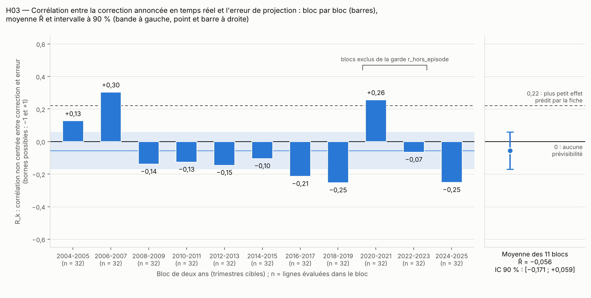

# H03 — Rapport de l'expérimentateur

Rédigé le 2026-11-12. Ce rapport donne des chiffres, pas un verdict. Les chiffres de `temoin.json` ne sont qu'un témoin :
le vérificateur recalcule tout à partir de `H03_analyse.csv`.

## À lire d'abord

Le test a été exécuté tel que préinscrit et tous les chiffres ont pu être calculés. Deux constats liés pèsent sur leur
lecture ; ils sont détaillés dans `ecarts.md` (écarts 1 et 2).

1. **Les lettres `S` et `G` sont inversées dans la préinscription par rapport à la source.** La préinscription écrit `S` =
   juin et `G` = septembre. Les titres des 111 fichiers disent l'inverse : `G` = juin, `S` = septembre. Le premier
   trimestre projeté de chaque fichier confirme les titres. Le fichier d'analyse est construit avec la correspondance
   préinscrite, donc avec les exercices de juin et de septembre rangés dans l'ordre inverse du calendrier, chaque année.
2. **Le contrôle de schéma qui devait détecter cette inversion ne s'applique pas dans la lecture littérale.** La
   préinscription fait lire le mois dans la colonne `TITLE`, qui est vide partout ; le titre est dans `TITLE_COMPL`. Lecture
   littérale retenue : `mois_titre` vide, `n_violations_schema` = 0. Autre lecture (`TITLE_COMPL`) : contrôle n° 4 violé sur
   224 lignes, `n_violations_schema` = 1. Les 24 autres champs sont les mêmes dans les deux lectures.

Les chiffres ci-dessous sont donc ceux du test tel qu'écrit, sur des révisions dont trois sur quatre ne comparent pas deux
exercices consécutifs. L'expérimentateur n'a pas recalculé la statistique avec la correspondance corrigée (raison dans
`ecarts.md`).

## Ce qui a été fait

| Étape | Script | Sortie |
|---|---|---|
| Téléchargement des 111 millésimes et de la liste des clés | `telecharger.py` | `donnees/*.csv`, `construire_journal.json` |
| Table de provenance | `provenance.py` | `donnees/PROVENANCE.md` |
| Construction du fichier d'analyse à partir de `donnees/` seul | `construire.py` | `H03_analyse.csv`, `construire_bilan.json`, annexe de l'autre lecture |
| Contrôles de schéma, statistique principale, S1, S2, S3, figure | `analyse.py` | `temoin.json`, `analyse_details.json`, `analyse_lignes.csv`, `figure.png` |

Commandes, dans cet ordre, depuis le dossier `H03/` : `python3 -I telecharger.py`, `python3 -I provenance.py`,
`python3 -I construire.py`, `python3 -I analyse.py`. Les deux dernières ne font aucune requête. Aucun tirage aléatoire.
`preenregistrement.md` n'a pas été modifié (sha256 vérifié après le travail : identique au scellé).

## Données

- Source unique : API de la BCE, base MPD, une requête par millésime, selon le modèle d'URL de la préinscription.
- 112 requêtes le 2026-11-12 entre 19:00:31 et 19:09:30 UTC, toutes en HTTP 200 au premier essai. Durée la plus longue :
  43 secondes. Aucun 503, aucun délai dépassé.
- Les 111 fichiers attendus sont là ; le plus court a 12 trimestres (`W99`), le plus long 136. Statuts rencontrés : `A`
  (7 500 lignes) et `F` (1 199 lignes), aucun autre. Aucune valeur vide. Toutes les valeurs ont au plus une décimale.
- Ce que la préinscription disait de `W21` est confirmé : 116 trimestres de 1995-Q1 à 2023-Q4, premier statut `F` en 2021-Q1.
- Liste des clés : 6 206 clés, les 111 clés attendues présentes, pas de millésime `A26`.

## Échantillon obtenu à chaque filtre

| Filtre | Lignes |
|---|---|
| Fichier d'analyse (111 millésimes × 4 horizons) | 444 |
| `projection` présente | 444 |
| `projection_precedente` présente | 440 (manquent les 4 lignes de `W99`, sans prédécesseur) |
| `realise` présent | 426 (manquent les 18 lignes dont la cible est 2026-Q2 ou après) |
| Lignes complètes (`revision` et `erreur` présentes) | 422 |
| … dont cible entre 2004-Q1 et 2025-Q4 | 352 |
| … dont ensemble d'apprentissage d'au moins 8 lignes et S_rr > 10⁻¹² (lignes évaluées) | 352 |
| Par horizon (1, 2, 3, 4) | 88, 88, 88, 88 |
| Par bloc de deux ans | 32 dans chacun des 11 blocs |

Les 426 valeurs réalisées ont toutes été lues au numéro cible + 2 ; le repli sur + 3 ou + 4 n'a jamais servi. La taille de
l'ensemble d'apprentissage va de 10 à 103 lignes sur les lignes évaluées. Aucune ligne n'est perdue entre « complète dans
la fenêtre » et « évaluée » : les 352 lignes possibles sont toutes là.

## Contrôles de schéma

Les 11 contrôles passent sur `H03_analyse.csv` : `n_violations_schema` = 0. Le contrôle n° 4 passe sans porter sur aucune
ligne (`mois_titre` vide partout, voir écart 1). Le contrôle n° 5 passe avec, pour tous les millésimes `G`, un premier
trimestre projeté égal à `t_millesime` − 1 et, pour tous les `S`, égal à `t_millesime` + 1 (voir écart 2).

## Statistique principale

| Champ | Valeur |
|---|---|
| `n_obs_evaluees` | 352 |
| `n_blocs` (K) | 11 |
| `r_moyen` (R̄) | −0,0559 |
| `et_r_moyen` | 0,0634 |
| `borne_basse_ic90` | −0,1709 |
| `borne_haute_ic90` | 0,0591 |
| `marge_indecision` | −0,1609 |
| `r_hors_episode` | −0,0894 |
| `rapport_eqm_geo` | 1,0615 |
| `conflit_gardes` | 0 |

Intermédiaires : g0 = 0,03854 ; g1 = 0,00287 (positif, donc compté) ; quantile 1,8125. Seuils de la préinscription, pour
situer les chiffres : 0 et 0,22 pour les bornes, 0 pour `r_hors_episode`, 1 pour `rapport_eqm_geo`. La borne haute de
l'intervalle (0,059) est sous 0,22 ; la borne basse (−0,171) est sous 0.

Bloc par bloc (voir `figure.png`) :

| Bloc | Cibles | Lignes | R_k | Q_k (erreur quadratique corrigée / brute) | Σ erreur² |
|---|---|---|---|---|---|
| 0 | 2004-2005 | 32 | +0,127 | 1,040 | 5,52 |
| 1 | 2006-2007 | 32 | +0,304 | 0,914 | 6,94 |
| 2 | 2008-2009 | 32 | −0,139 | 1,101 | 52,63 |
| 3 | 2010-2011 | 32 | −0,126 | 1,102 | 13,04 |
| 4 | 2012-2013 | 32 | −0,146 | 1,029 | 6,79 |
| 5 | 2014-2015 | 32 | −0,105 | 1,012 | 17,38 |
| 6 | 2016-2017 | 32 | −0,214 | 1,055 | 13,86 |
| 7 | 2018-2019 | 32 | −0,254 | 1,062 | 4,53 |
| 8 | 2020-2021 | 32 | +0,257 | 0,979 | 45,58 |
| 9 | 2022-2023 | 32 | −0,066 | 1,047 | 460,87 |
| 10 | 2024-2025 | 32 | −0,251 | 1,398 | 3,65 |

R_k est positif dans 3 blocs sur 11 et négatif dans 8. Q_k est sous 1 dans 2 blocs sur 11.

*Figure.* Barres : R_k de chaque bloc. Bande et trait bleus à gauche, point et barre à droite : R̄ et son intervalle à
90 %. Traits de référence : 0 (aucune prévisibilité) et 0,22 (plus petit effet prédit par la fiche). L'axe est coupé à
±0,65 pour la lisibilité ; R_k peut aller de −1 à +1.

## Analyses secondaires — descriptives, hors verdict

**S1 — Le test de la fiche tel qu'elle l'avait écrit** (horizon 4, millésimes numérotés 2020-Q1 et après).

| Champ | Valeur |
|---|---|
| `n_obs_h4_2020` | 21 (millésimes `W20` à `W25`) |
| `rapport_eqm_h4_2020` | 1,0076 |
| `p_dm_hln_h4_2020` | 0,686 |

Intermédiaires : d̄ = −0,0881 ; DM = −0,590 ; DM* = −0,492 ; 20 degrés de liberté. La dernière ligne (`W25`, horizon 4)
vise 2026-Q1, hors de la fenêtre principale, comme le prévoit S1 (« sans borne sur `t_cible` »).

**S2 — Lecture en clair** (352 lignes évaluées).

| Champ | Valeur |
|---|---|
| `rapport_eqm_global` | 1,0476 |
| `rapport_eqm_hors_2021_2022` | 1,2009 |
| `taux_amelioration` | 0,4185 (131 lignes améliorées, 182 dégradées, 39 inchangées) |
| `part_b_positif` | 0,4830 |
| `r_moyen_h1` | −0,1645 |
| `r_moyen_h2` | +0,1464 |
| `r_moyen_h3` | −0,0823 |
| `r_moyen_h4` | −0,1002 |

Part des pentes positives par horizon (complément, non demandé dans le témoin) : 0,34 ; 0,72 ; 0,50 ; 0,38 pour les
horizons 1 à 4. Pente b : de −1,40 à +1,66, médiane −0,014. Les moyennes par horizon reposent chacune sur 11 blocs de 8
lignes. La fiche prédisait un gain à l'horizon 4 et aucun à l'horizon 1 : les chiffres obtenus sont −0,100 et −0,164.
Avec l'inversion des lettres, « horizon h » ne désigne pas la même distance réelle selon le millésime (écart 2).

**S3 — Placebo** (révision vieille de deux ans).

| Champ | Valeur |
|---|---|
| `r_moyen_placebo` | 0,0762 |
| `et_r_placebo` | 0,0596 |
| `n_blocs_placebo` | 11 |

390 lignes complètes pour le placebo, 340 évaluées (le bloc 2004-2005 en a 20, les dix autres 32). Lecture écrite d'avance
dans la préinscription : elle s'applique si `r_moyen_placebo` dépasse 1,8 fois `et_r_placebo`, soit 0,107. Le chiffre obtenu
est 0,076, soit 1,28 fois l'écart-type : la condition n'est pas remplie.

## Vérification interne

La statistique principale, les deux gardes, `rapport_eqm_global`, `part_b_positif` et S1 ont été recalculés une seconde
fois avec un code écrit autrement (pandas, pente par `numpy.polyfit`) : mêmes chiffres à 10⁻¹⁴ près. Ce second calcul n'a
servi qu'à chercher des erreurs de programmation ; il n'est pas gardé et ne remplace pas le vérificateur.

## Difficultés

1. **Inversion des lettres `S` et `G`** (écart 2). C'est la difficulté de fond : le fichier respecte la préinscription,
   mais pas le calendrier réel des exercices.
2. **Colonne `TITLE` vide** (écart 1). Elle rend sans objet le contrôle qui devait révéler le point précédent, et fait
   dépendre `n_violations_schema` (0 ou 1) de la lecture choisie.
3. **Règles de téléchargement différentes** entre la préinscription (10 essais espacés de 10 s) et l'ordre de mission
   (8 essais avec attente croissante). La préinscription a été suivie ; aucun nouvel essai n'a été nécessaire.
4. **API.** Aucune panne pendant le téléchargement, contrairement à ce qui était annoncé. Requêtes par millésime comme
   préinscrit, sans requête groupée.
5. **Rien d'autre à signaler** sur le calcul : aucun bloc non valide, aucune ligne écartée par la règle des 8 points,
   aucune convention de repli (K < 5, n < 8, V ≤ 0, G + P = 0) n'a été déclenchée.

## Fichiers du dossier

| Fichier | Rôle |
|---|---|
| `donnees/` | 111 fichiers bruts, liste des clés, `PROVENANCE.md` |
| `construire_journal.json` | journal du téléchargement (chaque essai : date, code HTTP, durée, sha256) |
| `H03_analyse.csv` | **fichier d'analyse** (444 lignes, 15 colonnes) ; sha256 `ca2a55ec…20a1a3` |
| `construire_bilan.json` | comptes par filtre, lignes incomplètes, description de chaque millésime |
| `annexe_lecture_TITLE_COMPL/` | même fichier avec `mois_titre` lu dans `TITLE_COMPL` ; **pas le fichier d'analyse** |
| `temoin.json` | les 25 champs du témoin |
| `analyse_details.json`, `analyse_lignes.csv` | détail par bloc et par ligne (n_A, pente, correction) |
| `figure.png` | figure ci-dessus |
| `ecarts.md` | les trois écarts |
