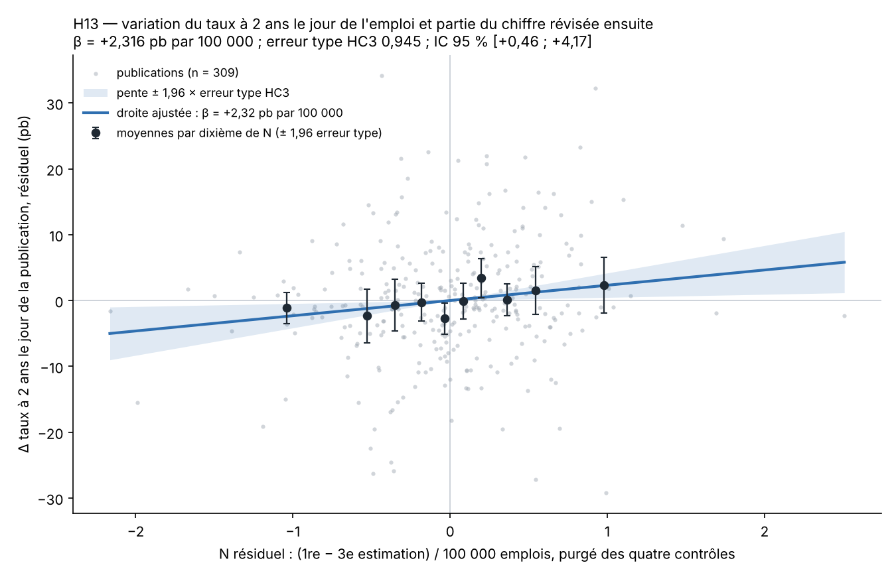

# H13 — rapport de l'expérimentateur

Rédigé le 2026-11-12. Ce rapport donne des nombres. Il ne contient pas de verdict : le verdict est calculé par le code de
l'orchestrateur à partir des nombres du vérificateur.

Préinscription scellée : sha256 `c5a6e2b1a2b5996b785ec42e344bbd6a9b1577e9d524e9fb2f411b88747b17e2`, vérifié avant et après
le travail ; le fichier n'a pas été touché.

## 1. Nombres du témoin (`temoin.json`)

| Champ | Valeur |
|---|---|
| `schema_ok` | 1 |
| `n_publications` | 309 |
| `beta_pb_par_100k` | 2,315513 |
| `erreur_type_pb` | 0,944753 |
| `t_stat` | 2,450920 |
| `borne_inf_95_pb` | 0,463798 |
| `borne_sup_95_pb` | 4,167228 |
| `marge_zone_grise` | −0,490920 |
| `t_placebo_abs` | 0,997663 |

En clair : sur 309 publications, le coefficient de N vaut +2,32 pb par 100 000 emplois, erreur type HC3 0,94, intervalle à
95 % de +0,46 à +4,17. Cet intervalle recoupe la fourchette de +1 à +3 écrite dans la préinscription. Le coefficient du
placebo (variation du taux la veille) vaut −0,71 pb par 100 000, erreur type 0,72, |t| = 1,00.

## 2. Ce qui a été fait, dans l'ordre

1. **D1** : page des millésimes de `PAYEMS` téléchargée. 861 dates de 1955-05-06 à 2026-11-06 ; 438 dans la fenêtre
   1989-12-01 à 2026-03-31, la première 1989-12-08. Conforme à l'attendu.
2. **D2** : 37 lots de 12 millésimes au plus (le dernier en a 6), par `alfredgraph.csv`. L'en-tête de chaque lot a été
   contrôlé au téléchargement et de nouveau à la lecture : n colonnes, dans l'ordre demandé. Aucun lot tronqué. Niveaux tous
   entiers. Aucun trou à l'intérieur d'un millésime.
3. **Étape 2** : 435 publications, 3 corrections (2002-12-09, 2003-10-10, 2020-05-11), 431 publications du 1990-01-01 au
   2025-12-31. Conforme à l'attendu. Recoupement avec le menu de `UNRATE` : les trois corrections sont les seules dates de
   `PAYEMS` absentes de ce menu.
4. **D3** : `UNRATE` aux 435 dates de publication, 37 lots, mêmes contrôles d'en-tête. Le dernier mois de `UNRATE` est le
   mois de référence m pour les 431 lignes.
5. **Étapes 3 à 5** : colonnes d'emploi et de chômage construites. Exemple de contrôle retrouvé : publication du
   1990-02-02, A1 = 275, v3 = 1990-04-06, A3 = 361, N = −0,86.
6. **Étape 6** : `emploi_intermediaire.csv` écrit à 19:02:33Z, sha256
   `06d1166132eb6013152461f739b1a3c2101c57b0fc7b6c7ee28e1c03d687bab1`, noté dans `journal.md`. À cet instant ni D4 ni D5
   n'étaient dans `donnees/` (le journal le dit). D4 a été téléchargé à 19:02:49Z, D5 vers 19:04Z.
7. **Étape 7** : calendrier des taux, puis `H13_analyse.csv` (431 lignes, 22 colonnes, sha256
   `e39af5d5fa9fdf4cf29c229ab35e865ee347ac6a3db8f00ea8a91d60802951a6`). Le fichier intermédiaire reconstruit à cette étape
   a le même sha256 qu'à l'étape 6. Une seconde exécution de `construire.py` rend les deux mêmes sha256.
8. **Contrôles de schéma 1 à 9** : tous passent. Alignement `DGS2` / `SVENY02` : écart maximal de 0,255 point le jour
   (427 paires) et de 0,260 point la veille (431 paires), pour une limite de 0,75.
9. **Analyse** : `analyse.py`, formule fermée écrite dans la section 6 (numpy). Recoupement avec
   `statsmodels.OLS(...).fit(cov_type="HC3")` : mêmes β et erreur type à 10⁻¹⁵ près.

Fichiers : `telecharger.py` (téléchargements), `construire.py`, `analyse.py`, `H13_analyse.csv`,
`emploi_intermediaire.csv`, `journal.md`, `temoin.json`, `resultats_detail.json` (tous les nombres de ce rapport),
`figure.png`, `donnees/` (78 fichiers bruts, `PROVENANCE.md`, `journal_telechargement.tsv`).

## 3. Échantillon à chaque filtre

| Étape | Lignes restantes | Retirées à cette étape |
|---|---:|---:|
| Publications du 1990-01-01 au 2025-12-31 | 431 | |
| `complet` = 1 | 429 | 2 |
| `n_mois_nouveaux` = 1 | 429 | 0 |
| `revision_large` = 0 | 312 | 117 |
| `extreme` = 0 (échantillon principal P) | **309** | 3 |

Nombre de lignes touchées par chaque filtre pris seul (une ligne peut en cumuler plusieurs) :

| Filtre | Lignes | Détail |
|---|---:|---|
| `complet` = 0 | 2 | 1994-04-01 (`DGS2` vide, Vendredi saint, attendu) ; 2025-12-16 (taux de chômage d'octobre 2025 absent du millésime, donc variation non calculable) |
| `n_mois_nouveaux` = 2 | 1 | 2025-12-16 (octobre et novembre 2025 publiés ensemble, attendu) |
| `revision_large` = 1 | 119 | 114 lignes ne sortent que par ce filtre |
| `extreme` = 1 | 6 | 2020-04-03, 2020-05-08, 2020-06-05, 2020-07-02, 2020-08-07, 2020-09-04 ; les trois premières ont aussi `revision_large` = 1 |

P va du 1990-01-05 au 2025-11-20 : 87 publications dans les années 1990, 86 dans les années 2000, 89 dans les années 2010,
47 de 2020 à 2025. Par mois civil de publication : 12 à 14 en décembre, janvier et février ; 22 en avril, mai et juin ; 33 à
35 les autres mois.

**Publications de révision large (étape 5)** : 41 sur 435. Une par an en juin de 1991 à 2003 et en février de 2004 à 2026,
plus cinq que la préinscription n'annonçait pas : 1990-09-07, 1996-10-04, 2003-01-10, 2010-03-05, 2020-06-05. Deux d'entre
elles suivent un millésime de correction (2002-12-09 et 2020-05-11) : la règle compare à la publication précédente, donc la
correction se retrouve dans la publication suivante. Les trois autres sont données par la règle mécanique sans que j'en
connaisse la cause. Le fichier est construit tel que la règle le donne.

## 4. Statistique principale

Moindres carrés sur P, y = a + β·N + c1·R1 + c2·R2 + c3·U + c4·T, erreurs types HC3.

| Terme | Coefficient | Erreur type HC3 |
|---|---:|---:|
| constante | 0,246 | 0,846 |
| **N** (partie révisée, par 100 000) | **2,316** | **0,945** |
| R1 (révision du mois précédent, par 100 000) | 2,727 | 1,405 |
| R2 (révision du mois d'avant, par 100 000) | 3,970 | 1,732 |
| U (variation du taux de chômage, par point) | −5,141 | 4,062 |
| T (tendance sur douze mois, par 100 000) | −0,289 | 0,376 |

R² = 0,068. Levier maximal : 0,121.

- t = 2,451 (comparé à 1,96).
- Intervalle à 95 % : [0,464 ; 4,167].
- `marge_zone_grise` = min(1,96 − 2,451 ; 4,167 − 1) = −0,491.

**Placebo** (même X, variable expliquée : variation du taux la veille) : coefficient de N = −0,715, erreur type HC3 0,717,
|t| = 0,998 (seuil de la garde : 1,96).

### Figure

`figure.png` : régression partielle. Les deux axes sont les résidus de y et de N après retrait de la constante et des
quatre contrôles ; la pente de la droite dans ce nuage est exactement β. Points gris : les 309 publications. Points noirs :
moyennes par dixième de N résiduel, avec ± 1,96 erreur type de la moyenne. Bande bleue : pente ± 1,96 × erreur type HC3.
Le nuage est large : la dispersion verticale (écart-type de y de 9,4 pb) domine la pente, et R² vaut 0,07.

## 5. Grandeurs demandées pour la comparaison avec la section 7

| Grandeur | Supposée (section 7) | Observée sur P |
|---|---|---|
| n | 270 à 315 | 309 |
| Écart-type de N (centaines de milliers) | 0,5 à 0,8, centre 0,6 | 0,585 |
| Écart-type de y (pb) | 6,5 à 9, centre 8 | 9,43 |
| Erreur type de β | 0,46 à 1,10, centre 0,77 | 0,945 (la formule simple de la section 7 donne 9,43 / (0,585 × √309) = 0,917) |
| Lignes à révision large | environ 108, peut-être 150 | 119 |
| Extrêmes de A7 | environ 6, tous en 2020 | 6, tous en 2020 |

L'écart-type de y est au-dessus de la fourchette supposée ; les autres grandeurs sont dedans. Moyenne de N : −0,087 ; écart
absolu moyen de N : 0,440 (44 000 emplois) ; N va de −2,48 (2021-09-03) à +2,44 (2008-10-03). Moyenne de y : −0,02 pb ; y va
de −30 à +36 pb.

## 6. Analyses secondaires — descriptives, sans effet sur le verdict

**S1 — nature des révisions (descriptif, emploi seul).** Régression de Sn = `emploi_1re_k` / 100 − T sur N avec constante,
sur P (n = 309) : p̂ = 0,078, erreur type HC3 0,182. p̂ est sous 0,3 : β / p̂ n'est pas rapporté, comme le prévoit la
préinscription.

**S2 — à chiffre publié donné (descriptif).** Régression principale avec Sn en septième colonne (n = 309, X de rang 7) :

| Terme | Coefficient | Erreur type HC3 |
|---|---:|---:|
| Sn (surprise naïve, par 100 000) | 1,666 | 0,462 |
| N (δ) | 1,787 | 0,932 |

**S3 — sensibilité à la règle A7 (descriptif).** Régression principale sur les lignes `complet` = 1, `n_mois_nouveaux` = 1,
`revision_large` = 0, quel que soit `extreme` : β = 2,211, erreur type HC3 0,927, n = 312. Dates où `extreme` = 1 dans cet
échantillon : 2020-07-02, 2020-08-07, 2020-09-04. Les trois autres dates extrêmes du fichier (2020-04-03, 2020-05-08,
2020-06-05) ont `revision_large` = 1 et restent donc hors de S3 : S3 ne remet que trois des six publications écartées par A7.

## 7. Difficultés

1. **D5 refusé à Python.** `federalreserve.gov` a répondu 403 cinq fois à `urllib`, puis 200 à `curl`. Même adresse, même
   fichier. Voir `ecarts.md`, écart 2.
2. **`SVENY02` a douze décimales**, non quatre comme le décrit la préinscription. Recopié sans arrondi ; le contrôle n° 9
   passe.
3. **Une réinitialisation de connexion** sur un lot de D3 (ALFRED), résolue au deuxième essai. Aucun corps vide.
4. **Dossier `donnees/` au lieu de `brut/`** : consigne de l'orchestrateur contre texte de la préinscription. Écart 1.
5. **Cinq publications de révision large non annoncées** (section 3 ci-dessus). Elles retirent une dizaine de lignes de
   plus que le décompte « une par an ». Règle appliquée telle quelle.
6. **2025-12-16** sort deux fois : deux mois nouveaux, et variation du chômage non calculable (octobre 2025 vide dans
   `UNRATE`). La préinscription n'annonçait que la première raison ; le résultat est le même.
7. **S1 donne p̂ = 0,08 alors que la préinscription jugeait p proche de 1 probable.** Rapporté tel quel ; la lecture
   appartient à la suite du protocole. Conséquence pratique : β / p̂ n'est pas calculé.
8. **Limite n° 9 de la préinscription non levée** : les dates de publication sont celles des millésimes d'ALFRED, sans
   recoupement avec le calendrier du BLS. Constat sur le fichier : 417 publications un vendredi, 12 un jeudi, 2 un mardi ;
   la veille de cotation est la veille civile dans 425 cas et l'avant-veille civile dans 6.

Rien n'a été calculé hors de ce que la préinscription demande, sauf les décomptes descriptifs des sections 3 et 5 et le
recoupement `statsmodels`. Aucune sous-période, aucune autre spécification, aucun autre taux n'a été essayé.

## 8. Écarts

Quatre, détaillés dans `ecarts.md` : dossier `donnees/` ; D5 pris avec `curl` et décimales de `SVENY02` ; fichier
supplémentaire du menu `UNRATE` ; arrondi d'écriture de `d_chomage_pt` (effet de l'ordre de 10⁻¹⁵ sur β).
