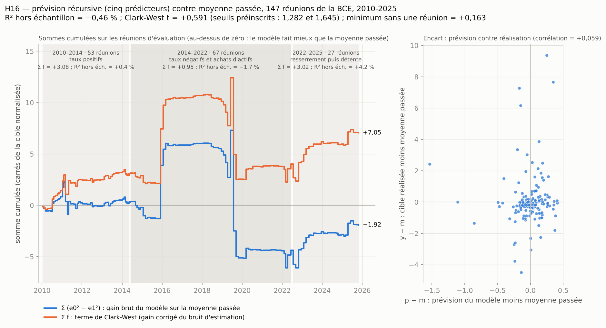

# H16 — compte rendu de l'expérimentateur

Rédigé le 2026-11-12. Je rapporte des nombres ; je n'écris pas le verdict. Tout ce que ce fichier contient n'est qu'un
témoin : le vérificateur recalcule à partir de `analyse_H16.csv` et de la préinscription seule.

Préinscription exécutée : `preenregistrement.md`, sha256 `6862049133ba2826e17247ed7bdf04b100f2012a08bc5696d2a044898277c38c`
(conforme au fichier `.sha256`, vérifié avant et après ; non modifiée). Convention : virgule décimale dans le texte, point
dans les fichiers.

## 1. Résultat principal (§ 6.2), nombres de `temoin.json`

| Champ | Valeur | Repère préinscrit |
|---|---|---|
| `n_eval` | 147 | attendu 147 ; minimum 140 |
| `n_estim_init` | 151 | attendu 151 ; minimum 140 |
| `r2_oos` | −0,004554090 (−0,46 %) | condition : > 0 |
| `cw_fbar` | 0,047940272 | — |
| `cw_se` | 0,081081095 | — |
| `cw_t` | 0,591263249 | seuils : 1,645 et 1,282 |
| `cw_t_min_sans_une` | 0,162928907 | seuil : 1,282 |
| `zone_grise` | 0 | — |
| `violations_schema` | 0 | — |

Lecture mécanique des trois conditions du § 8, sur mes nombres : `r2_oos > 0` : non ; `cw_t ≥ 1,645` : non ;
`cw_t_min_sans_une ≥ 1,282` : non. `cw_t` est sous 1,282, donc `zone_grise` = 0.

Détails : Σ e0² = 421,3917 ; Σ e1² = 423,3107 ; Σ (e0² − e1²) = −1,9191 ; Σ f = 7,0472 ; identité `f_t = 2·e0_t·d_t` vérifiée
à la précision machine ; fenêtre d'estimation de 151 lignes pour la première réunion d'évaluation et de 297 pour la
dernière. `f_t` est positif à 82 réunions sur 147, négatif à 65. Le minimum sans une réunion est obtenu en retirant celle
du 2015-12-03 (`f_t` = +5,307).

Recoupement : la statistique a été calculée par deux chemins de code différents (numpy `lstsq` dans `analyse.py` ;
statsmodels `OLS` dans une boucle pandas jetable) ; les valeurs concordent à 1e-13 près.

Position par rapport aux prédictions écrites au § 2 de la préinscription : `r2_oos` = −0,46 % est dans la fourchette du
rédacteur (−3 % à +3 %) et hors de celle de la fiche (+2 % à +6 %) ; `cw_t` = 0,59 est dans la fourchette du rédacteur
(0,5 à 2,5), près de son bord bas.

## 2. Figure

`figure.png` : à gauche, en fonction de la date, la somme cumulée de `e0² − e1²` (bleu) et celle de `f_t` (orange), avec
les trois sous-périodes en fond ; à droite, `p − m` contre `y − m` pour les 147 réunions. Ce qu'on y lit :

- la courbe bleue (gain brut du modèle sur la moyenne passée) finit à −1,92 : sur l'ensemble, le modèle a une erreur
  quadratique un peu plus grande que la moyenne passée ;
- la courbe orange (terme de Clark-West) finit à +7,05, mais son parcours est fait de quelques marches : +5,31 le
  2015-12-03, +4,68 le 2019-06-06, −7,45 le 2019-07-25, −2,46 le 2019-09-12. Entre ces dates, elle est presque plate ;
- le nuage de droite n'a pas de pente visible (corrélation +0,059, nombre hors préinscription) : les prévisions du modèle
  s'écartent peu de la moyenne passée (écart-type de `p − m` : 0,25) alors que la cible normalisée va de −4,3 à +9,4.

## 3. Ce que j'ai fait

1. **Téléchargement** (`telecharger.py`) : les cinq fichiers nommés au § 4, chacun obtenu au premier essai (HTTP 200) le
   2026-11-12 vers 18:55 UTC. Fichiers bruts non modifiés dans `donnees/` ; URL, heure, sha256 et nombre de lignes dans
   `donnees/PROVENANCE.md`. L'empreinte d'EA-MPD est celle de la préinscription
   (`f417fb86…426cef`). Le repli `DGS2` (A14) n'a pas servi.
2. **Construction** (`construire.py`, journal `construire.log`) : `analyse_H16.csv`, 315 lignes, 16 colonnes, reconstruit
   à partir de `donnees/` seul ; deux exécutions donnent le même fichier (sha256 `369fc914…14c350`).
3. **Analyse** (`analyse.py`, journal `analyse.log`) : contrôles de schéma refaits à partir du fichier, statistique
   principale, S1 à S3, figure ; sorties `temoin.json`, `resultats_analyse.json`, `previsions_H16.csv`, `figure.png`.

Exécution : `python3 -I telecharger.py` (déjà fait), puis `python3 -I construire.py`, puis `python3 -I analyse.py`.
Python 3.13, numpy, pandas, statsmodels, matplotlib, openpyxl 3.1.5. Moins de dix secondes au total.

## 4. Échantillon à chaque filtre

| Étape | Effectif |
|---|---|
| Feuille `Monetary Event Window` : lignes sous l'en-tête | 324 |
| − lignes sans date (vides, en fin de feuille) | −9 |
| Réunions datées | 315 (299 dates Excel, 16 dates en texte `jj/mm/aaaa`, du 14/12/2023 au 30/10/2025) |
| − réunions postérieures au 2025-10-30 | 0 |
| − doublons de date | 0 |
| Réunions retenues, triées (`rang` 1 à 315) | **315**, du 1999-01-07 au 2025-10-30 |
| dont `OIS_1Y` vide ou non numérique | 0 |
| `rodage` (rangs 1 à 17) | 17 |
| Rangs 18 à 315 | 298 |
| − `exclue` (un prédicteur ou la cible manque) | 0 |
| `estimation` (date ≤ 2009-12-03) | **151** |
| `evaluation` (2010-01-14 à 2025-10-30) | **147** |

Repères de la préinscription, tous retrouvés : rang 17 = 1999-09-23 ; rang 18 = 1999-10-07 ; rang 168 = 2009-12-03 ;
rang 169 = 2010-01-14 ; rang 315 = 2025-10-30. Sous-périodes de S3 : 53, 67 et 27 réunions, comme annoncé.

Séries des prédicteurs (observations valides) : Ken French 9 458 (aucune manquante), Brent 9 122 sur 10 295, euro-dollar
6 984 sur 7 265, `SVENY02` 16 314 sur 17 063. Prédicteurs manquants : seulement `eurusd_60j_pct` aux rangs 1 à 5 (rodage ;
la série commence le 1999-01-04, il n'y a pas encore 60 observations d'historique).

Le fichier contient 26 valeurs exactement nulles de `d_ois1y_pb`, dont 17 avant 2002 (le compte de la note de nouveauté).

## 5. Antériorité : aucune donnée du jour de la réunion ou d'après

- Dans `construire.py`, la position `i` est celle de la dernière observation valide de date strictement inférieure à `D`
  (`bisect_left(dates, D) − 1`), avec une assertion `date_fin < D` à chaque appel.
- Contrôle séparé par balayage complet, sans `bisect` : pour chaque ligne utilisable et chaque série, la `date_fin_*`
  écrite est bien la dernière date valide `< D`, et toutes les observations suivantes sont `≥ D`. Réussi pour les
  4 × 298 cas.
- Retard en jours calendaires entre `date_fin_*` et la réunion, sur les 298 lignes utilisables : actions 1 à 3 ; Brent
  1 à 7 ; euro-dollar 1 à 3 ; taux américain 1 à 3. C'est ce que la préinscription avait relevé sur les dates (7 jours
  pour le Brent, 3 pour les autres).
- `cible_prec_norm` vient de la ligne précédente du fichier ; `sigma16_pb` des 16 lignes précédentes.
- Contrôle 8 du schéma, refait dans `analyse.py` à partir du fichier : réussi.

### Trois réunions tirées au sort, lignes brutes utilisées

Tirage : `numpy.random.default_rng(16).choice` sans remise parmi les 298 lignes utilisables, graine fixée avant
l'exécution → rangs 177, 186 et 263. Les lignes ci-dessous sont copiées des fichiers bruts (`construire.log`).

**Rang 177, réunion du 2010-09-02 (`evaluation`).**
- EA-MPD : `OIS_1Y` = −0,9 pb ; écart-type des 16 précédentes = 3,368574 pb ; `cible_norm` = −0,267175 ;
  `cible_prec_norm` = −0,460946.
- Actions : 60 rendements, de `20100610    ,2.70   ,-0.58    ,1.04    ,0.00` à
  `20100901    ,3.54   ,-1.34    ,0.25    ,0.00` → `act_eu_60j_pct` = 12,057951.
- Brent : `2010-06-08,71.43` et `2010-09-01,75.53` → 100 × ln(75,53 / 71,43) = 5,581198.
- Euro-dollar : `2010-06-08,1.1995` et `2010-09-01,1.2813` → 6,597038.
- Taux américain : `SVENY02` = 0,750699996948242 le 2010-06-08 et 0,489199995994568 le 2010-09-01 → −0,261500.
- Observation valide suivante de chaque série : 2010-09-02, le jour de la réunion — non utilisée.

**Rang 186, réunion du 2011-06-09 (`evaluation`).**
- EA-MPD : `OIS_1Y` = −3,65 pb ; écart-type des 16 précédentes = 5,838293 pb ; `cible_norm` = −0,625183 ;
  `cible_prec_norm` = −2,602012.
- Actions : de `20110317    ,2.55   ,-0.79    ,0.48    ,0.00` à `20110608   ,-1.68   ,-0.05   ,-0.12    ,0.00` → 9,254865.
- Brent : `2011-03-10,114.07` et `2011-06-08,118.43` → 3,750977.
- Euro-dollar : `2011-03-15,1.3968` et `2011-06-08,1.4587` → 4,336172.
- Taux américain : 0,588599979877472 le 2011-03-14 et 0,37830001115799 le 2011-06-08 → −0,210300.
- Observation suivante de chaque série : 2011-06-09 — non utilisée. Les dates de départ diffèrent d'une série à l'autre
  (10, 14 et 15 mars) : chaque série a son calendrier, 60 observations valides en arrière, comme le fixe le § 4.3.

**Rang 263, réunion du 2019-04-10 (`evaluation`).**
- EA-MPD : `OIS_1Y` = −0,4899979 pb ; écart-type des 16 précédentes = 0,280183 pb (le plus petit de tout le fichier) ;
  `cible_norm` = −1,748850 ; `cible_prec_norm` = −2,196862.
- Actions : de `20190116    ,0.19    ,0.05    ,0.45    ,0.01` à `20190409   ,-0.45    ,0.04    ,0.04    ,0.01` → 9,180157.
- Brent : `2019-01-15,58.65` et `2019-04-09,71.02` → 19,137395.
- Euro-dollar : `2019-01-09,1.1524` et `2019-04-09,1.1278` → −2,157789.
- Taux américain : 2,52830004692078 le 2019-01-11 et 2,3313000202179 le 2019-04-09 → −0,197000.
- Observation suivante de chaque série : 2019-04-10 — non utilisée.

## 6. Contrôles de schéma (§ 5)

Les dix contrôles, refaits par `analyse.py` à partir du fichier lu comme texte : tous réussis ; `violations_schema` = 0.
Format des nombres : notation scientifique à 17 chiffres significatifs (voir `ecarts.md`, E1).

## 7. Analyses secondaires — **descriptives**, elles n'entrent pas dans la règle

### S1 — Signes (une régression sur les 298 lignes utilisables, erreurs types HC3)

R² = 0,026528 (2,65 %) ; R² ajusté = 0,009859 (0,99 %) ; n = 298.

| Variable | Coefficient | Erreur type HC3 | t | b ± 1,645 × se |
|---|---|---|---|---|
| constante | 0,129191 | 0,101498 | 1,273 | [−0,0378 ; 0,2962] |
| `act_eu_60j_pct` | 0,003850 | 0,012397 | 0,311 | [−0,0165 ; 0,0242] |
| `brent_60j_pct` | −0,003059 | 0,005030 | −0,608 | [−0,0113 ; 0,0052] |
| `eurusd_60j_pct` | −0,038718 | 0,022448 | −1,725 | [−0,0757 ; −0,0018] |
| `us2a_60j_pp` | −0,179701 | 0,310817 | −0,578 | [−0,6910 ; 0,3316] |
| `cible_prec_norm` | −0,101358 | 0,082659 | −1,226 | [−0,2373 ; 0,0346] |

Lectures fixées par la préinscription :
- actions : **« signe non établi »** (ni lecture A ni lecture B) ;
- surprise précédente : **« signe non établi »** (coefficient négatif, comme chez Worms, mais l'intervalle contient zéro) ;
- la phrase « prévisible après coup, pas en temps réel » ne s'applique **pas** : elle demande un R² dans l'échantillon
  supérieur à 3 % ; il est de 2,65 % (avec `r2_oos` ≤ 0).

Le R² dans l'échantillon (2,65 %) est dans la fourchette du rédacteur (2 à 6 %) et sous celle de la fiche (5 à 10 %).

### S2 — Autres schémas de prévision, mêmes 147 réunions

| Schéma | `r2_oos` | `cw_t` | `r2_oos > 0` | `cw_t ≥ 1,645` |
|---|---|---|---|---|
| (a) test d'origine de la fiche : coefficients gelés fin 2009, référence « zéro » | +0,029388 | 1,795986 | oui | oui |
| (b) fenêtre glissante de 100 lignes (modèle et moyenne) | −0,119494 | 0,129606 | non | non |
| (c) schéma principal avec référence « zéro » | +0,002191 | 0,876180 | oui | non |
| rappel : schéma principal (statistique du test) | −0,004554 | 0,591263 | non | non |

Lecture fixée : (a) aurait rempli les deux conditions ; (b) aucune ; (c) la première seulement. Aucun ne remplace la
statistique principale.

### S3 — Régimes et unité

(a) Sous-périodes, schéma principal :

| Sous-période | n | Σ f | Σ e0² | Σ e1² | 1 − Σ e1² / Σ e0² | part de Σ f total |
|---|---|---|---|---|---|---|
| 2010-01-14 à 2014-05-08 | 53 | 3,075659 | 84,337154 | 84,002502 | +0,003968 | 43,6 % |
| 2014-06-05 à 2022-06-09 | 67 | 0,951306 | 279,059910 | 283,766925 | −0,016867 | 13,5 % |
| 2022-07-21 à 2025-10-30 | 27 | 3,020255 | 57,994614 | 55,541307 | +0,042302 | 42,9 % |
| total | 147 | 7,047220 | 421,391678 | 423,310734 | −0,004554 | 100 % |

Lecture fixée : aucune sous-période ne porte plus de la moitié de Σ f total. À noter : la sous-période du milieu porte
66 % de Σ e0² (279,06 sur 421,39) : la cible normalisée y a ses plus grandes valeurs.

(b) Cible en points de base bruts (`y = d_ois1y_pb`, cinquième prédicteur = `d_ois1y_pb` du rang précédent, mêmes
lignes, même schéma récursif) : `r2_oos` = **+0,065595** ; `cw_t` = **3,067536** (`cw_fbar` = 1,855286 ; `cw_se` = 0,604813).

Lecture fixée : `r2_oos` change de signe et `cw_t` passe de l'autre côté de 1,645 → **le résultat dépend de la
normalisation**. La statistique préinscrite est celle de la cible normalisée (§ 1) ; celle-ci est descriptive.

Plancher de 0,25 point de base : il joue à **0** réunion (sur 299 de rang ≥ 17, sur 298 utilisables, sur 147 d'évaluation).
Le plus petit écart-type des 16 surprises précédentes est de 0,2802 pb (réunion du 2019-04-10).

## 8. Nombres ajoutés, hors préinscription (voir `ecarts.md`, E5)

Les huit réunions d'évaluation aux plus grands `|f_t|` (`gain` = `e0² − e1²`) :

| Date | y | m | p | d = p − m | f | gain | `cw_t` sans cette réunion |
|---|---|---|---|---|---|---|---|
| 2019-07-25 | 2,509 | 0,083 | −1,453 | −1,536 | −7,452 | −9,811 | 1,572 |
| 2015-12-03 | 7,716 | 0,042 | 0,388 | 0,346 | 5,307 | 5,188 | 0,163 |
| 2019-06-06 | 9,423 | 0,045 | 0,295 | 0,249 | 4,675 | 4,613 | 0,216 |
| 2019-09-12 | 7,376 | 0,093 | −0,076 | −0,169 | −2,456 | −2,484 | 0,816 |
| 2016-01-21 | −1,267 | 0,077 | −0,780 | −0,857 | 2,304 | 1,570 | 0,405 |
| 2011-03-03 | 6,233 | 0,058 | −0,093 | −0,152 | −1,873 | −1,896 | 0,758 |
| 2022-10-27 | −3,611 | 0,155 | −0,083 | −0,238 | 1,795 | 1,739 | 0,445 |
| 2022-07-21 | 3,487 | 0,132 | −0,068 | −0,200 | −1,342 | −1,382 | 0,709 |

- En retirant une seule réunion, `cw_t` va de 0,163 (sans le 2015-12-03 ; c'est le champ préinscrit) à **1,572** (sans le
  2019-07-25 ; non préinscrit). Dans aucun des 147 cas il n'atteint 1,645 ; il dépasse 1,282 dans un seul cas, celui du
  2019-07-25.
- La réunion du 2019-07-25 est celle où la prévision s'écarte le plus de la moyenne passée (`d` = −1,54, soit six fois
  l'écart-type de `d`) ; la cible y a été de +2,51. C'est le cas décrit par la limite 8 du § 9 (valeur extrême d'un
  prédicteur, ici `cible_prec_norm` = 9,42 après la réunion du 2019-06-06).
- Cible normalisée sur les 147 réunions d'évaluation : moyenne 0,207 ; écart-type 1,692 ; minimum −4,335 ; maximum 9,423
  (2019-06-06, quand l'écart-type des 16 surprises précédentes était d'environ 0,3 pb). Trois réunions ont `|y|` > 7.

## 9. Difficultés

1. **Aucune difficulté d'accès** : les cinq sources ont répondu au premier essai, y compris le site de la BCE et FRED.
2. **Passages ambigus de la préinscription**, tous sans effet sur les neuf champs, consignés dans `ecarts.md` : format
   « huit chiffres significatifs » (E1) ; `date_fin_*` d'un prédicteur manquant (E2) ; règle « `i−60` n'existe pas »
   pour les actions (E3) ; lecture S1 pour la surprise précédente (E6).
3. **Encart de la figure** réalisé en panneau latéral (E4).
4. **Attente de la préinscription non réalisée** : le plancher de 0,25 pb ne joue jamais (§ 7, S3). Ce n'est pas un écart.
5. **Poids de quelques réunions.** La cible normalisée a des valeurs de 6 à 9 écarts-types à quatre réunions
   (2011-03, 2015-12, 2019-06, 2019-09) ; la somme des `f_t` et son écart-type sont dominés par elles (§ 8). La
   préinscription l'avait prévu (limites 4 et 8) et fixé la condition de retrait d'une réunion ; je le signale parce que
   c'est aussi ce qui sépare la version normalisée (`cw_t` = 0,59) de la version en points de base bruts (`cw_t` = 3,07).
6. **Données non figées** (limite 6 du § 9) : les fichiers FRED, Fed et Ken French sont ceux du 2026-11-12 ; leurs
   empreintes sont dans `donnees/PROVENANCE.md`. Un téléchargement ultérieur peut différer.

## 10. Fichiers

| Fichier | Rôle |
|---|---|
| `donnees/` + `donnees/PROVENANCE.md` | fichiers bruts et leur provenance |
| `telecharger.py` | téléchargement avec reprises |
| `construire.py`, `construire.log` | construction de `analyse_H16.csv` et journal |
| `analyse_H16.csv` | fichier d'analyse (315 lignes, 16 colonnes), sha256 `369fc9140325ef835c0f295a5fafc41cc19a493b5a6de0f58412b15476ced13b` |
| `analyse.py`, `analyse.log` | statistique principale, contrôles, S1-S3, figure |
| `temoin.json` | les neuf champs, mes nombres |
| `resultats_analyse.json`, `previsions_H16.csv` | analyses secondaires et prévisions réunion par réunion |
| `figure.png` | figure |
| `ecarts.md` | écarts à la préinscription |
