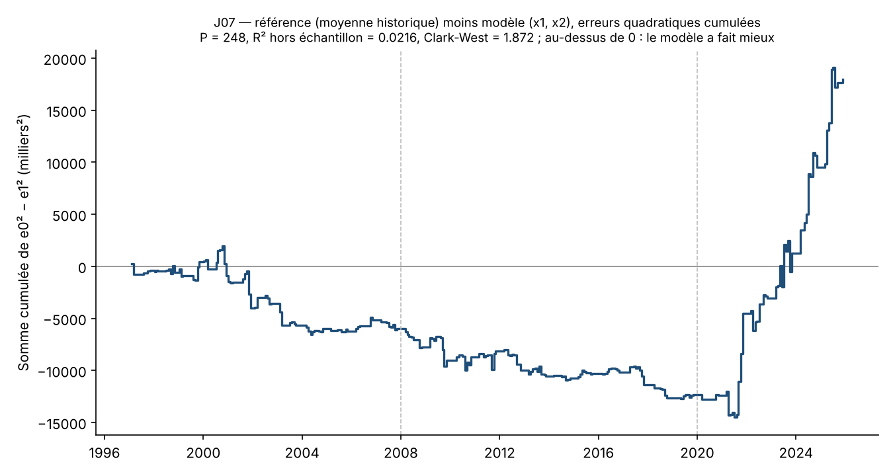

# J07 — Rapport de l'expérimentateur

Rôle : expérimentateur. Ce rapport décrit ce qui a été fait et les nombres obtenus. Il ne contient pas de verdict : les
nombres de `temoin.json` ne sont qu'un témoin, le verdict est calculé ailleurs à partir des nombres du vérificateur.

Préinscription exécutée : `preenregistrement.md`, sha256 `2122df8e83b17a5dfdcfbbdce6bd5cc928507ee0590bb969d874d9075dc92fc3`
(identique au fichier `.sha256`, ni l'un ni l'autre n'a été modifié).

## 1. Ce qui a été fait

1. **D1** (2026-11-12, 21:11 UTC) : page `downloaddata?seid=PAYEMS` téléchargée par `curl`. Le menu
   `form[selected_vintage_dates][]` compte 861 dates ; **438** sont comprises entre 1989-12-01 et 2026-03-31, de 1989-12-08 à
   2026-03-06.
2. **D2** (`telecharger.py`, 21:12-21:14 UTC) : les 438 millésimes de `PAYEMS`, par 37 requêtes groupées de 12 millésimes au
   plus (la dernière en compte 6), syntaxe `alfredgraph.csv?id=PAYEMS,…&vintage_date=…`. L'en-tête de chaque réponse a été
   contrôlé (une colonne `PAYEMS_AAAAMMJJ` par date demandée, dans l'ordre). Toutes ont réussi au premier essai ; aucune
   réponse vide, aucun millésime manquant. Rien n'a été repris du dossier `H13/` (interdit par la préinscription, section 4 et
   B4). Fichiers, URL, heures, sha256 et nombres de lignes : `donnees/PROVENANCE.md`.
3. **Construction** (`construire.py`, depuis `donnees/` seul) : étapes 1 à 6 de la section 4, fichier `J07_analyse.csv`
   (431 lignes, 18 colonnes), puis relecture du fichier écrit et exécution des huit contrôles de schéma de la section 5 :
   **tous passent, `schema_ok` = 1** (détail dans `construire_controles.json`). En particulier, contrôle 5 (datation) : sur
   chaque ligne, `date_millesime_precedent` < `date_publication`, `date_info_predicteurs` = `date_publication` (A1, R1, R2 sont
   lus dans v, T dans prec(v)), et `date_millesime_3e` > `date_publication` et ≤ 2026-03-31.
4. **Analyse** (`analyse.py`) : prévisions récursives, Clark-West, R² hors échantillon, REQM, puis S1 à S3. Prévisions ligne à
   ligne dans `previsions.csv`, résultats complets dans `analyse_resultats.json`.

## 2. Reconstruction des publications

- 438 millésimes → 3 corrections (2002-12-09, 2003-10-10, 2020-05-11) → **435 publications**, dont **431** datées du
  1990-01-01 au 2025-12-31. Exactement les décomptes attendus.
- Ligne de contrôle du 1990-02-02 : mois 1990-01, A1 = 275, v3 = 1990-04-06, A3 = 361, N = −86. Conforme.
- 41 publications de révision large entre 1990 et 2026 : les révisions de référence (juin jusqu'en 2003, février ensuite),
  plus 1990-09-07, 1996-10-04, 2003-01-10, 2010-03-05, 2020-06-05.

## 3. Échantillon à chaque filtre

| Filtre (appliqué dans cet ordre) | Avant | Écartées | Après |
|---|---|---|---|
| `complet` = 1 | 431 | 0 | 431 |
| `n_mois_nouveaux` = 1 | 431 | 1 (2025-12-16) | 430 |
| `revision_large` = 0 | 430 | 118 | 312 |
| `extreme` = 0 | 312 | 3 | **309** |

Comptes non séquentiels : `complet` = 0 : 0 ligne ; `n_mois_nouveaux` = 2 : 1 ; `revision_large` = 1 : 119 ; `extreme` = 1 : 6.
Dates où `extreme` = 1 : 2020-04-03, 2020-05-08, 2020-06-05, 2020-07-02, 2020-08-07, 2020-09-04 (les trois premières ont aussi
`revision_large` = 1).

**`n_admissibles` = 309**, du 1990-01-05 au 2025-11-20.

## 4. Statistique principale (section 6)

Ensemble d'apprentissage S_i = lignes admissibles dont la troisième estimation est publiée au plus tard le jour de i ;
prévision dès que S_i compte 60 lignes. Première prévision : **1997-02-07** (60 lignes d'apprentissage) ; dernière :
2025-11-20 (307 lignes d'apprentissage). **P = 248.**

| Champ | Valeur |
|---|---|
| `schema_ok` | 1 |
| `n_admissibles` | 309 |
| `n_previsions` | 248 |
| `premiere_prevision_aaaammjj` | 19970207 |
| `cw_stat` | 1,871964 |
| `r2_hors_echantillon` | 0,021568 |
| `reqm_reference_k` | 57,9221 milliers |
| `reqm_modele_k` | 57,2941 milliers |

- f̄ = 133,18 ; Ω (Newey-West, Bartlett, 4 retards, sans correction) = 1 255 201 ; `statsmodels` donne la même statistique
  (1,8719644).
- Gain en REQM : 57,922 − 57,294 = 0,628 millier d'emplois. Le R² hors échantillon (2,16 %) est sous les 5 % de la fiche.
- Coefficients de la dernière prévision : constante −6,41 ; x1 +0,0346 ; x2 −0,2006.

## 5. Analyses secondaires — DESCRIPTIVES, sans effet sur le verdict

**S1. Chaque prédicteur seul** (mêmes 248 lignes) :

| Modèle | R² hors échantillon | Clark-West | REQM modèle |
|---|---|---|---|
| (1, x1) écart à la tendance | −0,0092 | −1,155 | 58,187 |
| (1, x2) somme des révisions | +0,0246 | +2,116 | 57,205 |
| (1, x1, x2) principal | +0,0216 | +1,872 | 57,294 |

**S2. Sous-périodes** (prévisions inchangées) :

| Morceau | P | R² hors échantillon | Clark-West | REQM référence | REQM modèle |
|---|---|---|---|---|---|
| avant 2008-01-01 | 94 | −0,0282 | −0,749 | 47,57 | 48,23 |
| 2008-01-01 à 2019-12-31 | 107 | −0,0219 | −1,103 | 51,95 | 52,51 |
| ≥ 2020-01-01 | 47 | +0,0916 | +3,720 | 83,87 | 79,94 |

**Figure** (`figure.png`) : somme cumulée de e0² − e1² (référence moins modèle) par date de publication ; au-dessus de zéro, le
modèle a cumulé moins d'erreur quadratique que la moyenne historique. La courbe descend de 1997 à 2021 (environ −14 500 au
plus bas, mi-2021), puis remonte fortement de 2021 à 2025 pour finir à +17 945. Tout le gain cumulé de l'échantillon complet
vient des prévisions faites après 2020 ; sur 1997-2019 le modèle fait moins bien que la référence.

**S3. Dans l'échantillon, à la Neumark et Wascher** (MCO sur les 309 lignes admissibles ; erreurs types Newey-West, Bartlett,
4 retards, sans correction de petit échantillon) :

| Coefficient | Estimation | Erreur type | t |
|---|---|---|---|
| constante | −6,198 | 3,734 | −1,660 |
| x1 | +0,0343 | 0,0282 | +1,218 |
| x2 | −0,2022 | 0,0882 | −2,292 |

R² dans l'échantillon = 0,0427 ; moyenne de y = −8,71 milliers ; écart-type de y = 58,53 (n − 1). Coefficients b(i) de la
dernière prévision (2025-11-20) : −6,414 ; +0,0346 ; −0,2006. Le R² dans l'échantillon (4,3 %) est environ deux fois le R²
hors échantillon (2,2 %). Le signe de x2 est celui qu'annonçait la préinscription (négatif) ; x1 est positif et faible.

## 6. Difficultés

1. **Conflit de consignes sur la réutilisation de H13.** L'orchestrateur permettait de copier les millésimes bruts de H13 ;
   la préinscription l'interdit. Tout a été retéléchargé ; aucun fichier de `H13/` n'a été ouvert.
2. **Emplacement des bruts** : `donnees/` (consigne de livraison) au lieu de `brut/` (préinscription) ; `brut` est un lien
   symbolique vers `donnees/`. Voir `ecarts.md`, É1.
3. **Septembre 2025.** À cause de la fermeture fédérale de l'automne 2025, la règle mécanique donne pour la publication du
   2025-11-20 (septembre) v3 = 2025-12-16, la publication double, 26 jours plus tard ; la valeur de septembre y est en pratique
   sa dernière estimation mensuelle (deuxième), non une troisième. Appliqué tel qu'écrit ; ligne admissible et prévue ;
   contribution +291 à Σ(e0² − e1²). Voir `ecarts.md`.
4. **Première prévision en 1997**, alors que la préinscription l'attendait « vers 1996 » ; la phrase type de la section 11
   (« de 1996 à 2025 ») ne correspond donc pas aux dates : 1997-02-07 à 2025-11-20.
5. **Réseau** : aucune difficulté ; ALFRED a répondu du premier coup aux 37 requêtes groupées et à la page D1.
6. Deux ambiguïtés mineures (corrections comme publications de révision large ; correction de petit échantillon en S3)
   tranchées par la lecture littérale ; la première ne change rien, la seconde ne touche que S3 (`ecarts.md`).

## 7. Fichiers

`donnees/` (bruts + `PROVENANCE.md`), `brut` (lien), `telecharger.py`, `journal_telechargement.csv`, `construire.py`,
`construire_controles.json`, `J07_analyse.csv` (sha256 `8b9f5299a14813b93a298021a10410eda4b1205e0bc0d473ec8b221faf8f369d`),
`analyse.py`, `analyse_resultats.json`, `previsions.csv`, `temoin.json`, `figure.png`, `ecarts.md`.
