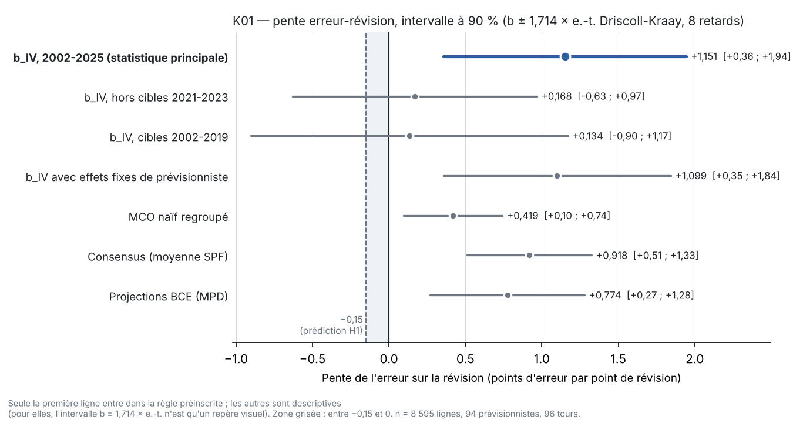

# K01 — Rapport de l'expérimentateur

Session du 2026-11-13. J'exécute la préinscription scellée (`preenregistrement.md`, sha256
`0808bd18…33cc`, inchangé). Je ne rends pas de verdict : les chiffres ci-dessous ne sont qu'un témoin ; le chiffre qui compte
est celui du vérificateur. Les écarts de forme et les lectures sont dans `ecarts.md`.

## 1. Ce que j'ai fait

1. **Téléchargement** (`telecharger.py`) : l'archive des microdonnées de l'enquête, 97 séries annuelles MPD
   (`A01`, puis `W`, `G`, `S`, `A` de 2002 à 2025) et la série Eurostat `prc_hicp_ainr` (`RCH_A_AVG`, `TOTAL`, `EA`).
   Jusqu'à 10 essais, 120 s par essai, 10 s entre essais (section 5). Les 99 fichiers sont arrivés au premier essai, HTTP 200.
   Fichiers bruts non modifiés dans `donnees/` ; journal dans `construire_journal.json` ; table dans `donnees/PROVENANCE.md`.
2. **Construction** (`construire.py`, à partir de `donnees/` seul) : `K01_analyse.csv`, 22 colonnes dans l'ordre préinscrit,
   tri `source, id_prev, t_tour, annee_cible`. Les 12 contrôles de schéma sont refaits sur le fichier écrit ; j'ai vérifié
   qu'ils détectent des altérations volontaires (une révision, un `echantillon_iv`, un `nb_tours_complets`, un `realise`, un
   `mois_titre` modifiés font échouer respectivement les contrôles 10, 12, 12, 10-11 et 5).
3. **Analyse** (`analyse.py`, à partir du seul fichier d'analyse) : estimateur et écart-type de Driscoll-Kraay codés à partir
   des formules de la section 7 (moyennes retirées par horizon, b_IV = Σ z̃ẽ / Σ z̃x̃, sommes par tour, LRV₈ à poids de
   Bartlett 1 − j/9, sans correction de petit échantillon). Écrit `temoin.json`, `analyse_details.json`, `figure.png`.
4. **Contrôle croisé** (`controle_croise.py`, hors préinscription) : b_IV par `linearmodels.IV2SLS` = 1,1507054171654 ;
   b_IV et écart-type de Driscoll-Kraay par le sandwich matriciel complet (indicatrices d'horizon comprises) =
   1,1507054171654 et 0,4633528453600 ; MCO naïf et son écart-type par statsmodels `hac-groupsum` = 0,419426 et 0,188360.
   Identiques à mes valeurs.

## 2. Échantillon à chaque filtre

| Étape | Lignes |
|---|---|
| `1_HICP.csv` (copie à la racine de l'archive), toutes lignes | 354 060 |
| `table_name` = `Point` | 31 983 |
| identifiant numérique (exclut `AGG`, `ECB`) | 31 235 |
| types `A_YEAR_0/1/2_AHEAD` | 16 307 |
| tours 2001Q4-2025Q4 → lignes SPF du fichier | **14 255** (5 457 / 5 346 / 3 452 par horizon ; 97 tours ; 106 identifiants) |
| lignes BCE (97 millésimes × années Y, Y+1, Y+2 de statut `F`) | **291** |
| SPF, horizon 0 ou 1, tours 2002T1-2025T4, cible ≤ 2025 | 10 474 |
| … dont avec révision | 8 873 |
| … dont avec révision et instrument | 8 663 (105 identifiants) |
| … et `nb_tours_complets` ≥ 8 → **échantillon E** | **8 595** (94 prévisionnistes, 96 tours, 24 années cibles ; 4 393 horizon 0, 4 202 horizon 1 ; 47 à 108 lignes par tour, médiane 92) |
| E hors cibles 2021-2023 (E') | 7 425 (88 tours) |
| E, cibles 2002-2019 | 6 269 |
| cellules consensus / BCE | 188 / 188 (96 horizon 0, 92 horizon 1) |

Tous ces comptes sont exactement ceux annoncés par la préinscription. `n_violations_schema` = 0 (12 contrôles sur 12
satisfaits).

## 3. Statistique principale (règle préinscrite)

| Champ | Valeur |
|---|---|
| n_obs_iv / prévisionnistes / tours | 8 595 / 94 / 96 |
| **b_iv** | **1,150705** |
| et_b_iv_dk8 (Driscoll-Kraay, 8 retards) | 0,463353 |
| t_iv | 2,483 |
| **intervalle à 90 % (± 1,714 × et)** | **[0,356519 ; 1,944892]** |
| marge_indecision | −0,506519 |
| coef_premiere_etape (π) | 0,496125 (et 0,021889) |
| f_premiere_etape | 513,72 |
| t_forme_reduite (Anderson-Rubin) | 2,592 (ρ = 0,570894) |
| et_b_iv_grappes_tour (96 groupes, descriptif) | 0,460128 |
| et_b_iv_grappes_cible (24 groupes, descriptif) | 0,292651 |

**Garde de l'épisode 2021-2023 (E')** : n = 7 425 ; b_iv_hors_2021_2023 = 0,168348 ; et = 0,466177 ; borne haute à 90 % =
0,967375 ; f_premiere_etape_hors_2021_2023 = 315,45 ; conflit_episode = 0.

En nombres : l'estimation ponctuelle est positive (une révision d'un point est suivie, en moyenne, d'une erreur de +1,15 point
dans le même sens) ; l'intervalle à 90 % est entièrement au-dessus de 0 et ne contient pas −0,15 ; la première étape est très
forte (F ≈ 514, bien au-dessus de 23,1). Hors cibles 2021-2023, la pente reste positive mais beaucoup plus petite (0,17) et
son intervalle contient 0 et −0,15. L'application de la règle revient à `verdict.py`, sur les chiffres du vérificateur.

`figure.png` : b_IV et son intervalle à 90 % (en bleu, seule ligne qui entre dans la règle), puis les pentes descriptives (en
gris) ; zone grisée entre −0,15 (prédiction de la fiche) et 0.

## 4. Analyses secondaires — **descriptives, hors verdict**

| Analyse (descriptive) | Valeur |
|---|---|
| b_iv_max_sans_une_annee (24 retraits d'une année cible) | 1,319787 (sans 2009) ; minimum 0,894887 (sans 2023) ; sans 2022 : 0,953323 ; sans 2021 : 1,261195 |
| b_iv_ef_prev (effets fixes de prévisionniste) | 1,099004 (et DK8 0,434192) |
| b_mco_naif (MCO regroupé, constante par horizon) | 0,419426 (et DK8 0,188360) |
| b_intra_tour_naif (statistique de la fiche, cellules tour × cible) | −0,452042 (et groupé par tour 0,065594) |
| sigma_bruit_necessaire_mco | 0 (pente MCO positive : max(0, −b) = 0) |
| sigma_bruit_commun_necessaire_iv | 0 (b_IV positif) |
| Avant 2020 (cibles ≤ 2019) : n_obs_avant_2020 | 6 269 |
| b_iv_avant_2020 | 0,133758 (et DK8 0,604449) |
| b_mco_ef_avant_2020 (à côté de −0,169 (0,182) de Broer et Kohlhas) | 0,043285 (et DK8 0,094860) |
| Consensus : n / b / et DK8 | 188 / 0,917537 / 0,238283 |
| BCE (MPD) : n / b / et DK8 | 188 / 0,774347 / 0,294082 |
| Écart BCE − consensus / et DK8 | −0,143191 / 0,146167 |
| b_consensus_hors_2021_2023 (164 cellules) | 0,514872 (et DK8 0,207210, non préinscrit) |
| b_bce_hors_2021_2023 (164 cellules) | 0,162106 (et DK8 0,118561, non préinscrit) |

Remarques descriptives, sans interprétation de verdict :
- La pente naïve intra-tour (−0,452) est proche de −1/2. Phrase demandée par la préinscription : **elle mesure l'évolution
  de la dispersion des prévisions, pas leur justesse.**
- Les bornes de bruit valent 0 parce que les pentes MCO et IV sont positives : aucun bruit de saisie (propre ou commun) n'est
  nécessaire pour produire une pente positive, la formule n'en demande que pour une pente négative.
- Moments de E : révision moyenne 0,053 (écart-type 0,496 ; 22,2 % de révisions nulles) ; instrument moyen 0,051 (0,496 ;
  22,4 % nulles) ; erreur moyenne 0,290 (1,370) ; corrélation révision-instrument 0,493.
- L'écart-type par année cible (24 groupes, 0,293) est plus petit que celui de Driscoll-Kraay (0,463) pour la statistique
  principale ; hors 2021-2023 c'est l'inverse (0,420 contre 0,466 pour DK, 21 groupes).
- Pour les pentes agrégées, la section 8 de la préinscription rappelle ce qu'on ne peut pas conclure : un écart BCE −
  consensus de −0,14 avec un écart-type de 0,15 n'établit ni une égalité ni une différence.

## 5. Difficultés et incidents

- **Réseau** : aucun échec. L'API de la BCE a répondu en 10 à 15 s par série ; les 97 séries ont pris environ 17 minutes.
  Archive et fichier Eurostat identiques (sha256) à ceux de la préinscription ; même date de mise à jour Eurostat (17/09/26).
- **Construction** : une erreur de programmation (tableau en lecture seule dans pandas) au premier lancement, corrigée ; aucune
  incidence sur les données.
- **Formules incomplètes** : le dénominateur des écarts-types MCO n'est pas écrit (É4) ; les retards de LRV₈ quand des tours
  manquent dans E' (É7, lecture littérale appliquée, lecture alternative chiffrée, différence < 0,001 sur l'écart-type).
- **Vu avant calcul** : en inspectant le format des fichiers, j'ai vu les cinq premières lignes de la série MPD `A01`
  (années 1999-2003) et les premières lignes Eurostat (1997-2002). Rien n'a été réglé après coup : le code de construction et
  d'analyse était écrit avant le premier calcul de la statistique et n'a été modifié ensuite que pour la mise en page de la
  figure.
- Python 3.13, numpy, pandas, statsmodels, linearmodels (contrôle croisé seulement), matplotlib.

## 6. Fichiers

`donnees/` (99 fichiers bruts + `PROVENANCE.md`), `construire_journal.json`, `telecharger.py`, `provenance.py`,
`construire.py`, `construire_controles.json`, `K01_analyse.csv`, `analyse.py`, `analyse_details.json`, `temoin.json`,
`figure.png`, `controle_croise.py`, `controle_croise.json`, `ecarts.md`, ce rapport.
