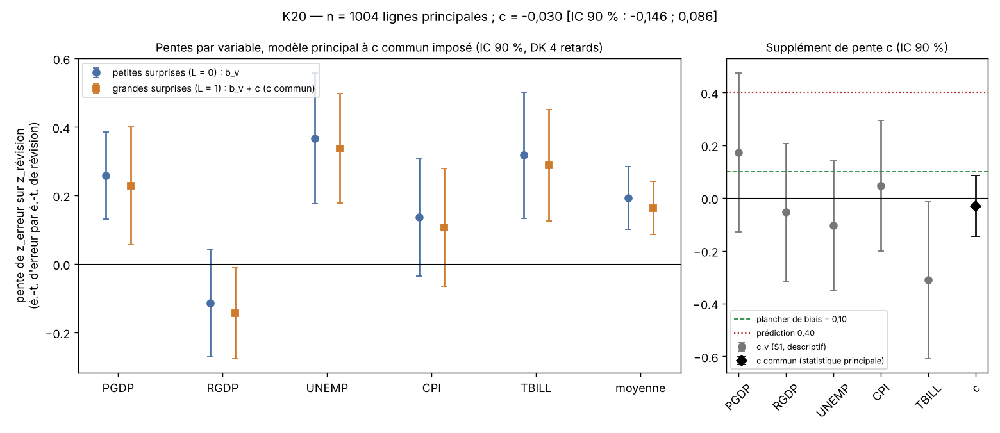

# K20 — rapport de l'expérimentateur

Ce rapport décrit l'exécution de la préinscription scellée `preenregistrement.md` (sha256
`2c34e6f5…51ad7`, vérifié identique au fichier `.sha256` avant tout travail). Les chiffres ci-dessous sont un **témoin** :
le chiffre qui compte est celui du vérificateur. Je n'écris pas de verdict.

## 1. Ce que j'ai fait

1. **Téléchargement** (`telecharger.py`) : les 9 fichiers de la section 4, plus FRED `USRECQP` pour vérifier les fenêtres
   d'épisodes. Tous en HTTP 200 au premier essai, le 2026-11-12 vers 23 h 56 UTC. Sha256, date, code et taille dans
   `construire_journal.json` et `donnees/PROVENANCE.md`. Aucun fichier ne manque.
2. **Construction** (`construire.py`, lit `donnees/` seulement) : `K20_analyse.csv`, 1 038 lignes × 28 colonnes, selon la
   section 5, puis les 12 contrôles de schéma de la section 5.
   - Prévisions : colonne 5 de l'enquête t − 3, colonne 6 de l'enquête t − 4, colonne 2 de l'enquête t − 4, moyennes
     (`meanGrowth` pour `PGDP`, `RGDP` ; `meanLevel` pour `UNEMP`, `CPI`, `TBILL`) et médianes pour les colonnes 10-11.
   - Réalisés `PGDP`, `RGDP` : premier millésime de numéro > t où les lignes t et t − 1 sont remplies ; taux annualisé.
     Les délais obtenus sont t + 1 partout sauf t + 2 pour 1995T4, 2025T3 et 2025T4, comme annoncé.
   - Réalisés `UNEMP`, `TBILL`, `CPI` : moyennes trimestrielles de 3 mois du dernier millésime FRED ; `CPI` en taux
     annualisé de la moyenne trimestrielle.
   - Q_v et L calculés sur la `surprise` telle qu'écrite dans le fichier.
3. **Analyse** (`analyse.py`, lit `K20_analyse.csv` seulement) : étapes 1 à 5 de la section 6, écart-type de
   Driscoll-Kraay codé à la main (scores sommés par trimestre cible, trimestres vides compris, Bartlett, sans correction
   de petit échantillon), biais mécanique, sept exclusions d'épisodes, analyses secondaires S1 à S7. Sorties :
   `temoin.json` (53 champs de `champs_verification`), `resultats_detail.json` (b_v, α_v, δ_v, Q_v, a, A, t des
   exclusions…), `figure.png`.

## 2. Échantillon à chaque filtre

| | `PGDP` | `RGDP` | `UNEMP` | `CPI` | `TBILL` | Total |
|---|---|---|---|---|---|---|
| Grille (lignes) | 228 | 228 | 228 | 177 | 177 | **1 038** |
| `complete` = 1 | 223 | 223 | 222 | 175 | 177 | **1 020** |
| `principal` = 1 | 223 | 215 | 214 | 175 | 177 | **1 004** |
| dont L = 1 | 74 | 72 | 71 | 58 | 59 | **334** |

- Grille → complete (−18) : `prev_h4` vide pour `PGDP`, `RGDP`, `UNEMP` × 1970-Q1, 1970-Q2, 1970-Q3, 1971-Q1, 1975-Q3
  (15 lignes) ; `realise` vide pour `UNEMP` 2025-Q4, `CPI` 2025-Q4, `CPI` 2026-Q1 (3 lignes, octobre 2025 manquant).
  Aucune `surprise` vide.
- Complete → principal (−16) : `RGDP` et `UNEMP`, cibles 2020-Q1 à 2021-Q4.
- 223 trimestres cibles distincts (1969-Q4 à 2026-Q3 ; manquent 7880-7882, 7884 et 7902) ; 184 trimestres ont au moins une
  ligne L = 1.
- Lignes principales par épisode : E1 15, E2 27, E3 60, E4 35, E5 40, E6 55, E7 69 ; hors épisode 703.

Tous ces comptes sont exactement ceux annoncés par la préinscription.

**Contrôles de schéma** : 11 sur 12 passent. Le contrôle 9 échoue sur une ligne (`CPI` 2026-Q1 : `niveau_cible` présent,
`niveau_avant` vide à cause d'octobre 2025). D'où `n_violations_schema` = 1. Voir `ecarts.md`, en tête : la préinscription
annonçait ce contrôle comme satisfait par la structure des sources ; il ne l'est pas. Cette ligne n'entre dans aucune
régression.

## 3. Statistique principale (témoin)

Réduction (étape 1), écarts-types sur les lignes principales :

| | s_r (révision) | s_e (erreur) | k_v | Q_v (|surprise|, 2/3) | b_v (petites) | b_v + c (grandes) |
|---|---|---|---|---|---|---|
| `PGDP` | 0,419 | 1,800 | 0,233 | 1,033 | 0,259 | 0,229 |
| `RGDP` | 0,591 | 2,810 | 0,210 | 1,602 | −0,113 | −0,143 |
| `UNEMP` | 0,314 | 0,714 | 0,440 | 0,147 | 0,367 | 0,338 |
| `CPI` | 0,298 | 2,180 | 0,137 | 0,992 | 0,137 | 0,107 |
| `TBILL` | 0,514 | 1,139 | 0,451 | 0,095 | 0,318 | 0,288 |

| Champ | Valeur |
|---|---|
| `n_principal` | 1 004 |
| **`c`** | **−0,0298** |
| `et_c_dk4` | 0,0707 |
| `t_c` | −0,42 |
| IC 90 % | [−0,1461 ; 0,0865] |
| `b_moyen` | 0,1936 |
| `pente_moyenne_grandes` | 0,1638 |
| `k_moyen` | 0,2943 |
| a, A (variance de z_r, L = 0 / L = 1) | 0,5689 ; 1,7430 |
| `rapport_variance_revision` | 3,064 |
| `biais_mecanique_nu20` | 0,0807 |
| `seuil_survie_bas` | 0,10 |
| `borne_basse_moins_seuil` | −0,2461 |
| `marge_indecision` | −0,3135 |
| `et_c_iid` | 0,0639 |
| `n_effectif` | 819,8 |
| `n_grands` / `n_trimestres` / `n_trimestres_grands` | 334 / 223 / 184 |

Exclusions d'épisodes (garde de robustesse, même z, même L) :

| Retiré | n | c_(−k) | t_(−k) |
|---|---|---|---|
| E1 1969T4-1971T4 | 989 | −0,0325 | −0,45 |
| E2 1973T4-1976T1 | 977 | −0,0837 | −1,52 |
| E3 1980T1-1983T4 | 944 | +0,0142 | +0,15 |
| E4 1990T3-1992T1 | 969 | −0,0206 | −0,28 |
| E5 2001T1-2002T4 | 964 | −0,0277 | −0,39 |
| E6 2007T4-2010T2 | 949 | −0,0074 | −0,11 |
| E7 2019T4-2023T4 | 935 | −0,0267 | −0,34 |

`t_min_sans_episode` = −1,52 (`episode_t_min` = 2, soit E2) ; `c_min_sans_episode` = −0,0837 ; `conflit_robustesse` = 0.

Pour situer ces nombres face aux seuils écrits (sans en tirer de verdict) : la borne haute de l'IC 90 % (0,0865) est sous
0,40 et sous le plancher 0,10 ; la borne basse (−0,146) est sous 0 ; le rapport de variances (3,06) dépasse 1,25.

## 4. Analyses secondaires — descriptives, hors verdict

Toutes reprennent les étapes 3 à 5 avec les z et le L de l'échantillon principal (sauf S6 et S7, comme préinscrit).

| Analyse | n | c | é.-t. | t | IC 90 % |
|---|---|---|---|---|---|
| Principal, DK 4 retards (rappel) | 1 004 | −0,0298 | 0,0707 | −0,42 | [−0,146 ; 0,087] |
| S2 — DK 8 retards | 1 004 | −0,0298 | 0,0682 | −0,44 | [−0,142 ; 0,082] |
| S2 — DK 0 retard | 1 004 | −0,0298 | 0,0731 | −0,41 | [−0,150 ; 0,091] |
| S3 — avec la pandémie | 1 020 | −0,0949 | 0,0739 | −1,29 | [−0,217 ; 0,027] |
| S4 — depuis 1985 | 816 | −0,0669 | 0,0833 | −0,80 | [−0,204 ; 0,070] |
| S5 — avant 2020 (≤ 2019T4) | 888 | −0,0371 | 0,0795 | −0,47 | [−0,168 ; 0,094] |
| S6 — médianes | 1 004 | +0,0746 | 0,0694 | +1,08 | [−0,040 ; 0,189] |
| S7 — coupure de la fiche, \|z_r\| > 1 (217 lignes L' = 1 ; contient le biais de la section 7) | 1 004 | −0,0026 | 0,0856 | −0,03 | [−0,143 ; 0,138] |
| S1 — c_PGDP | 223 | +0,1734 | 0,1832 | +0,95 | [−0,128 ; 0,475] |
| S1 — c_RGDP | 215 | −0,0531 | 0,1585 | −0,34 | [−0,314 ; 0,208] |
| S1 — c_UNEMP | 214 | −0,1033 | 0,1489 | −0,69 | [−0,348 ; 0,142] |
| S1 — c_CPI | 175 | +0,0465 | 0,1510 | +0,31 | [−0,202 ; 0,295] |
| S1 — c_TBILL | 177 | −0,3110 | 0,1803 | −1,72 | [−0,608 ; −0,014] |

(Pour S1, n est le nombre de lignes principales de la variable ; la régression S1 porte sur les 1 004 lignes.)

## 5. Figure

`figure.png`. À gauche : pour chaque variable, la pente de l'erreur réduite sur la révision réduite pour les petites
surprises (b_v, ronds) et pour les grandes (b_v + c, carrés), avec IC 90 % de Driscoll-Kraay à 4 retards, dans le modèle
principal où c est **commun** aux cinq variables ; la colonne « moyenne » montre `b_moyen` et `pente_moyenne_grandes`.
L'écart entre ronds et carrés est donc le même pour toutes les variables, par construction. À droite : c commun (losange
noir, statistique principale) et les c_v libres de S1 (descriptifs), avec le plancher de biais (0,10, tirets) et la
prédiction de la fiche (0,40, pointillés).

## 6. Difficultés rencontrées

1. **Contrôle 9 et octobre 2025** : voir § 2 et `ecarts.md`. C'est la seule anomalie de construction ; elle porte
   `n_violations_schema` à 1 sans toucher aucune régression.
2. **Égalités au quantile** : pour `PGDP`, `UNEMP` et `CPI`, Q_v coïncide exactement avec une |surprise| observée
   ((n_v − 1) × 2/3 entier) ; la règle stricte « > » donne L = 0 à ces trois lignes. Un vérificateur qui calculerait le
   quantile autrement pourrait obtenir 337 grandes nouvelles au lieu de 334. Signalé dans `ecarts.md`.
3. **openpyxl** : le contournement préinscrit est nécessaire et suffit ; les classeurs de l'enquête émettent en plus des
   avertissements sans effet sur les en-têtes et pieds de page.
4. **Réseau** : aucune difficulté ; tous les téléchargements ont réussi au premier essai.
5. **Vérification de l'écart-type** : la préinscription interdit `statsmodels` pour le verdict ; je l'ai utilisé seulement
   pour contrôler mon code sur S4, où aucun trimestre n'est vide. Les deux coïncident à 10⁻¹⁵.
6. **Fenêtres d'épisodes** : vérifiées sur `USRECQP` ; elles correspondent exactement à « pic à creux + 4 trimestres ».
7. **Arrondi des premières médianes** : `prev_h3_med` vaut exactement 0 pour `PGDP` 1969-Q4 (enquête 1969T1 : niveaux
   médians entiers, donc taux nul entre deux horizons égaux). C'est la valeur publiée ; elle n'entre que dans S6, et
   illustre la raison de l'amendement A4.

## 7. Fichiers

- `donnees/` (10 fichiers bruts + `PROVENANCE.md`), `construire_journal.json`
- `telecharger.py`, `construire.py`, `analyse.py`
- `K20_analyse.csv`, `temoin.json`, `resultats_detail.json`, `figure.png`
- `ecarts.md`
