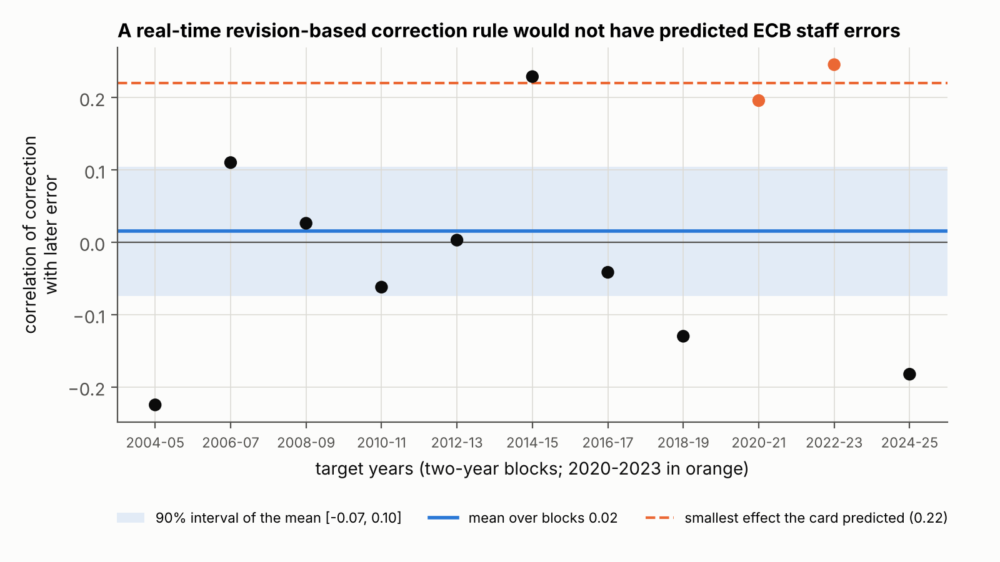
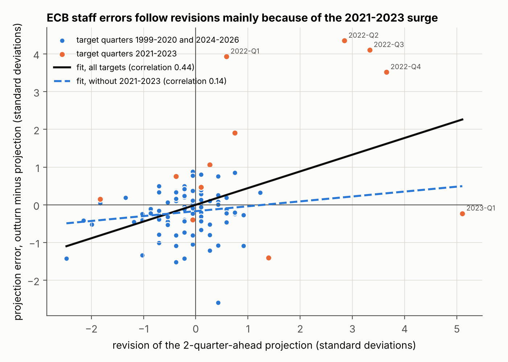
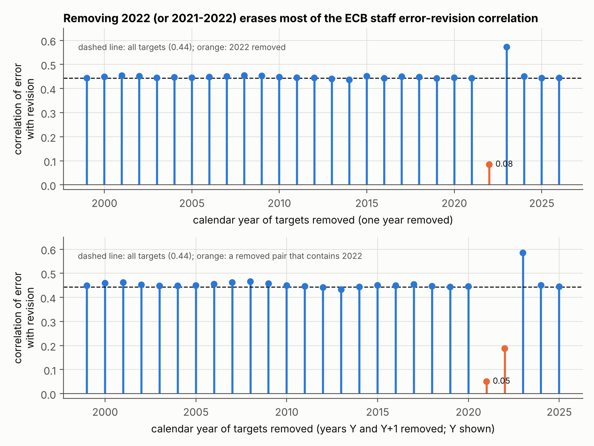
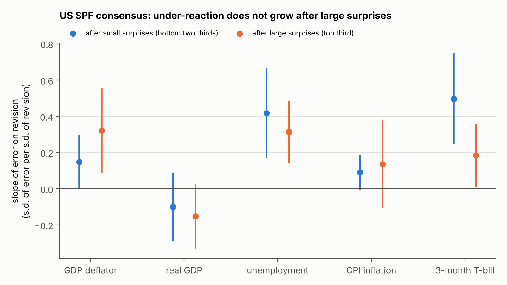

# 1 Introduction

A forecaster under-reacts when news moves the forecast in the right direction but not far enough. The standard
measure is the slope of the forecast error (outturn minus forecast) on the forecast revision (new minus old
forecast for the same target). If forecasts used all available information, the revision could not predict the
error and the slope would be zero. A positive slope is under-reaction: an upward revision is followed, on average,
by inflation higher still. A negative slope is over-reaction.

This matters to a central bank. Staff projections feed policy decisions. If they systematically move too little,
policy based on them may move too little too, and the 2021–2022 surge made that cost visible. And if errors were
predictable from revisions, a simple correction might improve the projections. Whether such a correction would
have worked in real time is a different question from whether a slope exists in a full sample studied after the
fact.

This note reports four tests of the question. Each was preregistered and sealed by a SHA-256 hash before any
statistic was computed. Each verdict was applied by code to numbers recomputed by an independent verifier, and a
separate pipeline then rebuilt every number from raw public data. The answer, in three sentences:

1. A revision-based correction rule estimated in real time would not have predicted the errors of ECB/Eurosystem
   staff inflation projections over 2004–2025.
2. Over 1999–2026, staff errors two quarters ahead do follow revisions, and so do the errors of individual
   forecasters in the ECB Survey of Professional Forecasters (SPF), but in both cases the size of the effect comes
   mostly from the 2021–2023 surge.
3. In the US Survey of Professional Forecasters, the point estimates show no extra under-reaction of the consensus
   after large data surprises, but that test's verdict is inconclusive for a formal reason.

# 2 Related work

**ECB staff projections.** Granziera, Jalasjoki and Paloviita (2021) ran this regression on quarterly ECB staff
inflation projections over targets 1999Q4–2019Q4, on data then confidential. Two quarters ahead they found 0.20
(standard error 0.21) points of error per point of revision: positive, not significant. Their published version
(2025) extends the sample to 2023Q4 but studies bias only. The ECB's own evaluation up to 2024Q1 (Chahad et al.,
2024) rejects "no oversmoothing" up to three quarters ahead in rolling 32-quarter windows, without publishing a
coefficient or sign. At two quarters ahead the rejection disappears once errors are adjusted for technical
assumptions, which an earlier box (Chahad et al., 2022) credits with about three quarters of the 2021 and early
2022 errors. Kontogeorgos and Lambrias (2019) and Conrad, Enders and Müller (2025) find the projections broadly
unbiased and efficient in earlier samples. This note adds one full-sample slope through 2026Q3 on the public
projection database, with a size threshold fixed in advance, and a real-time test of whether the slope was usable.

**Real-time correction.** Eva and Winkler (2023) re-estimate the Coibion–Gorodnichenko regression recursively on US
surveys. The out-of-sample correction usually hurts; for CPI the gain is about 1% of squared error, almost all in
2021–2022. Arai (2014) finds modest gains for the Fed's Greenbook. The project's search found no such real-time
test on ECB staff projections, which is not proof that none exists.

**Consensus versus individuals.** A positive consensus slope is what dispersed, noisy information predicts even
with rational forecasters (Coibion and Gorodnichenko, 2015). Bordalo, Gennaioli, Ma and Shleifer (2020) find that
the US consensus under-reacts while individuals over-react. On the ECB SPF over 2000Q1–2020Q1, Broer and Kohlhas
(2024) find a consensus slope of 0.740 (0.406) and an individual slope of −0.169 (0.182). Kučinskas and Peters
(2024) find strong over-reaction in a within-period version on US data, while noting they cannot rule out
autocorrelated measurement error. Juodis and Kučinskas (2023) show that reporting noise alone pushes individual
slopes negative. Gemmi and Valchev (2026) find neither over- nor under-reaction in the Fed's Greenbook. Andrade and
Le Bihan (2013) document predictable errors in the ECB SPF without this regression.

**Size of news.** Coibion and Gorodnichenko (2015) find less rigidity in turbulent periods. Coibion and
Gorodnichenko (2012) show that in the sticky-information model the normalised response does not depend on shock
volatility. Kučinskas and Peters (2024) find more under-reaction when inflation is high. Baker, McElroy and Sheng
(2020) find less rigidity after large disasters, and de Silva et al. (2025) over-reaction to extreme news in firms'
sales forecasts. No estimate of an extra slope after large surprises on the US SPF consensus was found.

# 3 Data

**ECB Macroeconomic Projection Database (MPD).** One series per projection exercise ("vintage") from the ECB data
API (`MPD/Q.U2.HIC.A.<vintage>.0000`: quarterly year-on-year euro area HICP inflation). The MPD has no publication
timestamp. Each vintage was identified by its letter (W = March, G = June, S = September, A = December), checked
against the exercise name in `TITLE_COMPL` and against the first quarter flagged as projected (`F`). Only values
with status `F` were read as projections. The annual series (`MPD/A.U2.HIC.A.<vintage>.0000`, 97 vintages)
supplied staff projections for annual targets in K01.

**ECB SPF individual forecasts.** `SPF_microdata_by_variable.zip`, file `1_HICP.csv`: point forecasts of annual
average HICP inflation for the current and the next year. Rounds 2002Q1–2025Q4, target years 2002–2025, forecasters
present in at least eight complete rounds: 8,595 revisions, 94 forecasters, 96 rounds.

**Eurostat HICP.** For quarterly targets, the monthly index `prc_hicp_minr` (2015 = 100, ECOICOP v2), with the
outturn computed as the year-on-year change of the quarterly average. For annual targets, the annual average rate
`prc_hicp_ainr`. Both are latest vintages.

**Philadelphia Fed SPF.** Mean forecasts (`meanLevel.xlsx`, `meanGrowth.xlsx`; medians as a check) of the GDP
deflator, real GDP, unemployment, CPI inflation and the 3-month T-bill, three and four quarters ahead, with
annualised growth rates for the deflator and real GDP. Targets 1969Q4–2026Q3 (1982Q3 onward for CPI and the
T-bill); real GDP and unemployment exclude targets 2020Q1–2021Q4. In all, 1,004 rows over 223 target quarters.

**Outturns for K20.** First releases from the Philadelphia Fed real-time data set (`pQvQd.xlsx`,
`routputQvQd.xlsx`) for the deflator and real GDP; the latest FRED vintage of `UNRATE`, `CPIAUCSL` and `TB3MS`,
which are revised little or not at all. `USRECQP` dated the episode windows. ALFRED was checked but is not used by
any test.

**Real-time conventions.** Only H03-v2 is a real-time exercise. There the outturn of a target quarter was read in
the MPD vintage published two quarters later (three or four if missing), and the rule at each vintage used only
pairs whose outturn had been published by then. J02, K01 and K20 are in-sample tests. The ECB exercise of a quarter
is finalised about two months after the SPF round of the same quarter, so the two do not share an information set.

# 4 Method

## 4.1 The four tests

In all tests the revision is the new forecast minus the previous one for the same target, and the error is the
outturn minus the new forecast. Each preregistration fixed three outcomes: *survives*, *eliminated* and
*inconclusive*. "Inconclusive" applies when a data or schema guard fails, or when the 90% interval contains both
"no effect" and the predicted effect.

**H03-v2: real-time correction (ECB staff, horizons 1–4, targets 2004–2025).** At each vintage and horizon, a slope
of error on revision was estimated by OLS on the pairs whose error was already known (at least eight). The announced
correction was that slope times the current revision. The statistic is the mean, over 11 two-year blocks of
targets, of the uncentred correlation between correction and realised error, with a Student-t interval allowing
for similar neighbouring blocks. *Rule*: survive if the lower bound is above 0, the mean outside 2020–2023 is
positive and the geometric mean of block MSE ratios (corrected over published) is below 1. Eliminate if the
interval excludes 0.22, the smallest predicted effect (a 5% fall in squared error).

**J02: full-sample slope (ECB staff, two quarters ahead, 108 targets 1999Q4–2026Q3).** The standardised slope of
error on revision, which equals their correlation, with a Newey-West standard error (4 lags). *Rule*: survive if
the 90% lower bound is above 0, the upper bound is at least 0.40 (the predicted size) and the correlation stays
positive when any two consecutive years of targets are removed. Eliminate if the upper bound is below 0.40.

**K01: individual forecasters (ECB SPF, targets 2002–2025).** A pooled two-stage least squares (2SLS) slope of the
individual error on the individual revision, with a constant per horizon and no time or forecaster fixed effects.
Driscoll-Kraay standard errors (round-level sums, 8 lags), critical value 1.714 (t with 23 degrees of freedom for
24 target years). *Rule*: survive (over-reaction) if the upper bound is below 0 and the slope without targets
2021–2023 is negative. Inconclusive if the first-stage F is below 23.1 or the interval contains both 0 and −0.15,
the predicted slope. Otherwise eliminate, which includes an interval wholly above −0.15.

**K20: large surprises (US SPF consensus, five variables).** A surprise is the gap between a data release,
published between the two surveys that define the revision, and the consensus nowcast of it. "Large" is the top
third of absolute surprises for each variable. The statistic is the extra slope *c* of the standardised error on the
standardised revision after large surprises, with variable-specific constants, class effects and base slopes, and
Driscoll-Kraay standard errors (4 lags in calendar quarters). *Rule*: survive if the 90% lower bound exceeds a
mechanical-bias floor, max(0.10, the bias implied by a 20% noise share), the upper bound is at least 0.40, and
*t* ≥ 1 after removing each of seven recession-based episodes. Inconclusive if any schema check fails, among other
conditions. Otherwise eliminate.

## 4.2 Why an instrument, in plain words

The natural individual test compares forecasters within the same survey round. It cannot work. In a round, every
forecaster faces the same outturn, so a forecaster's error relative to the round average is exactly minus the
deviation of the forecast from that average. The outturn drops out, and the within-round slope depends only on
how the dispersion of forecasts changes between rounds. If dispersion is stable it equals −1/2 by construction,
whatever forecasters do.

The pooled slope keeps the outturn, but a typo or rounding in a reported number enters the revision with a plus
sign and the error with a minus sign. That creates a negative slope even for rational forecasters, and fixed
effects do not remove it.

Each forecaster reports two annual forecasts per round, the current year and the next. News about inflation, such
as an oil price move or a monthly print, moves both; a typo in one number has no reason to appear in the other. So
the revision of target year *y* was instrumented with the same forecaster's revision of the other target year in
the same round. The instrument moves with news but not with the noise in the number evaluated. The forecaster knows
it, so under rationality it cannot predict the error and the 2SLS slope is zero. Noise common to both numbers of a
round is not removed, and the preregistration required reporting how much of it would be needed to explain a
negative slope.

## 4.3 Preregistration and verification

A preregistration author who could see only file headers, column names and counts of present cells wrote the data,
sample, statistic, thresholds, guards, tolerances and verdict rule, with a machine-readable copy of the rule. The
text was then sealed by its SHA-256 hash (Appendix B). An experimenter in a fresh session built the analysis file
and computed every field. A verifier on a different model read only the preregistration and the analysis file and
recomputed everything, without seeing the experimenter's code or numbers. A separate script checked agreement
within the preregistered tolerances and applied the sealed rule to the verifier's numbers.

For this note, a separate pipeline rebuilt the four analysis datasets from the raw files with its own code. It
reproduced all 149 sealed verifier numbers within tolerance and gives the same four verdicts (Appendix A). Every
number below comes from `results/results.json`, except a few block-level and per-year descriptive values from
tables in `results/RESULTS.md` produced by the same run, which are marked.

# 5 Results

| Test | Primary statistic | 90% interval | Sealed verdict |
|---|---|---|---|
| H03-v2, real-time rule | mean block correlation 0.016 (se 0.049) | [−0.074, 0.105] | eliminated |
| J02, full-sample slope | correlation 0.443 (NW se 0.196, *t* = 2.27) | [0.122, 0.765] | survives |
| K01, individuals | 2SLS slope 1.151 (DK se 0.463; first-stage F 514) | [0.357, 1.945] | eliminated |
| K20, large surprises | extra slope *c* = −0.030 (DK se 0.071) | [−0.146, 0.086] | inconclusive (schema guard) |

: Primary statistics and verdicts.

## 5.1 A real-time correction would not have worked (H03-v2)

The rule produced 352 evaluated projections in 11 blocks. The mean block correlation between announced correction
and realised error was 0.016, 90% interval [−0.074, 0.105]. The interval contains zero and lies below 0.22. The
verdict is **eliminated**: the rule estimated in real time did not announce the errors of ECB staff inflation
projections over 2004–2025, and the data exclude, at the 5% level, the smallest effect predicted.

Without the 2020–2023 blocks the mean was −0.030. Over all evaluated rows the corrected projection had 3% less
squared error than the published one (ratio 0.970), but 9.6% more without targets in 2021–2022 (ratio 1.096). In a
typical block the correction made errors larger (geometric mean of block ratios 1.097). It helped in 44.8% of the
projections it changed. The 2024–2025 block had a ratio of 1.81 (`RESULTS.md`): a slope learned during the surge
over-corrected the disinflation. By horizon the mean correlation was 0.145, 0.128, 0.111 and −0.087 (one to four
quarters ahead). The original idea's own test (horizon 4, vintages from 2020, 21 rows) gave an MSE ratio of 1.010
and a Diebold-Mariano-HLN *p*-value of 0.911. A placebo with a two-year-old revision gave 0.075 (se 0.062), below
the preregistered 1.8 standard errors that would have signalled a slow bias.

{width=95%}

## 5.2 Under-reaction in the full sample, carried by 2021–2022 (J02)

Over 108 target quarters, the correlation between revision and error was 0.443 (Newey-West se 0.196, *t* = 2.27),
90% interval [0.122, 0.765]. In raw units, 0.678 points of error per point of revision (se 0.299). The smallest
correlation after removing two consecutive years was 0.050, when 2021–2022 is removed. That is above zero, so the
guard passed, and the verdict is **survives**. In the preregistered wording: over 1999Q4–2026Q3 the errors of the
ECB's two-quarter-ahead inflation projections followed their revisions, compatibly with the 0.40 predicted and
positively whichever two consecutive years are removed. The test does not say whether this comes from
under-reaction, deliberate smoothing or the technical assumptions.

The guard passed by a margin of 0.05. Removing a single year leaves the correlation between 0.43 and 0.46, except
2022 (0.084) and 2023 (0.572; `RESULTS.md`). Without targets in 2021–2023 (96 quarters) it was 0.144 (se 0.065).
Before 2020 (81 quarters) it was 0.134, and the raw slope 0.192 (se 0.111), close to the 0.20 (0.21) of
Granziera et al. (2021) for the same period, here from public data. A small positive correlation outside the surge
is plausible. The 0.40 size exists only with 2021–2022. With 8 lags the standard error was 0.162. A moving-block
bootstrap gave [0.051, 0.592]. In Figure 1, the four target quarters of 2022 have errors of 3.5 to 4.4 standard
deviations, three of them after upward revisions of roughly three standard deviations or more.

{width=95%}

{width=95%}

The two ECB results do not conflict. A slope can exist in a full sample studied after the fact without being
usable in real time, as Eva and Winkler (2023) found for US surveys. Here it came mostly from one episode that no
rule estimated on earlier data could anticipate, and a rule that learned from it then over-corrected.

## 5.3 Individuals under-react too; the naive negative slope is mechanical (K01)

The first stage was strong: coefficient 0.496, F = 514, far above 23.1. The 2SLS slope was +1.151 (Driscoll-Kraay
se 0.463, *t* = 2.48), 90% interval [0.357, 1.945]. The reduced form, a weak-instrument-robust test of a zero slope,
gave *t* = 2.59. The verdict is **eliminated**: the data exclude, at the 5% level, individual over-reaction of the
predicted size. Because the lower bound is also above zero, the preregistered reading is that individual
forecasters under-react as well, so the under-reaction of the consensus and the ECB is not simply an aggregation
effect. This runs against the US pattern of Bordalo et al. (2020), and it must be weighed against 2021–2023.

That weight is large. Without targets 2021–2023 the 2SLS slope was 0.168 (se 0.466, F = 315): positive, far from
significant. The largest slope after removing one target year was 1.320. With forecaster fixed effects it was 1.099
(0.434). Before 2020 the 2SLS slope was 0.134 (0.604), and OLS with forecaster fixed effects 0.043 (0.095), against
−0.169 (0.182) in Broer and Kohlhas (2024). The pre-2020 numbers are too imprecise to contradict them.

The naive within-round slope was −0.452 (se 0.066, clustered by round), close to the −1/2 of Section 4.2. As the
preregistration requires us to write, it measures the change in the dispersion of forecasts, not their accuracy.
The naive pooled OLS slope, 0.419 (0.188), lies below the 2SLS estimate, as reporting noise would predict. Both
noise bounds were zero: with positive pooled slopes there is no negative slope for noise to explain.

On the same annual targets, the consensus slope was 0.918 (0.238) and the ECB staff slope 0.774 (0.294). Their
difference, −0.143 (0.146), is not evidence of equality: the preregistered power analysis put the smallest
detectable difference at 0.5–0.9. Without 2021–2023 the consensus slope was 0.515 and the staff slope 0.162.

{width=95%}

## 5.4 No extra under-reaction after large surprises, but an inconclusive verdict (K20)

The verdict is **inconclusive**. Schema check 9 failed on one row, CPI for target 2026Q1. The check required the
previous-quarter CPI level whenever the current one is present, and it is missing because October 2025 is missing
in FRED. The preregistration had claimed the source structure guaranteed this check without verifying the last
row. The row enters no regression. Experimenter and verifier each judged it correct, but the guard was not
rewritten after the fact, and any schema violation makes the test inconclusive.

The numbers are informative but are not a verdict. On 1,004 rows (334 after large surprises) the extra slope was
*c* = −0.030 (se 0.071), 90% interval [−0.146, 0.086]. The sort worked: revisions were 3.06 times more variable
after large surprises, above the 1.25 relevance threshold. The base slope averaged 0.194 across variables, and 0.164
after large surprises. Without each episode, *c* ranged from −0.084 to 0.014. By variable it ranged from −0.311
(T-bill, se 0.180) to 0.173 (deflator, se 0.183). It was −0.067 since 1985, −0.037 before 2020, −0.095 with the
pandemic quarters, 0.075 with medians, and −0.003 on the original card's cut (absolute standardised revision above
1). The reading written after the verdict, which states that it does not change the verdict, notes that with check
9 passed the rule would have given "eliminated" (upper bound 0.086 < 0.40). Its conclusion is that the consensus's
under-reaction does not grow after large surprises, at least as measured here. That is a reading, not a verdict.

{width=95%}

# 6 Discussion

**What holds.** Three results meet the preregistered standard. A mechanical real-time correction of ECB staff
projections based on revisions would not have helped over 2004–2025, and it raised squared errors in a typical
two-year block. Over 1999–2026, staff errors two quarters ahead are positively correlated with revisions, at a size
compatible with 0.40. Individual ECB SPF forecasters do not over-react as measured by the pooled instrumented slope:
the predicted −0.15 is excluded.

**What does not hold.** The positive results do not describe ordinary times. The J02 correlation falls from 0.44 to
0.05 without 2021–2022. The individual slope falls from 1.15 to 0.17 without 2021–2023, and the staff and consensus
slopes on annual targets fall too. The negative within-round slope, which a naive analysis would read as individual
over-reaction, is a property of the statistic. The idea that bigger news brings more under-reaction gets no support
from the US point estimates, though the formal verdict is inconclusive.

**How the four fit together.** One episode, the 2021–2022 surge, accounts for most of the measured under-reaction
in euro area inflation forecasts over 1999–2026. Staff, consensus and individual forecasters all revised up too
little during it. Without it the slopes are smaller: staff 0.14 on quarterly targets (about two standard errors
above zero) and 0.16 on annual targets, consensus 0.51, individuals 0.17 with a standard error of 0.47. Because the
effect was concentrated in time, a rule learned from the past could not use it, and once learned it over-corrected
the disinflation. The K20 estimates, with an inconclusive verdict, do not suggest a general law in which
under-reaction grows with the size of news. These tests cannot say what was special about 2021–2022. The ECB's own
work points to energy and other technical assumptions (Chahad et al., 2022, 2024), which this project did not test.

**What a central bank could take from this.** (i) A full-sample error-on-revision slope that includes 2021–2022
overstates how projections behave in a typical year; evaluations should report leave-episode-out estimates next to
it. (ii) A simple revision-based correction is not a free improvement: here it would not have predicted errors in
real time, and it hurt after the surge. (iii) "Individual forecasters over-react" is sensitive to measurement: on
the ECB SPF, a statistic without the mechanical component points the other way, in a sample dominated by one
episode. None of this says whether staff should have revised faster in 2021–2022.

# 7 Limitations

1. **One episode drives every positive result.** The J02 guard removed two consecutive years and passed by 0.05.
   The preregistration warned that three years in the same direction could carry the slope through it, and the
   breakdown shows exactly that. J02's survival is a statement about 1999–2026 as a whole.
2. **Under-reaction cannot be told apart from deliberate smoothing.** A positive slope also fits an institution
   that revises in small steps on purpose, an average of rational but differently informed forecasters (Coibion and
   Gorodnichenko, 2015), conditioning on market-based technical assumptions, or autocorrelated shocks. Hence the
   wording "errors follow revisions", not "forecasters are irrational".
3. **The K20 guard failure.** The verdict is inconclusive for a reason unrelated to the hypothesis: a check the
   preregistration called guaranteed was not verified on the last row. Repairing it after seeing the numbers would
   have defeated the purpose of the seal.
4. **Power and standard errors.** J02's standard error (0.196) matched the pessimistic preregistered scenario
   (0.19). K01's (0.463) was worse than the pessimistic scenario (0.40) and decided only because the estimate was
   far from −0.15. K20's (0.071) beat the optimistic scenario (0.10). Newey-West and Driscoll-Kraay errors tend to
   be too small with about 24 independent target years (K01) or 108 overlapping quarters (J02); the J02 bootstrap
   interval keeps the verdict.
5. **The plans were not blind to history.** The preregistrations were written in 2026 by agents who knew the surge,
   the literature and, for K01 and K20, J02's numbers. No outcome data were read before sealing, but design choices
   cannot be proven independent of that knowledge.
6. **Data.** Outturns are latest vintages except in H03-v2 and for US national accounts. Projections are rounded to
   0.1 point, which attenuates slopes. The 1999–2000 MPD vintages were not published at the time with quarterly
   detail. Vintages are identified by letter codes, and a swapped mapping voided the first H03 run. Eurostat
   revisions mean a fresh download may differ slightly. K20 mixes first releases and latest vintages, CPI and the
   T-bill start in 1981, and the pandemic exclusion for real GDP and unemployment is a choice.
7. **Selection across the programme.** These tests came out of a pipeline that tested other ideas. Each verdict is
   a one-sided 5% decision under its own rule, with no correction for the number of ideas tested.

# 8 How this project was run

The project came out of an AI-agent research pipeline run under a fixed protocol. The human set the question, the
constraints (public and free data only, a laptop, a few weeks of part-time work, methods defensible before
economists), the selection criterion (interest to an admissions committee and to recruiters), and took the decision
at every node between stages.

**Proposal and selection.** AI agents from up to four model families (Kimi, Gemini, OpenAI Astra and Claude; the
very first round used Claude models only) proposed ideas as cards in a fixed format, each with a falsifiable
hypothesis, a numerical prediction and a test that would kill it. Judges from the same families ranked the cards
blind to their origin; code sealed before judging aggregated the ranks. Agents then checked the retained ideas
for novelty, recording which sources they had opened, and tested data access.

**Testing.** Each retained idea got a preregistration by a separate agent who saw only headers and counts, sealed
by SHA-256 before any data were read for results. An experimenter agent ran it. A verifier agent on another model
recomputed every number from the analysis file without seeing the experimenter's code. A separate script applied
the sealed verdict rule.

**Generations and errors.** Surviving ideas became parents of the next generation; there were three. A
first-generation idea on the real-time predictability of ECB projection errors became test H03. Its first run was
voided: the preregistration had swapped the June and September vintage letters, and the schema check meant to
catch it read an empty column. The voiding, its reason and the voided run's number (mean correlation −0.06) were
recorded, not erased (`audit/H03/annulation.md`). The test was re-preregistered as H03-v2 before any statistic was
computed under the correct mapping, and was eliminated. In the second generation a Kimi-family agent proposed J02,
motivated by the H03 record, and it survived. In the third, a Claude-family agent proposed K01 and K20 as daughters
of J02.

**This repository** rebuilds the four analyses from raw public files, checks the seals and reproduces all 149
sealed verifier numbers.

**Division of labour.** Agents proposed, judged, checked novelty, wrote preregistrations, ran experiments, verified
and drafted. [To be completed by the author: what the author personally wrote, checked or re-derived; the decision
taken at each node; the models and versions in each role; whether an economist reviewed the results.]

**What the protocol does not guarantee.** The verifier checked computations from the analysis file, not the
construction of that file from raw data; the independent rebuild covers that only insofar as its code was written
separately. [To be completed by the author.]

# References

Andrade, P. and Le Bihan, H. (2013). Inattentive professional forecasters. *Journal of Monetary Economics*, 60(8),
967–982. <https://econpapers.repec.org/RePEc:eee:moneco:v:60:y:2013:i:8:p:967-982>

Arai, N. (2014). Using forecast evaluation to improve the accuracy of the Greenbook forecast. *International
Journal of Forecasting*, 30(1), 12–19. <https://econpapers.repec.org/RePEc:eee:intfor:v:30:y:2014:i:1:p:12-19>

Baker, S. R., McElroy, T. S. and Sheng, X. S. (2020). Expectation formation following large, unexpected shocks.
*Review of Economics and Statistics*, 102(2), 287–303.
<https://econpapers.repec.org/RePEc:tpr:restat:v:102:y:2020:i:2:p:287-303>

Bordalo, P., Gennaioli, N., Ma, Y. and Shleifer, A. (2020). Overreaction in macroeconomic expectations. *American
Economic Review*, 110(9), 2748–2782. <https://econpapers.repec.org/RePEc:aea:aecrev:v:110:y:2020:i:9:p:2748-82>;
NBER WP 24932: <https://www.nber.org/system/files/working_papers/w24932/w24932.pdf>

Broer, T. and Kohlhas, A. N. (2024). Forecaster (mis-)behavior. *Review of Economics and Statistics*, 106(5),
1334–1351. <https://econpapers.repec.org/RePEc:tpr:restat:v:106:y:2024:i:5:p:1334-1351>

Chahad, M., Hofmann-Drahonsky, A.-C., Krause, W., Landau, B. and Sigwalt, A. (2024). The empirical performance of
ECB/Eurosystem staff inflation projections since 2000. *ECB Economic Bulletin*, Issue 5/2024.
<https://www.ecb.europa.eu/press/economic-bulletin/articles/2024/html/ecb.ebart202405_03~492166f5d2.en.html>

Chahad, M., Hofmann-Drahonsky, A.-C., Meunier, B., Page, A. and Tirpák, M. (2022). Box, *ECB Economic Bulletin*,
Issue 3/2022. <https://econpapers.repec.org/article/ecbecbbox/2022_3a0003_3a5.htm>

Coibion, O. and Gorodnichenko, Y. (2012). What can survey forecasts tell us about information rigidities?
*Journal of Political Economy*, 120(1), 116–159. <https://econpapers.repec.org/RePEc:ucp:jpolec:doi:10.1086/665662>

Coibion, O. and Gorodnichenko, Y. (2015). Information rigidity and the expectations formation process: a simple
framework and new facts. *American Economic Review*, 105(8), 2644–2678.
<https://www.aeaweb.org/articles?id=10.1257/aer.20110306>

Conrad, C., Enders, Z. and Müller, G. (2025). Inflation forecast targeting revisited. CEPR DP20467 / CESifo WP
12006. <https://ideas.repec.org/p/ces/ceswps/_12006.html>

de Silva, T., Larsen-Hallock, E., Rej, A. and Thesmar, D. (2025). Expectations formation with fat-tailed
processes: evidence and theory. NBER WP 33808. <https://www.nber.org/system/files/working_papers/w33808/w33808.pdf>

Eva, K. and Winkler, F. (2023). A comprehensive empirical evaluation of biases in expectation formation. FEDS
2023-042. <https://www.federalreserve.gov/econres/feds/files/2023042pap.pdf>

Gemmi, L. and Valchev, R. (2026). Biased surveys. *Journal of Monetary Economics*, 157, 103868. NBER WP 31607:
<https://www.nber.org/system/files/working_papers/w31607/w31607.pdf>

Granziera, E., Jalasjoki, P. and Paloviita, M. (2021). The bias and efficiency of the ECB inflation projections: a
state dependent analysis. Norges Bank Working Paper 1/2021.
<https://www.norges-bank.no/contentassets/7b0610e058b042fab94bd4c3cbe2d8d5/wp_01_2021.pdf?ft=.pdf>

Granziera, E., Jalasjoki, P. and Paloviita, M. (2025). The bias of the ECB inflation projections: a
state-dependent analysis. *Journal of Forecasting*, 44(3), 922–940.
<https://econpapers.repec.org/RePEc:wly:jforec:v:44:y:2025:i:3:p:922-940>

Juodis, A. and Kučinskas, S. (2023). Quantifying noise in survey expectations. *Quantitative Economics*, 14(2),
609–650. <https://pure.uva.nl/ws/files/167529930/quan200274.pdf>

Kontogeorgos, G. and Lambrias, K. (2019). An analysis of the Eurosystem/ECB projections. ECB Working Paper 2291.
<https://www.ecb.europa.eu/pub/pdf/scpwps/ecb.wp2291~6b06275781.en.pdf>

Kučinskas, S. and Peters, F. S. (2024). Measuring under- and overreaction in expectation formation. *Review of
Economics and Statistics*, 106(6), 1620–1637.
<https://econpapers.repec.org/RePEc:tpr:restat:v:106:y:2024:i:6:p:1620-1637>

*Note.* Only references that the project's literature notes record as opened and verified are listed. Standard
estimators named in the text (Newey-West, Driscoll-Kraay, Diebold-Mariano with the Harvey-Leybourne-Newbold
correction, two-stage least squares) are used as defined in the sealed preregistrations; their original papers are
not listed.

# Appendix A: Reproduction summary

The pipeline recomputed every field listed in the sealed verdicts and compared it with the independent verifier's
sealed number, using each preregistration's tolerance (0 for counts; 0.005 for slopes, correlations and standard
errors; 0.01 for interval bounds; 0.02 for *t* statistics; 1 for F statistics and effective sample sizes). The
largest absolute gap on any field was of the order of 10⁻¹².

| Test | Fields within tolerance | Verdict from pipeline numbers | Sealed verdict |
|---|---|---|---|
| H03-v2 | 25 / 25 | eliminated | eliminated |
| J02 | 26 / 26 | survives | survives |
| K01 | 45 / 45 | eliminated | eliminated |
| K20 | 53 / 53 | inconclusive | inconclusive |
| **Total** | **149 / 149** | | |

: Sealed verifier numbers reproduced by the pipeline (field by field in `results/reproduction.md`).

# Appendix B: Audit trail

The preregistrations are kept byte for byte, in French as written, in `audit/<ID>/preenregistrement.md`. Their
seals, recomputed on these copies before writing this note:

| Test | SHA-256 of the sealed preregistration |
|---|---|
| H03-v2 | `ca1b83452e562a4bbb9f4ba309bc1b709ce199b2297d03d2a6e3b599930f6d6d` |
| J02 | `6cbe19eac13e77331aa0bcb7d51cb96f10e0d07c5618e61b2d4b2b35fb441ed0` |
| K01 | `0808bd18fc0f748fe7703773d4e7b53ec640532202560cbaa10383be13c733cc` |
| K20 | `2c34e6f5ff86721f1ae903f2dce8f91d79324d94a909cff19aee569a16451ad7` |
| H03, voided first run | `ea611aca877077d8b5014037d777c31041f8bbf131ced534c7f622e9de9633b7` |

: Seals of the preregistrations.

Each hash also appears as `sceau_preenregistrement` in the test's `verdict.json`, and `run_all.py` stops if a copy
no longer matches. Each `verdict.json` holds the verifier's numbers, the machine-readable rule and, for K20, the
reason for the inconclusive verdict ("condition de non-conclusion tenue : n_violations_schema > 0").
`audit/K20/lecture-apres-coup.md` is the reading written after that verdict and states that it does not change
it. `audit/H03/annulation.md` records why the first H03 run was voided; the verdict script was never run on it,
so it has no verdict file.
