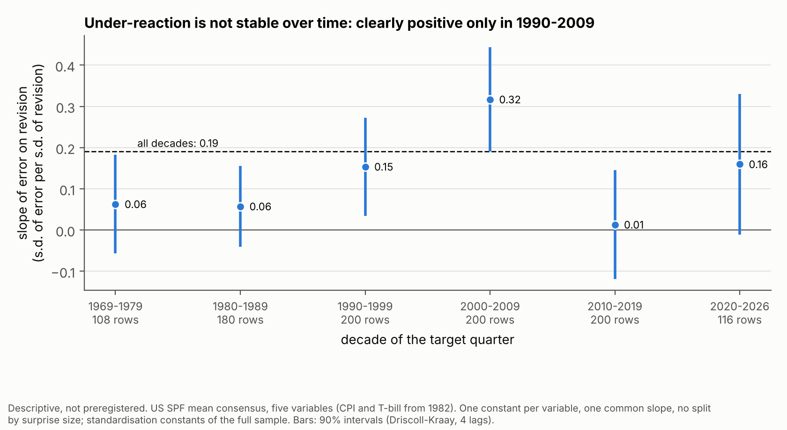
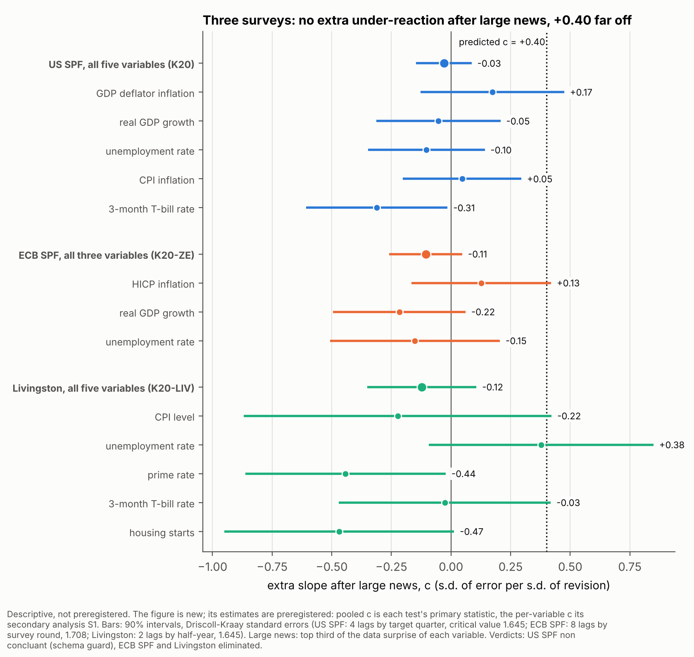
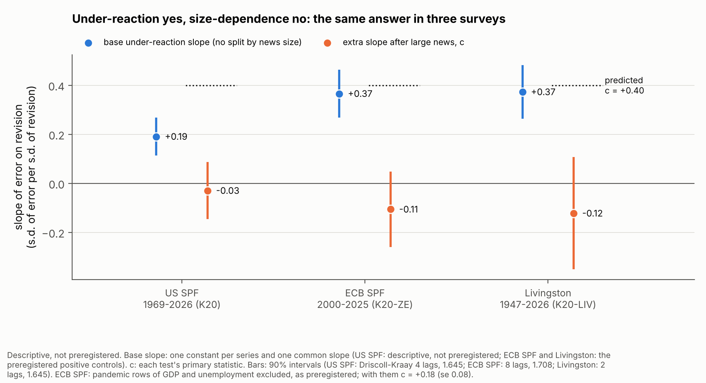
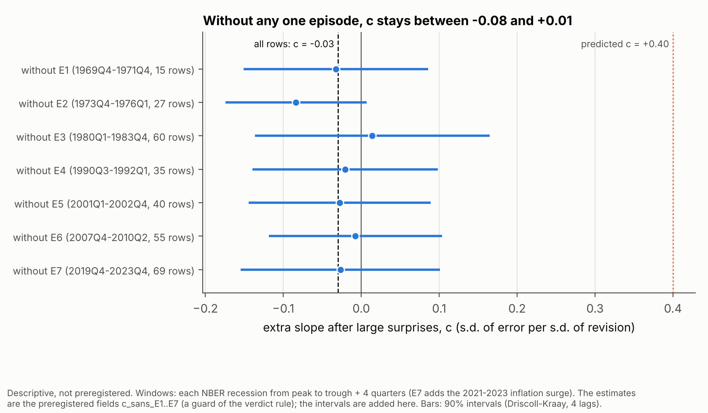
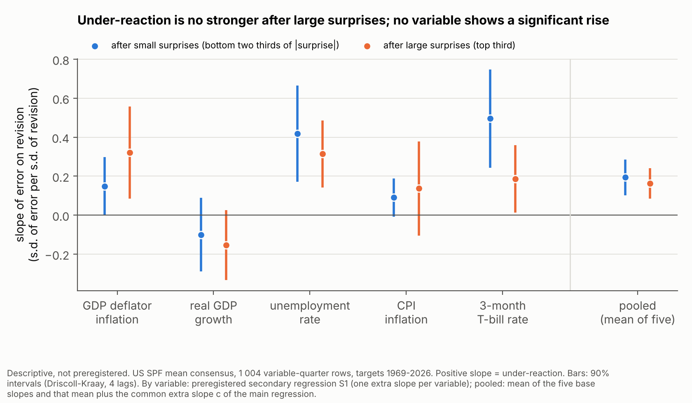

# 1 Introduction

A forecaster under-reacts when news moves the forecast in the right direction but not far enough. The standard
measure is the slope of the forecast error (outturn minus forecast) on the forecast revision (new minus older
forecast for the same target), as in Coibion and Gorodnichenko (2015). If the forecast used all its information,
the revision could not predict the error, and the slope would be zero. A positive slope means under-reaction: after
an upward revision, the outturn ends up higher still.

The consensus of professional forecasters is known to under-react on average. This note asks a narrower question:
**is the under-reaction stronger after large news?** If it were, a big data surprise would leave the consensus
further behind than a small one. The 2021–2022 inflation surge made the question natural: forecasters revised up,
and inflation kept beating them.

The answer matters to two kinds of readers. A rates or macro desk uses the consensus as the benchmark against which
data are read. If the consensus lagged more after large surprises, the size of the last surprise would tell the
desk how stale the consensus is. A central bank that reads survey expectations needs to know whether their
sluggishness depends on the size of shocks.

This note reports three tests. Each was preregistered and sealed by a SHA-256 hash before any statistic was
computed. Each verdict was applied by code to numbers recomputed by an independent verifier. A separate pipeline
then rebuilt every number from raw public data. The answer, in three sentences:

1. Consensus forecasts under-react on average in all three surveys: the slope of the error on the revision is 0.19
   in the US SPF, 0.37 in the ECB SPF and 0.37 in the Livingston Survey.
2. The under-reaction does not grow after large news: the extra slope after large news is −0.03, −0.11 and −0.12.
3. The predicted extra slope of +0.40 is excluded in the two conclusive tests (ECB SPF and Livingston), while the
   first test, on the US SPF, is formally inconclusive because a schema guard failed on a row outside every
   regression.

All slopes are in standard deviations of error per standard deviation of revision. The US base slope is
descriptive; the other two are preregistered positive controls.

# 2 How the question arose

**An AI-assisted pipeline.** The question came out of an AI-agent research pipeline run under a fixed protocol. In
each generation, agents from four model families (Kimi, Gemini, OpenAI Astra and Claude) each proposed five idea
cards in a closed format: a falsifiable hypothesis, a numerical prediction and a test that would kill it. Judges
from the same four families ranked the twenty cards on anonymised copies; code sealed before the judging aggregated
their ranks, and the top five went on. For each retained card an agent checked novelty, recording the sources it
had opened, and tested access to the data. Ideas that survived their tests became parents of the next generation.

**The K20 card.** One parent of the third generation was J02, a test on ECB staff inflation projections. Their
errors two quarters ahead follow revisions (standardised slope 0.443 over 1999–2026), but the slope falls to 0.050
when 2021–2022 is removed. J02 rests on one large shock. A Claude-family proposer asked the next question: is
under-reaction a property of large shocks? The US SPF has five variables and several large shocks since the late
1960s, so each episode can be removed in turn. The card (K20) predicted a base slope of about +0.3 and an extra
slope of about +0.40 (range +0.2 to +0.6) when the standardised revision exceeds one standard deviation. It framed
this as "reluctance to make large revisions", against models in which attention rises with large shocks and the
interaction is negative. K20 ranked second of twenty in the aggregate. Two of the three judges from other families
ranked it third, the Gemini judge tenth; three of the four judges put it on their short list, none on their discard
list. The judges' scores for interest and contribution were high, for novelty low (2 or 3 out of 5).

**The novelty check and the judges' flaws.** The novelty check classed K20 as a "variant". The base slope was
published long ago, and so was its dependence on periods and states, but no estimate of the extra slope after large
news on the SPF consensus was found. The check corrected the card on data (growth rates instead of base-dependent
levels; CPI and the T-bill start in 1981) and stressed its main flaw, also named by two judges: a large revision is
not a large exogenous piece of news, and sorting on the revision creates the interaction through survey noise, in
the direction of the hypothesis (Section 4.3).

**The first test, and why it ended inconclusive.** The K20 preregistration answered these flaws. "Large" became the
top third of the data surprise released between the two surveys; constants, class effects and base slopes became
variable-specific; a floor for mechanical bias and an episode guard entered the rule. K20 ended **inconclusive**.
Schema check 9 failed on one row, CPI 2026-Q1: October 2025 is missing in FRED (no data were collected during the
federal shutdown), so the previous-quarter CPI level is missing. That row has no outturn and enters no regression.
The estimate itself was c = −0.030, 90% interval [−0.146, 0.086].

**Decisive instruments.** The project lead then asked that the next tests be decisive. Two requests reached the
writer of the first replication while it was being drafted: a **positive control**, so that a null extra slope could
not be the silence of an instrument that sees nothing; and a **simulation, before sealing**, showing that the full
rule reaches a decision with probability of at least 0.80 both when the true extra slope is 0 and when it is +0.40.
The writer also fixed K20's faulty guard: **schema checks count for the verdict only on the rows that enter the
computation**; failures elsewhere are reported apart.

**Two blind replications.** The same question was then asked on two more surveys: K20-ZE on the ECB SPF and K20-LIV
on the Livingston Survey. Their writers knew K20's result and the literature but had seen no statistic from the new
survey. They kept K20's statistic, thresholds and floor formula, and adapted the data definitions. The Livingston
Survey publishes individual answers, so its preregistration replaced K20's assumed noise share by a measured one.

**How an economist could have had the idea.** No AI was needed to ask this. The error-on-revision regression is a
standard tool, and its state dependence is already debated: rigidity falls in turbulent periods (Coibion and
Gorodnichenko, 2015), and in rational-inattention models attention rises when shocks are large and visible (Baker,
McElroy and Sheng, 2020, after natural disasters). After 2021–2022 the obvious question is: is a big surprise
absorbed more slowly than a small one? An economist would add one interaction term to the standard regression. The
less obvious step, which the judges and the novelty check supplied here, is to define "big" from the data surprise
and not from the revision itself.

# 3 Related work

**The base slope.** Coibion and Gorodnichenko (2015) regress the consensus error on the consensus revision and read
a positive slope as information rigidity; they apply it to the US SPF, the Livingston Survey and other surveys.
Bordalo, Gennaioli, Ma and Shleifer (2020) run it on the SPF consensus with targets three quarters ahead. In their
Table 3 (2018 version), in points of error per point of revision: unemployment 0.82 (se 0.21), 3-month T-bill 0.71
(0.26), GDP deflator inflation 1.21 (0.21), real GDP 0.45 (0.25). On the ECB SPF, Broer and Kohlhas (2024) find a
consensus slope of 0.740 (0.406) for HICP inflation over 2000Q1–2020Q1. The base slope is therefore not new here; it
serves as a positive control.

**State dependence.** Coibion and Gorodnichenko (2015, Sections 4.2–4.3 of the working paper) find that rigidity
fell as volatility rose from the late 1960s to the early 1980s, and fell a few quarters into recessions, with little
rigidity after 11 September 2001. Kučinskas and Peters (2024) find more under-reaction of the SPF inflation
consensus when inflation is high and less in recessions, which they attribute to the persistence of inflation.
Baker, McElroy and Sheng (2020) find, in Consensus Economics forecasts for 54 countries, that information rigidity
falls sharply after large unexpected natural disasters. Baley, Turén and Bordini (2026) find that revisions are
more frequent and larger in volatile times. Coibion and Gorodnichenko (2012) show that in the sticky-information
model the normalised response of the error does not depend on the volatility of the shock. All of these condition
on periods or states, not on the size of the news.

**Size of the news.** de Silva, Larsen-Hallock, Rej and Thesmar (2025) find a strongly non-linear relation between
error and revision in firms' sales forecasts: forecasters under-react to ordinary news and over-react to very large
news. That is the interaction asked here, with the opposite sign to the card's hypothesis, on firm data rather than
macroeconomic data.

**The gap.** The novelty check searched for an estimate of the extra slope after large news on the US SPF consensus
and found none; that is not proof that none exists. The two replications add the same statistic on the ECB SPF and
the Livingston Survey. The literature leans against the hypothesis tested: only the high-inflation result of
Kučinskas and Peters points the same way.

# 4 Data and design

## 4.1 Three surveys

All data are public and free. Forecasts come from the Philadelphia Fed (SPF mean and median forecasts; Livingston
means, medians and individual answers) and from the ECB (SPF individual answers). Outturns come from the
Philadelphia Fed's Real-Time Data Set for Macroeconomists (first releases of the GDP deflator and real GDP), FRED
(latest vintage of unemployment, CPI, interest rates and housing starts) and Eurostat (euro-area HICP, real GDP and
monthly unemployment). The project README lists every file and URL. The consensus is the mean forecast; the median
is a secondary analysis.

| | US SPF (K20) | ECB SPF (K20-ZE) | Livingston (K20-LIV) |
|---|---|---|---|
| Variables | GDP deflator inflation, real GDP growth, unemployment, CPI inflation, 3-month T-bill | HICP inflation, real GDP growth, unemployment | CPI, unemployment, prime rate, 3-month T-bill, housing starts |
| Targets | quarters, 1969–2026 | calendar-year averages, 2000–2025 | June and December levels, 1947–2026 |
| Revision | forecast 3 quarters ahead minus forecast 4 quarters ahead, same target | round t minus round t−1, same target year | 6-month-ahead forecast of survey s+1 minus 12-month-ahead forecast of survey s |
| News (surprise) | outturn of quarter q−4, released between the two surveys, minus the consensus nowcast of it | change in the latest published figure the ECB sends forecasters, between two rounds | latest data known to survey s+1 minus the point that survey s's path implied for that month |
| Main sample | 1,004 rows, 223 target quarters | 578 rows, 107 rounds, 26 target years | 548 rows, 158 half-years |
| Rows after large news | 334 | 196 | 182 |
| Excluded for the pandemic | real GDP and unemployment, targets 2020Q1–2021Q4 | GDP and unemployment rows with 2020–2021 targets or rounds | four unemployment targets, 2020-06 to 2021-12 |

: Table 1. The three tests.

## 4.2 The regression

Within each test, the error and the revision are standardised by series on the main sample: by variable in the
US SPF and Livingston tests, by variable × horizon (six series) in the ECB SPF test. Call them $z_e$ and $z_r$, and
let $L = 1$ after large news. The main regression, by OLS, is

$$z_e = \sum_g \alpha_g D_g + \sum_g \delta_g D_g L + \sum_g b_g D_g z_r + c\, z_r L + u,$$

where $D_g$ indicates series $g$. Each series has its own constant, its own class effect and its own base slope
$b_g$: the slope after small news. The slope after large news is $b_g + c$. The extra slope $c$ is common to all
series; it is the primary statistic. A single common slope would confuse a non-linearity with differences between
variables, and an interaction without its own class effect would credit a level difference to the slope. The
**base slope** drops $L$: one constant per series and one common slope, the Coibion–Gorodnichenko regression in
standardised units.

## 4.3 What counts as large news, and why not the revision

The card defined large news as a large revision. The tests do not, for a mechanical reason. The published consensus
is the true average forecast plus noise: the panel changes from one survey to the next, and answers are rounded.
The noise of the survey being evaluated enters the revision with a plus sign and the error with a minus sign. Two
effects follow:

1. **Selection on noise.** Sorting on the size of the revision also sorts on the size of that noise. When true
   news has fatter tails than the noise, a large revision is mostly signal and a small one mostly noise. The slope
   is pushed down among small revisions and not among large ones, so c > 0 even if the true slope is the same
   everywhere.
2. **Differential attenuation.** Noise of a given size weighs more where true revisions vary less, so it lowers the
   small-news slope more. This also pushes c up, whatever the sort.

All three tests therefore define large news as the **top third of the absolute data surprise** of each variable,
measured on data released before the survey that makes the revision (Table 1). None of these surprises contains the
noise of the forecast being evaluated, which removes effect 1. Effect 2 remains; the floor of Section 4.5 handles it.

The project checked the argument on simulated panels with **no** true size effect: constant true slope, fat-tailed
news (Student t with 3 degrees of freedom), consensus noise in both surveys (about 11% of the revision variance),
and a lagged surprise that reveals the period's volatility but not the noise. Over 300 panels of 1,000 rows, the
mean c was −0.003 with the surprise sort and +0.046 with the card's revision sort when the noise grows with
turbulence. When the noise has a fixed size, the two sorts gave +0.050 and +0.120: the surprise sort removes the
selection bias, and a smaller residual remains, the differential attenuation (Figure 1, right; descriptive).

{width=100%}

## 4.4 Inference and guards

**Standard errors.** Driscoll-Kraay standard errors, written from the formula: scores summed by date, then
Newey-West with Bartlett weights in calendar time, empty dates counted, no small-sample correction. US SPF: 4 lags
by target quarter, critical value 1.645. ECB SPF: 8 lags by survey round, because the error on an annual target
contains the news of up to eight rounds, and critical value 1.708 (Student t with 25 degrees of freedom, for about
26 independent target years). Livingston: 2 lags by half-year, one year as in the US test, critical value 1.645.

**Episode guard.** A survival requires t ≥ 1 for c after removing each episode window in turn. US SPF: seven
windows, each NBER recession from peak to trough plus four quarters, with the 2020 recession joined to the
2021–2023 inflation surge. ECB SPF: three euro-area windows dated by the CEPR-EABCN committee (2008Q1–2009Q2,
2011Q3–2013Q1, 2019Q4–2023Q4). Livingston: eleven NBER windows, peak to trough plus 14 months. An effect carried by
a single episode cannot survive.

**Relevance.** Revisions must be at least 1.25 times more variable after large news than after small news;
otherwise the sort does not separate large news from small. In the ECB test this guard binds only when survival is
not reached, because its decisiveness simulation showed that the ratio can fall below 1 when the hypothesis is
true.

**Positive control** (replications only). ECB SPF: the lower 90% bound of the base slope, or of the mean
small-news slope, must be above zero. Livingston: the lower bound of the base slope must be above zero, unless the
whole interval of c lies below zero.

**Schema checks.** Twelve checks on the analysis file. In K20 a failure on any row made the test inconclusive; in
the replications only failures on rows in the computation count.

## 4.5 The mechanical-bias floor

If the true slope is β everywhere, differential attenuation alone produces

> c~meca~ = (2β + k) × (ν / 2) × (1/a − 1/A),

where ν is the share of noise in the variance of the revision, k the ratio of the standard deviations of revision
and error, and a and A the variances of the standardised revision after small and large news. β is estimated by the
mean small-news slope. A survival requires the whole 90% interval of c to lie above the floor
max(0.10, c~meca~), not just above zero. The floor was set differently in each test:

- **US SPF.** ν was assumed at 0.20, about twice the writer's central guess (0.02 to 0.12) for a mean of 30 to 40
  answers. The bias was 0.081 and the floor 0.10.
- **ECB SPF.** The same assumed ν = 0.20. With a variance ratio of 8.42 instead of about 3, the bias was 0.425, and
  so was the floor.
- **Livingston.** ν was **measured** from the individual answers: for each row, the sampling variance of the two
  consensus means over the variance of the revision; the median by variable, then the mean over variables:
  0.016 (0.010 to 0.025 by variable). Doubled for prudence, it gives a bias of 0.122 and a floor of 0.122. With the
  assumed 0.20, the same formula would have given 0.784.

The floor enters only the survival condition. Elimination compares the upper bound of c with 0.40, and the
mechanical bias pushes c up, not down.

## 4.6 Verdict rule

Each preregistration fixed three outcomes, applied in this order:

- **Inconclusive** if a schema check fails; the sample is below its minimum (1,000, 570 or 540 rows); the relevance
  guard fails; the positive control fails (replications); the 90% interval of c contains both the floor and 0.40;
  or the interval is above the floor and reaches 0.40, but removing one episode drops t below 1 with c still
  positive.
- **Survives** if the lower 90% bound of c is above the floor, the upper bound reaches 0.40, and t ≥ 1 without each
  episode.
- **Eliminated** otherwise. In practice, either (a) the upper bound is below 0.40, so the predicted +0.40 is
  excluded at the one-sided 5% level, or (b) the main test passes but c ≤ 0 without one episode.

# 5 Protocol

Every test followed one protocol, fixed before any preregistration.

- **Preregistration.** A writer agent read the card, the judges' flaws and the novelty note, then wrote the data
  sources, the sample, the columns and schema checks of the analysis file, the statistic, the standard errors, the
  guards, the secondary analyses, the tolerances and the verdict rule, with a machine-readable copy of the rule. It
  could see file headers, column names, counts of present cells and number formats. It computed no error, revision,
  surprise or regression; power and decisiveness were simulated without outcome data. The text was then sealed by
  its SHA-256 hash (Appendix A). Nothing in it changed afterwards.
- **Experimenter.** An agent in a fresh session downloaded the data, built the analysis file and computed every
  field. Deviations and ambiguities went to `ecarts.md`.
- **Verifier.** An agent in a fresh session, on another model, read only the preregistration and the analysis file
  and recomputed every field with its own code, schema checks included. It did not see the experimenter's code or
  numbers.
- **Verdict.** A script checked agreement between experimenter and verifier within the preregistered tolerances and
  applied the sealed rule to the verifier's numbers. No agent wrote a verdict. A reading written after each verdict
  explains it and states that it does not change it.

**Reproduction.** For this note, a separate pipeline (`run_all.py`) checks each seal, downloads the raw files,
rebuilds the three analysis datasets with its own code, recomputes every preregistered field and applies the sealed
rules. It reproduces every sealed verifier number within tolerance: 53 of 53 for K20, 65 of 65 for K20-ZE and 63 of
63 for K20-LIV. The largest gap on any field is about 4 × 10⁻¹². The sealed rules applied to the pipeline's numbers
give the sealed verdicts again. The rebuilt ECB SPF and Livingston analysis files are bit-identical to the sealed
ones, and every raw file is byte-identical (SHA-256) to the copy the sealed test downloaded.

Every number below comes from `results/results.json`, `results/RESULTS.md` or the sealed verifier files. Analyses
marked *descriptive* were added for this note and cannot change a verdict.

**Division of labour.** Agents proposed, judged, checked novelty, wrote the preregistrations, ran the experiments,
verified them and drafted this note. [To be completed by the author: what the author personally decided, wrote,
checked or re-derived; the models and versions in each role.]

# 6 Results

| | US SPF (K20) | ECB SPF (K20-ZE) | Livingston (K20-LIV) |
|---|---|---|---|
| Main sample | 1,004 rows, 1969–2026 | 578 rows, 2000–2025 | 548 rows, 1947–2026 |
| Base slope, no size split [90%] | 0.191 [0.11, 0.27]^a^ | 0.366 [0.27, 0.46] | 0.373 [0.26, 0.48] |
| Slope after small / large news | 0.194 / 0.164 | 0.447 / 0.341 | 0.443 / 0.321 |
| **Extra slope c** (se) | **−0.030** (0.071) | **−0.106** (0.090) | **−0.122** (0.139) |
| 90% interval of c | [−0.146, 0.086] | [−0.259, 0.047] | [−0.351, 0.107] |
| Variance ratio of revisions, large / small | 3.06 | 8.42 | 10.10 |
| Mechanical-bias floor | 0.10 (ν assumed) | 0.425 (ν assumed) | 0.122 (ν measured) |
| **Sealed verdict** | **inconclusive**^b^ | **eliminated** | **eliminated** |

: Table 2. Primary results. Slopes in standard deviations of error per standard deviation of revision. Intervals
use the critical values of Section 4.4. ^a^ Descriptive; the other two base slopes are preregistered positive controls, and both passed.
^b^ A schema guard failed on a row outside every regression.

## 6.1 The consensus under-reacts in all three surveys

The base slope is positive in every survey: 0.191 (se 0.047) in the US SPF, 0.366 (se 0.057) in the ECB SPF and
0.373 (se 0.067) in the Livingston Survey. In both replications the preregistered positive control passed, with
lower 90% bounds of 0.268 and 0.263. A null extra slope is therefore not the silence of an instrument that sees
nothing.

*Descriptive.* By variable, the US slope ranges from −0.12 (real GDP) to 0.36 (T-bill); the ECB slopes are 0.37
(HICP), 0.33 (GDP) and 0.39 (unemployment); the Livingston slopes run from 0.21 (prime rate) to 0.50 (CPI and
T-bill). In raw units, the US slopes for unemployment (0.80), the T-bill (0.80) and the deflator (1.11) are close to
the 0.82, 0.71 and 1.21 of Bordalo et al. (2020), with a different target definition; real GDP differs (−0.57
against 0.45). The base slope is not stable over time (Figure 2): in the US SPF it is 0.06 in the 1970s and 1980s,
0.32 in the 2000s and 0.01 in the 2010s; in the ECB SPF it falls from 0.40 (targets 2000–2009) to 0.23
(2020–2025).

{width=85%}

## 6.2 Under-reaction does not grow after large news

**US SPF (K20): inconclusive.** On 1,004 rows, 334 after large surprises, c = −0.030 (se 0.071, t = −0.42), 90%
interval [−0.146, 0.086]. The sort worked: revisions were 3.06 times more variable after large surprises. The
verdict is inconclusive because schema check 9 failed on CPI 2026-Q1. The preregistration had claimed this check was
guaranteed by the structure of the sources, without verifying the last row. The experimenter and the verifier each
found the failure and judged the row correct; neither rewrote the check. The row has no outturn, so it is not in
the main sample, and removing it changes no estimate. With the check set aside, the same rule applied to the same
numbers gives "eliminated" (upper bound 0.086 < 0.40). That is reported for information only, never as the verdict.

**ECB SPF (K20-ZE): eliminated.** On 578 rows, 196 after large news, c = −0.106 (se 0.090, t = −1.18), 90% interval
[−0.259, 0.047]. The schema checks found 0 violations and 0 anomalies elsewhere, and the positive control passed
(base slope 0.366; small-news slope 0.447, lower bound 0.298). The upper bound is below 0.40: eliminated, case (a).
One ambiguity was found in the text, whether to round surprises before the cut; both roles followed the letter
(no rounding), and the rounded reading gives c = −0.099 and the same verdict.

**Livingston (K20-LIV): eliminated.** On 548 rows, 182 after large news, c = −0.122 (se 0.139, t = −0.88), 90%
interval [−0.351, 0.107]. The positive control passed (base slope 0.373, lower bound 0.263), and the measured floor
was 0.122. The upper bound is below 0.40: eliminated, case (a).

In all three surveys the slope after large news (0.164, 0.341, 0.321) is below the slope after small news (0.194,
0.447, 0.443), although no difference is significant. Figures 3 and 4 show the answer.

{width=88%}

{width=100%}

## 6.3 Robustness

The preregistered secondary analyses were computed whatever the result and cannot change a verdict.

| | US SPF | ECB SPF | Livingston |
|---|---|---|---|
| c without each episode (range) | −0.084 to 0.014 | −0.185 to −0.064 | −0.131 to −0.056 |
| with the pandemic rows (S3) | −0.095 (0.074) | +0.177 (0.077) | −0.320 (0.149) |
| targets from 1985 (S4) | −0.067 (0.083) | — | −0.039 (0.153) |
| targets before 2020 | −0.037 (0.079) | −0.149 (0.134) | −0.161 (0.154) |
| median consensus (S6) | 0.075 (0.069) | −0.031 (0.102) | −0.095 (0.123) |
| card's cut, \|revision\| > 1 s.d. (S7) | −0.003 (0.086) | −0.229 (0.131) | −0.184 (0.113) |
| other standard errors of c (S2) | 0.068 (8 lags), 0.073 (0 lags) | 0.087, 0.094, 0.099 (4, 12, 0 lags); 0.079 (by target year) | 0.141 (4 lags), 0.141 (0 lags) |

: Table 3. Secondary analyses: c (standard error).

**Without each episode.** c stays between −0.084 and +0.014 in the US SPF (seven windows; Figure 5), between −0.185
and −0.064 in the ECB SPF (three windows) and between −0.131 and −0.056 in the Livingston Survey (eleven windows).
No single episode hides a positive effect.

{width=85%}

**By variable** (Figure 3). No variable has c above 0.40. Four of the thirteen point estimates are positive: US
deflator +0.17 (se 0.18), US CPI +0.05 (0.15), ECB HICP +0.13 (0.17) and Livingston unemployment +0.38 (0.29). The
other nine are negative, from −0.03 to −0.47. Figure 6 shows the US slopes after small and large surprises side by
side.

**The pandemic.** The preregistrations excluded the 2020–2021 rows of the activity variables before seeing any data,
because a handful of targets that moved by several points in one round would outweigh decades. Putting them back
gives −0.095 in the US SPF and −0.320 in the Livingston Survey. In the ECB SPF it turns c positive: +0.177 (se
0.077), 90% interval [0.04, 0.31], still below 0.40. *Descriptive:* the change comes from unemployment (+0.577, se
0.205, with the pandemic rows); HICP is unchanged (+0.127) and GDP gives −0.039.

**Size or era.** Large surprises cluster in the 1970s and early 1980s, when rigidity was lower (Coibion and
Gorodnichenko, 2015). Since 1985, c is −0.067 in the US SPF and −0.039 in the Livingston Survey.

**Other choices.** With medians, c is 0.075, −0.031 and −0.095. Even the card's own sort on the revision, which the
simulation shows is biased upward, gives −0.003, −0.229 and −0.184. In the ECB SPF, a surprise measured against the
consensus instead of the previous figure gives −0.271 (se 0.113, 554 rows), and c is −0.011 for the current year
and −0.198 for the next. None of the alternative standard errors would bring an upper bound near 0.40.

{width=88%}

# 7 Limits

1. **The first test is inconclusive.** K20's verdict rests on a guard that failed on a correct row outside every
   regression. Repairing the guard after seeing the numbers would have defeated the seal, so K20's "eliminated"
   remains a reading, not a verdict. The conclusive evidence is the two replications.
2. **The ECB SPF floor was far above the simulated one.** The decisiveness simulation assumed K20-like dispersions
   (variance ratio about 3, floor 0.10). The observed ratio was 8.42 and the floor 0.425. Had the true c been near
   +0.40, the test would mostly have ended inconclusive, so its simulated probability of deciding under the
   hypothesis (0.891) was too optimistic. The elimination does not depend on the floor: it comes from the upper
   bound of c (0.047), which the floor does not enter.
3. **The Livingston dispersions matched the writer's less favourable scenario.** Level targets gave k = 1.02 and a
   variance ratio of 10.10, not K20's 0.29 and 3.06. In that scenario (S-b) the preregistration's simulation
   eliminated a null effect only 78% of the time (0.778), just under the required 0.80, against 0.936 in the main
   scenario; a true +0.40 survived 88% of the time. The positive control passed and the test decided. Because the
   floor was measured (0.122) rather than assumed (0.784), a real +0.40 had a fair chance to survive.
4. **The unemployment lead is post hoc.** Unemployment is the only Livingston variable with a positive c (+0.38, se
   0.29), and in the ECB SPF the only notable positive sign comes from unemployment once the 2020–2021 targets are
   put back. This pattern was noticed after the verdicts, on one variable. It is a lead, not a result.
5. **"Eliminated" means "+0.40 excluded", not "no effect at all".** The tests were built to answer "+0.40 or not".
   In the Livingston simulation a true c of 0.20 was eliminated about 7 times in 10. By-variable intervals are wide
   (Livingston unemployment reaches 0.85). And the tests are about large *surprises*: a threshold in the size of the
   revision itself would show only weakly through a surprise sort (K20 preregistration, limit 3).
6. **The tests are not independent experiments.** The US SPF and the Livingston Survey cover the same US shocks, and
   some forecasters answer both. The replication writers knew K20's result; the Livingston writer read the
   euro-area test's commit titles at the end of drafting and changed nothing after.
7. **Standard errors.** Driscoll-Kraay errors tend to be too small with few independent periods. In the ECB SPF the
   effective number of observations (735) exceeds the 578 rows, which the preregistration flags as a sign of a
   too-small standard error; the 1.708 critical value corrects only part of it. Every alternative in Table 3 still
   keeps the upper bounds far below 0.40.
8. **Data choices.** Most outturns are latest vintages. The Livingston surprise interpolates a straight path; the
   ECB surprise is a change in the published figure, part of which was predictable (base effects). Both blur the
   sort and push c towards zero if an effect exists. The pandemic exclusions are choices (S3 undoes them). The ECB
   positive control was not blind for inflation: an earlier test had found a consensus slope of 0.92.
9. **Scope and review.** Each verdict is a one-sided 5% decision under its own rule, with no correction for the
   other ideas tested in the pipeline. No economist has reviewed this work.

# 8 What it means, and next steps

**Sticky but proportional updating.** After large news the consensus revises much more: revisions are 3 to 10
times more variable. But it leaves the same share of the news on the table, or slightly less: the slope after large
news (0.16, 0.34, 0.32) is no higher than after small news (0.19, 0.45, 0.44). The consensus moves part of the way
whatever the size of the news.

**Against "reluctance to make large revisions".** The card's hypothesis, that forecasters revise too little exactly
when they should revise a lot, is rejected wherever the test could decide. ECB staff under-reaction in 2021–2022
(J02) is not the expression of a general rule "the bigger the shock, the bigger the under-reaction" in these three
surveys.

**What remains compatible.** Constant rigidity: sticky or noisy information of a constant degree, in which the
normalised response does not depend on the volatility of shocks (Coibion and Gorodnichenko, 2012). Or attention
that rises mildly with shocks: c is negative in all three surveys, though never significant (t = −0.42, −1.18 and
−0.88). The slopes after large news stay positive, so there is no sign that the consensus over-reacts to large
news, as de Silva et al. (2025) find for firms' sales forecasts.

**For a desk.** In these samples, the under-reaction of the consensus is a constant-share effect. The size of the
last surprise does not signal that the consensus is lagging more than usual. These are in-sample slopes: none of the
three tests asks whether they could be used in real time.

**Next steps.**

- **Individual answers.** Build the consensus from the forecasters present in both surveys, as Bordalo et al.
  (2020) do, from the published individual data. That removes panel-composition noise and would allow a sort on the
  revision itself; the novelty check also suggests sorting on the previous survey's revision, which does not share
  the evaluated noise.
- **The unemployment lead.** Test it in a new sealed test, on data not used here, with its own prediction.
- **Real-time use.** Ask whether a revision-based correction of the consensus would have helped out of sample.
- **Review.** Have an economist review the design and the reading.

# References

Baker, S. R., McElroy, T. S. and Sheng, X. S. (2020). Expectation formation following large, unexpected shocks.
*Review of Economics and Statistics*, 102(2), 287–303.
<https://econpapers.repec.org/RePEc:tpr:restat:v:102:y:2020:i:2:p:287-303>

Baley, I., Turén, J. and Bordini, F. (2026). State-dependent forecasting in volatile times. Working paper, 27
February 2026. <https://www.isaacbaley.com/uploads/6/7/3/5/6735245/statedependentforecasting_bbt_feb2026.pdf>

Bordalo, P., Gennaioli, N., Ma, Y. and Shleifer, A. (2020). Overreaction in macroeconomic expectations. *American
Economic Review*, 110(9), 2748–2782. NBER WP 24932:
<https://www.nber.org/system/files/working_papers/w24932/w24932.pdf>

Broer, T. and Kohlhas, A. N. (2024). Forecaster (mis-)behavior. *Review of Economics and Statistics*, 106(5),
1334–1351. <https://econpapers.repec.org/RePEc:tpr:restat:v:106:y:2024:i:5:p:1334-1351>

Coibion, O. and Gorodnichenko, Y. (2012). What can survey forecasts tell us about information rigidities?
*Journal of Political Economy*, 120(1), 116–159. <https://econpapers.repec.org/RePEc:ucp:jpolec:doi:10.1086/665662>

Coibion, O. and Gorodnichenko, Y. (2015). Information rigidity and the expectations formation process: a simple
framework and new facts. *American Economic Review*, 105(8), 2644–2678.
<https://www.aeaweb.org/articles?id=10.1257/aer.20110306>; NBER WP 16537:
<https://www.nber.org/papers/w16537.pdf>

de Silva, T., Larsen-Hallock, E., Rej, A. and Thesmar, D. (2025). Expectations formation with fat-tailed
processes: evidence and theory. NBER WP 33808.
<https://www.nber.org/system/files/working_papers/w33808/w33808.pdf>

Kučinskas, S. and Peters, F. S. (2024). Measuring under- and overreaction in expectation formation. *Review of
Economics and Statistics*, 106(6), 1620–1637.
<https://econpapers.repec.org/RePEc:tpr:restat:v:106:y:2024:i:6:p:1620-1637>

*Note.* Only references that the project's novelty notes record as opened are listed. Standard estimators named in
the text (OLS, Newey-West, Driscoll-Kraay) are used as defined in the sealed preregistrations; their original papers
are not listed.

# Appendix A: Audit trail and reproduction

**Audit trail.** The sealed records of the three tests are kept byte for byte, in French as written, in
`audit/K20/`, `audit/K20-ZE/` and `audit/K20-LIV/`: the preregistration (`preenregistrement.md`) and its seal, the
verdict computed by code with the verifier's numbers and the machine-readable rule (`verdict.json`), the verifier's
numbers (`verification.json`, replications), the experimenter's deviations (`ecarts.md`) and the reading written
after the verdict (`lecture-apres-coup.md`). `audit/README.md` explains them in English. The seals, recomputed on
these copies:

| Test | SHA-256 of the sealed preregistration |
|---|---|
| K20 | `2c34e6f5ff86721f1ae903f2dce8f91d79324d94a909cff19aee569a16451ad7` |
| K20-ZE | `91c3f919cbf571abfeee2e087b387b4962960e183f832a7e4983de7bb802e63a` |
| K20-LIV | `e3afba764025ed5cd33b3caa8959d742f1d7d4e7616e28b4edaf153be811e505` |

: Table A1. Seals of the preregistrations.

| Test | Fields within tolerance | Verdict from pipeline numbers | Sealed verdict |
|---|---|---|---|
| K20 | 53 / 53 | inconclusive | inconclusive |
| K20-ZE | 65 / 65 | eliminated | eliminated |
| K20-LIV | 63 / 63 | eliminated | eliminated |

: Table A2. Sealed verifier numbers reproduced by the pipeline (field by field in `results/reproduction.md`).

**How to reproduce.** From the project folder, with Python 3.13 and numpy, pandas, scipy, statsmodels, matplotlib
and openpyxl:

```
python run_all.py      # checks the seals, downloads or reuses the raw files, rebuilds everything
python -m pytest       # estimators, conventions, every sealed number and verdict, the simulation
```

The first run downloads the raw public files into `data/raw/`; later runs reuse the cache and take about 35
seconds. `run_all.py` stops if a preregistration no longer matches its seal. It writes `results/results.json` (all
numbers), `results/RESULTS.md` (tables and descriptive analyses), `results/reproduction.md` (sealed against
pipeline, field by field) and the six figures.
