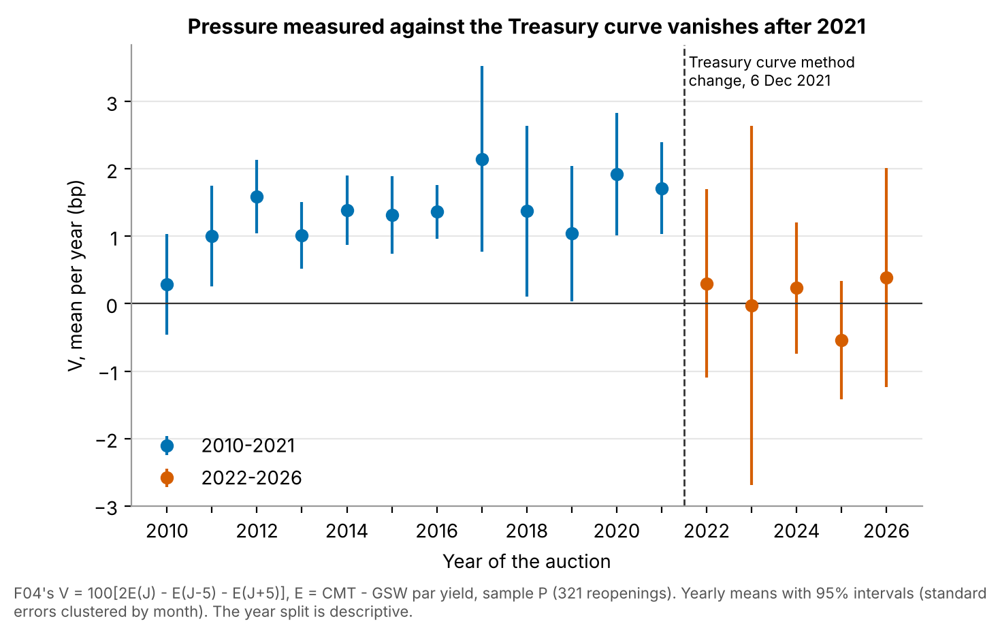
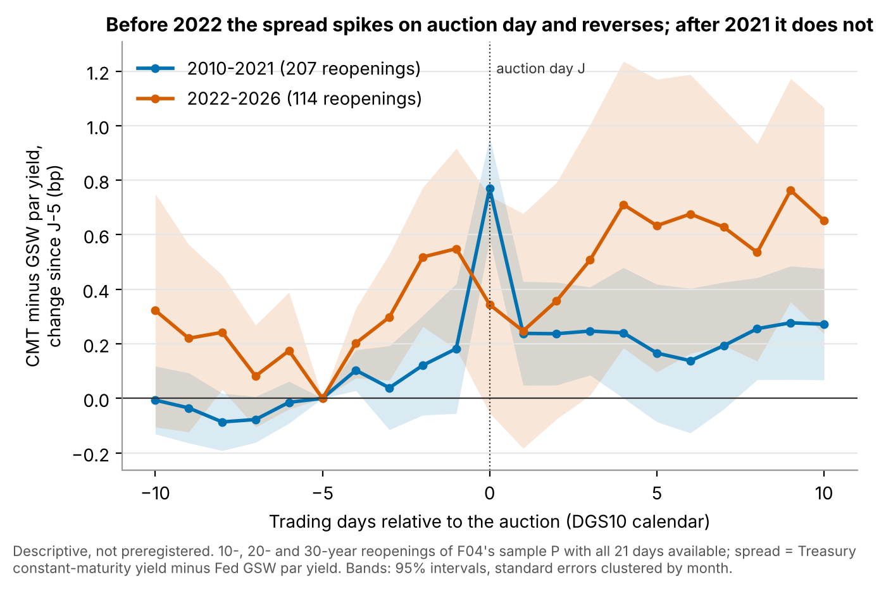
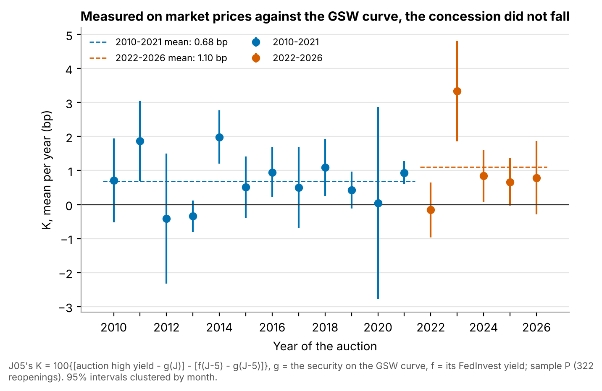
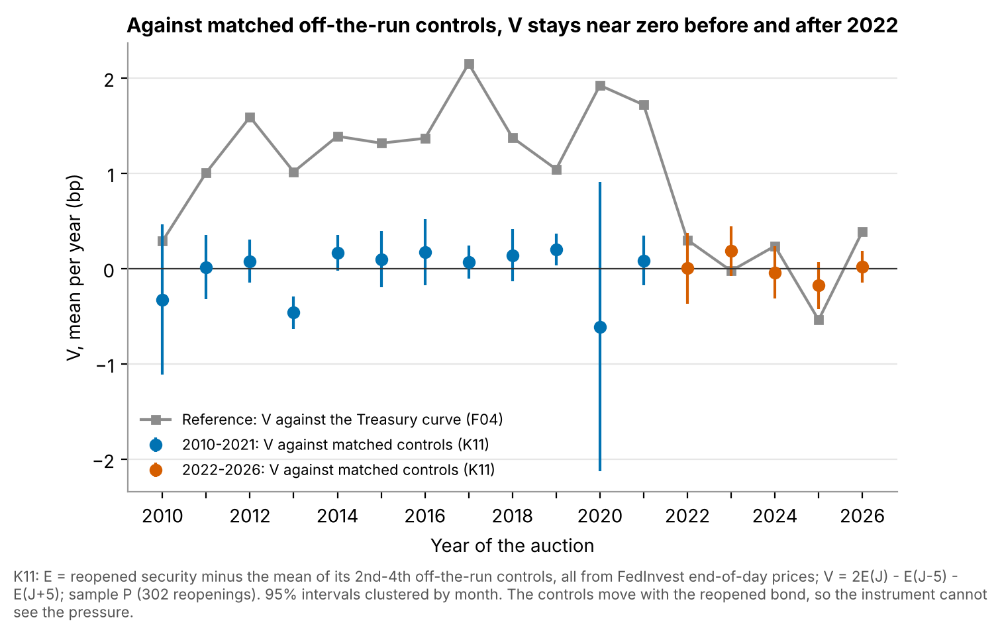

# 1 Introduction

When the U.S. Treasury sells a large amount of a security, dealers and investors must absorb it. If their capacity
to hold extra duration is limited, the security must be offered cheaply around the auction: its yield rises in the
days before and falls back after. Lou, Yan and Zhang (2013) documented this inverted V up to 2008; Fleming, Liu and
Nguyen (2026) extended it to July 2024 and found that it weakened after 2014.

The question matters to three readers. A rates desk that buys at auction or trades around the calendar wants to
know whether the concession still exists and how to measure it. A debt-management office pays the concession on
every security it sells, so its size is a cost of issuance. A central bank that monitors market functioning and
dealer capacity reads auction pressure as a symptom, often through the public constant-maturity series.

This note started from that last measurement. Against the Treasury's constant-maturity curve, the pressure around
reopenings of 10-, 20- and 30-year securities was clear until 2021 and near zero from 2022. On 6 December 2021 the
Treasury changed the method that builds that curve. Did the pressure disappear from the market, or only from the
measure? Four tests, each preregistered and sealed before its data were read, give this answer:

1. The pressure exists. Against the constant-maturity curve it averaged 0.91 bp over 2010–2026 and survived its
   test.
2. Its apparent disappearance after 2021 is at least partly a measurement artefact: on the one year where both
   curve methods are published, the new method alone removes 0.78 bp of 1.64, and a concession measured on
   security prices against the Fed's fitted curve does not fall after 2021.
3. Public end-of-day data cannot settle the question fully. Two of the three follow-up tests ended inconclusive,
   one because a calendar guard did not foresee Monday holidays, one because its instrument could not see the
   pressure in any period.

# 2 Origin of the question

The project did not begin with the method change. It began with a well-known effect and a routine question: does
it survive out of sample, after publication, on public data? The most natural public measure is the
constant-maturity yield, published daily by the Treasury and on FRED. The first test (F04) measured the pressure as
the spread of that yield to the Fed's fitted curve, on reopenings only (Section 5), and it survived.

A year-by-year cut made after that verdict showed something the test had not asked about: the pressure was 1.0 to
2.2 bp a year from 2011 to 2021 and near zero from 2022 to 2026. A break at a date has two readings, a change in the
market or a change in the instrument. The second is easy to check and often forgotten: read the data provider's
methodology notes. The Treasury's pages state that the monotone convex method replaced the quasi-cubic Hermite
spline on 6 December 2021, and that over fiscal 2021 the average differences between the methods were −0.1 to 0.5
bp, with standard deviations of 0.2 to 1.0 bp. That is the size of the effect being measured. The Treasury also
publishes both curves side by side for fiscal 2021, which allows a direct comparison on the same auctions (F04-bis).

The last step was to look for measures that do not depend on the suspect series: the auction's own yield and
end-of-day security prices against the Fed's curve (J05), then the reopened security against neighbouring
securities, with no curve at all (K11).

Each step is a habit a student could learn without any AI tool: test a published effect after its sample ends;
when an effect vanishes at a date, ask whether the measurement changed at that date; then rebuild the measure from
data the suspected change cannot touch. Section 9 describes how the steps were actually run.

# 3 Related work

**Auction pressure.** Lou, Yan and Zhang (2013) show, for 2-, 5- and 10-year notes from 1980 to June 2008, that
secondary prices fall before auctions and recover after, more so when auctions are large or dealers constrained.
Fleming, Liu and Nguyen (2026) use intraday data from 1991 to July 2024 and, in an online appendix, the same ten-day
statistic on daily yields of individual securities. The pressure is strongest in 2007–2014 and weakens in
2015–2024, when only one maturity of six stays significant over ten days (10-year: 1.2 bp, not significant). They
exclude the 20-year bond. Two of their findings matter here: the pressure spreads to securities of nearby duration,
and the first off-the-run security shows almost the same ten-day pattern as the on-the-run one. Somogyi, Wallen and
Xu (2025) find the inverted V in the 10-year yield over 1992–2010 but no post-auction decline over 2011–April 2025.

**Dealers and auction costs.** Issuance is the main driver of primary dealers' inventories, and prices fall in
auction weeks and recover (Fleming, Nguyen and Rosenberg, 2024); tighter dealer risk constraints worsen auction
outcomes (Bräuning and Stein, 2024). Goldreich (2007) measures auction
underpricing relative to the secondary market, smaller in uniform-price auctions.

**On-the-run premium, controls and curves.** Krishnamurthy (2002) shows that the on-the-run/old-bond spread
converges over the auction cycle and depends on supply and repo. The Treasury Borrowing Advisory Committee (2021)
puts the gap between 10-year on-the-run securities and a curve fitted on off-the-runs at about −7 bp since 2009,
varying by several basis points across years. Sigaux (2018), on Italian reopenings, rejects the domestic curve as a
control because it contains the securities to be auctioned, which arbitrage links to them. The Fed's curve
(Gürkaynak, Sack and Wright, 2006, "GSW") is fitted on off-the-run securities and excludes the two most recent
issues of each maturity and, from 1996, 20-year bonds. The Treasury's constant-maturity curve is built from the most
recently auctioned securities.

The novelty checks found no study measuring auction pressure across the December 2021 method change, or the auction
yield against the GSW curve with a cut in 2021; that is not proof that none exists. The contribution is narrow: a
public-data measurement, a documented measurement break, and an account of how far public end-of-day data go.

# 4 Data

All data are public, free and downloadable without an account.

**Auctions.** Treasury Fiscal Data API (`v1/accounting/od/auctions_query`), three queries copied from the
preregistrations: nominal fixed-rate notes and bonds; reopenings identified by the security term ("9-Year
10-Month", "29-Year 11-Month", ...) and the `reopening` flag; dates, coupon, high yield, high price, closing time.

**Constant-maturity yields.** FRED series DGS10, DGS20 and DGS30, in percent with two decimals.

**Fed fitted curve.** `feds200628.csv` (Federal Reserve Board): par yields `SVENPY10/20/30` for F04, and the
Svensson parameters `BETA0`–`BETA3`, `TAU1`, `TAU2` for J05, which allow any cash flow to be discounted.

**Two-method file.** `fy2021-mc-vs-hs-combined.csv` (Treasury): the par curve under the old (HS) and new (MC)
methods for 1 October 2020 to 30 September 2021. Its HS values equal FRED exactly on every date used.

**Security prices.** TreasuryDirect FedInvest, one page per date (921 pages), with an end-of-day clean price for
every marketable note and bond. These prices are not built from any curve, so the December 2021 change does not
touch them. Yields were computed with the Treasury's formula; the yield computed from each auction's high price
matched the published high yield within 0.1 bp on every J05 row.

| Test | Sample | Rows | Months |
|---|---|---|---|
| F04 | 10/20/30-year reopenings, Jan 2010 – Sep 2026 | 321 (placebo 318) | 134 |
| F04-bis | the same, fiscal 2021, windows inside the file | 23 | 8 |
| J05 | 10/20/30-year reopenings, 2010–2021 vs 2022 – Oct 2026 | 206 + 116 | 96 + 39 |
| K11 | 2022 – Oct 2026 (all); 2010–2021 (10/30-year) | 113; 184 | 39; 96 |

: Primary samples.

**Calendars.** J is the auction date and J±5 the date five ranks away in the test's calendar: dates with a DGS10
value (F04, F04-bis), dates with all six GSW parameters (J05), and U.S. federal business days (5 U.S.C. 6103, with
the weekend rule and Juneteenth from 2021) minus 2012-10-30 and 2018-12-05, two verified days without FedInvest
prices (K11).

# 5 Method

## 5.1 Why reopenings

The constant-maturity yield is read on the most recently auctioned security. At a new issue that security changes,
and its spread to a fitted curve jumps by the new issue's premium. At a reopening the Treasury sells more of the same
security, so the reference does not change. All four tests use reopenings of 10-, 20- and 30-year securities only.

## 5.2 The four measures and their rules

**F04, against the Treasury curve.** E = constant-maturity yield minus GSW par yield at the same maturity, and
V = 100 [2E(J) − E(J−5) − E(J+5)] in bp: positive if the spread rises into the auction and falls back. A constant
premium and a linear drift cancel. Statistic: mean V, standard errors clustered by month (the 10- and 30-year
reopenings fall in the same week, the 20-year a week later). *Rule*: survives if mean V > 0 with t ≥ 2, a placebo at
J+10 has |t| < 2 and the sample is large enough; eliminated if t < 2 and the 95% upper bound is at most 0.5 bp;
otherwise inconclusive.

**F04-bis, old versus new method.** V computed with the HS and with the MC rate on the same auctions and dates, and
the paired difference D = V_HS − V_MC, in which the GSW curve cancels. Statistic: mean D, clustered by month, with
the Student value 2.365 (8 clusters). *Rule*: survives ("the method explains the break") if the whole 95% interval
is above 0.9 bp, half of the 1.75 bp break in the exploratory split; eliminated if wholly below; inconclusive
otherwise or if a guard fails (HS differing from FRED, or mean V_HS below 0.9).

**J05, concession on security prices against the GSW curve.** K = 100 {[high yield − g(J)] − [f(J−5) − g(J−5)]},
where g is the yield of the same security priced on the GSW curve (forward to settlement for the auction yield) and f
its yield from the FedInvest price. K is the rise of the security's yield from five days before to the auction,
beyond the rise of the fitted curve on the same cash flows; subtracting the security's own spread at J−5 removes its
on-the-run premium, whatever its level. Statistic: the decline Δ = −b from an OLS of K on an after-2021 dummy and
maturity dummies, clustered by month. *Rule*: survives ("the market changed") if the 90% interval of Δ is above 0
and reaches 0.5 bp; eliminated if its upper bound is below 0.5 bp; otherwise, or if a guard fails, inconclusive.

**K11, against matched controls, no curve.** E = yield of the reopened security minus the mean yield of three
controls of the same original maturity (the 2nd to 4th off-the-run, at most 18 months shorter; the first off-the-run
excluded), all from FedInvest prices of the same day; V as in F04. Statistic: mean V after 2021. *Rule*: survives
("the pressure is still there") if the 90% interval is above 0, reaches 0.5 bp and the mean stays positive without
2023 and without the 30-year; eliminated if the upper bound is below 0.5 bp **and** the same instrument shows a
significant decline from 2010–2021 on 10- and 30-year reopenings; otherwise inconclusive. The second condition is an
instrument check: if the controls absorb the pressure, a zero after 2021 means nothing.

## 5.3 Preregistration and verification

For each test, a preregistration author fixed the data, the construction of the analysis file, one primary
statistic, minimum samples, schema checks, tolerances and a machine-readable verdict rule, without computing any
statistic on the test's data; what each author had seen (headers, counts, metadata, earlier results) is listed in
the text. The text was sealed by its SHA-256 hash (Appendix B) before the data were read. An experimenter built the
analysis file and computed the statistic. A verifier on a different model, reading only the preregistration and the
analysis file, recomputed every number with its own code, including every yield in J05 and K11. A separate script
applied the sealed rule to the verifier's numbers: inconclusive first, then survives, otherwise eliminated. Any
failed schema check makes a test inconclusive, even if the failing rows turn out to be correct.

A separate pipeline then rebuilt the analysis files from the raw downloads and reproduced all 60 sealed verifier
numbers (Appendix A). Every number below comes from `results/results.json`. Year-by-year means, the 2010–2021 /
2022–2026 split of F04 and all variants are descriptive and were chosen after seeing data.

# 6 Results

| Test | Primary statistic (bp) | Interval | Sealed verdict |
|---|---|---|---|
| F04 | mean V = 0.91 (SE 0.16, t = 5.62, N = 321) | 95%: [0.59, 1.22] | survives |
| F04-bis | mean D = 0.78 (SE 0.14, N = 23) | 95%: [0.45, 1.12] | inconclusive (interval contains 0.9) |
| J05 | decline in K = −0.66 (SE 0.37, N = 322) | 90%: [−1.27, −0.04] | inconclusive (schema check 5) |
| K11 | mean V after 2021 = −0.01 (SE 0.06, N = 113) | 90%: [−0.11, 0.09] | inconclusive (instrument alert; schema check 5) |

: Primary statistics and sealed verdicts.

## 6.1 Pressure against the Treasury curve (F04)

*Preregistered.* Around 321 reopenings in 134 months, mean V was 0.91 bp (SE 0.16, t = 5.62), 95% interval [0.59,
1.22]. The placebo at J+10 (318 rows) gave |t| = 0.27. The verdict is **survives**: around 10-, 20- and 30-year
reopenings over 2010–2026, the constant-maturity yield rises relative to the Fed's fitted curve in the five days
before the auction and falls back in the five days after. The interval lies inside the predicted range of 0.5 to
1.5 bp.

*Descriptive, after the verdict.* Mean V was 1.17 bp at 10 years, 1.04 at 30 years and −0.13 at 20 years. Over
2010–2021 it was 1.38 bp (SE 0.12; 207 reopenings), over 2022–2026 0.05 bp (SE 0.36; 114). Every year from 2011 to
2021 lies between 1.0 and 2.2 bp, every year from 2022 to 2026 between −0.54 and 0.39 bp (Figure 1). The
preregistered subperiod after the published sample (August 2024 – September 2026) gave −0.13 bp (SE 0.39; 51).

{width=92%}

The path of the spread shows where V comes from (Figure 2, descriptive). Before 2022, its cumulative change since
J−5 was 0.18 bp at J−1, 0.77 bp on the auction day and 0.24 bp at J+1: most of V sits on the auction day itself.
After 2021 the spread drifted up to 0.55 bp at J−1, was 0.34 bp on the auction day and 0.63 bp at J+5, with no
auction-day spike.

{width=92%}

## 6.2 Old versus new Treasury method on fiscal 2021 (F04-bis)

*Preregistered.* On the 23 fiscal-2021 reopenings whose windows fall inside the two-method file (8 months; Figure 3),
mean V was 1.64 bp with the old method and 0.85 bp (SE 0.32) with the new one. The paired difference D was 0.78 bp
(SE 0.14), 95% interval [0.45, 1.12]. The guards passed: the old-method rates equal FRED exactly, and V_HS is above
0.9 bp. The interval contains 0.9 bp, so the verdict is **inconclusive**: the test concludes neither that the method
change explains more than half of the break, nor that it explains less.

The preregistration anticipated this case and fixed its reading: if the half-width of the interval is below 0.45 bp,
the test is precise and the answer is "in part". The half-width was 0.33 bp. On the same auctions, with the same
fitted curve, switching the Treasury's method lowered V by 0.45 to 1.12 bp, about half its value; zero is far
outside the interval.

![Figure 3. F04-bis: V per auction under the old (HS) and new (MC) Treasury method, same 23 fiscal-2021 reopenings. Mean difference 0.78 bp, 95% interval [0.45, 1.12] (t with 7 df, clustered by month).](../results/figures/fig3_fy2021_old_vs_new_method.png){width=72%}

*Descriptive.* D was 0.71, 0.75 and 0.87 bp at 10, 20 and 30 years. On average the old-method yield exceeded the
new one by 0.26 bp five days before, 0.70 bp on the auction day and 0.35 bp five days after: the methods differ most
on auction days. The file gives yields to 0.01 percentage point, so each D is a whole number of basis points
(standard deviation 0.95 bp).

## 6.3 Concession on security prices against the Fed curve (J05)

*Preregistered.* Mean K was 0.68 bp over 2010–2021 (206 reopenings, 96 months) and 1.10 bp over 2022–2026 (116, 39
months; Figure 4). With maturity effects, the estimated decline was −0.66 bp (SE 0.37), 90% interval [−1.27,
−0.04]: the concession did not fall. No row failed the yield-convention check, and the verifier's independent
yields matched the file's to 10⁻¹⁰ bp.

The verdict is **inconclusive**, for a formal reason. Schema check 5 required J−5 to fall 7 to 9 calendar days
before J. It failed on three reopenings held on a Monday after a Monday holiday (12 September 2016, 12 July 2021,
12 September 2022), where five business days span 10 calendar days. Experimenter and verifier each found these rows
correct; the check, not the data, was wrong, and it was not rewritten after the fact. The reading written after the
verdict, which states that it does not change it, notes that with check 5 passed the sealed rule would have given
"eliminated" (upper bound −0.04, below 0.5 bp): the "market change" reading, a fall of at least 0.5 bp, would have
been excluded at the 5% level. That is a reading, not a verdict.

{width=92%}

*Descriptive.* The rise after 2021 comes mostly from 2023 (mean K 3.34 bp). Without 2023 the decline was −0.04 bp,
90% interval [−0.55, 0.48]: no change, still below 0.5 bp. Without the three Monday rows it was −0.71 [−1.33,
−0.09]. The rise of the security's spread to the curve between the closes of J−5 and J, on FedInvest prices without
the auction yield, did not fall either (decline −0.64, [−1.10, −0.18]); the remainder, auction and afternoon, did
not change (−0.02, [−0.47, 0.43]).

One descriptive result shows why K is a change and not a level. The level concession, high yield minus the GSW
yield of the same security, fell by 3.56 bp after 2021 (90% interval [2.37, 4.75]), and the security's own spread to
the curve at J−5 fell by 4.22 bp [3.07, 5.37]. A level comparison would have read a richer on-the-run premium as a
collapse of the concession.

## 6.4 Against matched off-the-run controls (K11)

*Preregistered.* After 2021, mean V against the controls was −0.01 bp (SE 0.06; 113 reopenings, 39 months), 90%
interval [−0.11, 0.09] (Figure 5), far below 0.5 bp. But on 10- and 30-year reopenings the same instrument gave
−0.03 bp (SE 0.08; 184 reopenings) in 2010–2021 and 0.04 bp (SE 0.07) after: a "decline" of −0.07 bp, 90% lower
bound −0.24. The instrument alert fired; schema check 5 also failed, on 8 rows outside every statistic where frozen
prices had exhausted the candidate controls. The verdict is **inconclusive**: the instrument does not see the
pressure even before 2022, when the Treasury-curve measure was about 1.4 bp, so its zero after 2021 says nothing
about "market or measure". The rule was built to return exactly this.

{width=92%}

*Descriptive.* The measure is precise but mute: V's standard deviation was 0.94 and 0.78 bp, against 3.2 assumed. Relative to its controls, the reopened security cheapened by 0.12 bp from J−5 to J and
by another 0.15 bp from J to J+5 before 2022 (0.11 and 0.12 bp after): a steady drift, not an inverted V. The first
off-the-run, against the same controls, showed no V either (−0.08 and 0.02 bp). The original card's measure, which uses the auction
high yield, gave 0.87 bp (SE 0.22) before 2022 and 0.56 bp (SE 0.23) after; it mixes the pressure with the morning's
market moves.

# 7 Discussion

**What holds.** One result meets its preregistered standard: the 0.91 bp pressure against the Treasury curve. On
fiscal 2021, that measure depends on the curve method by 0.45 to 1.12 bp, roughly half its size; the test was
inconclusive only on whether the method explains more than half of the break.

**Why the post-2021 disappearance is at least partly measurement.** Three facts point the same way. On the same
auctions and dates, the new method alone removes about half of V. Under the old method most of V sat on the auction
day, the two methods differ most on auction days, and after the change the auction-day spike is gone. And a measure
that does not use the Treasury curve shows no decline after 2021, with an upper bound below the smallest decline a
market change would imply, although its verdict is inconclusive because of the calendar guard. The tests do not say
which method is closer to the truth: the old one may have amplified the auction-day move, or the new one may smooth
it away.

**What remains open.** Under the new method, V on fiscal 2021 was still 0.85 bp (SE 0.32), well above the 0.05 bp of
2022–2026, so the method does not account for the whole drop. The rest may be a change in the market, a difference
between the comparison file and the series published after December 2021, or chance in a split chosen after seeing
the data. J05's evidence against a market change leans on 2023; without 2023 it shows no change in either direction.
K11 shows that near off-the-run securities cannot serve as controls: they move with the reopened security, as
Fleming, Liu and Nguyen (2026) and Sigaux (2018) would lead one to expect. Settling "market or measure" needs controls
from another maturity sector or intraday data; free public data offer neither.

**What a practitioner can take from it.**

- Constant-maturity yields are model outputs, not prices. Around auctions their behaviour depends on the
  interpolation method by up to about a basis point, the size of the effects studied. An event study or a
  relative-value signal built on them should not be spliced across 6 December 2021 without a check; the Treasury's
  two-method file allows one for fiscal 2021.
- For auction costs, measure on the security itself. On FedInvest prices against the Fed's curve, the point
  estimates show no fall in the concession on long reopenings after 2021 (formal verdict inconclusive). The
  constant-maturity series is not evidence that auctions became cheaper.
- Level comparisons to a fitted curve carry the on-the-run premium, which moved by about 4 bp across 2021 in this
  sample. Compare changes of the same security, not levels.
- The 2nd–4th off-the-runs move with the reopened security around reopenings. Pairing it with them captures none
  of the concession seen against the fitted curve.

# 8 Limitations

1. **Guards that failed on correct rows.** J05's calendar check did not foresee Mondays after Monday holidays, and
   K11's "three controls on every row" check could not hold on 8 rows. Both verdicts are inconclusive for reasons
   unrelated to the hypotheses. Repairing the checks after seeing the numbers would have defeated the seal, so the
   "eliminated" reading of J05 remains a reading.
2. **One fiscal year, at 1 bp resolution.** The method comparison covers 23 auctions in 8 months of a year with
   heavy Fed purchases and a sharp rise in long rates, and each D is an integer number of basis points. The file's
   MC rates were computed for the comparison before the change went live; nothing guarantees they equal the series
   published afterwards, and no check was possible. Carrying the fiscal-2021 result to 2022–2026 is an inference.
3. **Timing.** Auctions close at 1 pm; the constant-maturity yields, the GSW curve and FedInvest prices are
   end-of-day. V at the close understates the 1 pm peak, and K mixes the concession with the afternoon's moves, its
   main source of noise. A change in how fast the pressure unwinds after 1 pm would look like a change in pressure.
4. **Controls that share the pressure.** K11's controls move with the reopened security, so the instrument is blind
   in both periods. GSW, fitted on older securities and smooth, absorbs less, but by an unknown amount.
5. **No intraday or CRSP data.** The published work uses intraday platform data and CRSP daily prices; this project
   used only free public data. FedInvest documents neither its source nor the time of its end-of-day price, and
   older prices are multiples of 1/32.
6. **Choices made after seeing data.** The 2022 cut, the 0.9 bp threshold of F04-bis and the 0.5 bp thresholds of
   J05 and K11 came from exploratory splits of F04. The values of D, K and K11's V were not seen before sealing,
   but the designs were not blind to earlier results.
7. **Scope and multiplicity.** Reopenings of 10-, 20- and 30-year securities only: nothing on new issues or on 2- to
   7-year notes. Each verdict is a one-sided 5% decision under its own rule, with no correction for the other ideas
   tested in the same pipeline. No economist has reviewed the results.

# 9 How this project was run

The project came out of an AI-agent research pipeline under a fixed protocol. The human sponsor set the brief
(public and free data only, a laptop, a few weeks of part-time work, methods defensible before economists) and the
selection criterion (interest to an admissions committee and to recruiters), and took the decision at each node.

**Proposal and selection.** Agents proposed ideas as cards in a closed format, each with a falsifiable hypothesis,
a numerical prediction and a test that would kill it. Judges ranked the cards blind to their origin; code sealed
before the first judgement aggregated the ranks. In the first generation all proposers and judges were Claude
models; F04 ranked second of 20. Later generations used four model
families (Kimi, Gemini, OpenAI Astra, Claude). J05 was proposed by a Kimi-family agent in the second generation and
ranked first in the aggregate; K11, also from a Kimi-family agent, was ranked first by all four judges of the third.
Before each test, an agent checked novelty and data access, recording the sources it had opened; all three cards
were judged "variants" of published work.

**Testing.** Each retained card got a preregistration from a separate agent, sealed by SHA-256 before the data were
read for results. An experimenter in a fresh session ran it; a verifier on another model recomputed every number
from the analysis file alone; a script applied the sealed rule. Ideas that survived became parents of the next
generation, and the third generation was also served the open question "did the pressure leave the market or only
the Treasury curve?". F04 survived and became a parent; J05 is its daughter; K11 answers the open question. F04-bis
was not a card: the decisive test was identified in the first-round report, drafted by a preregistration agent and
sealed by the orchestrator on the sponsor's instruction, its first line ("PROJET NON SCELLÉ") kept byte for byte.

**Division of labour.** Agents proposed, judged, checked novelty, wrote preregistrations, ran experiments, verified
and drafted. [To be completed by the author: what the author personally wrote, checked or re-derived; the decision
taken at each node; the models and versions in each role.]

**What the protocol does not guarantee.** The verifier checked computations from the analysis file, not the
construction of that file; the independent rebuild covers that only insofar as its code was written separately.

# References

Bräuning and Stein (2024). The Effect of Primary Dealer Constraints on Intermediation in the Treasury Market.
Federal Reserve Bank of Boston Working Paper 24-7.
<https://www.bostonfed.org/-/media/Documents/Workingpapers/PDF/2024/WP2407.pdf>

Fleming, Liu and Nguyen (2026). Intraday Price Pressure and Order Flow Around U.S. Treasury Auctions. Federal
Reserve Bank of New York Staff Reports 1188, March 2026, revised October 2026.
<https://www.newyorkfed.org/medialibrary/media/research/staff_reports/sr1188.pdf>

Fleming, Nguyen and Rosenberg (2024). How do Treasury dealers manage their positions? *Journal of Financial
Economics*, 158, 103885. <https://www.newyorkfed.org/research/staff_reports/sr299.html>

Goldreich (2007). Underpricing in Discriminatory and Uniform-Price Treasury Auctions. *Journal of Financial and
Quantitative Analysis*, 42(2), 443–466. <https://ideas.repec.org/a/cup/jfinqa/v42y2007i02p443-466_00.html>

Gürkaynak, Sack and Wright (2006). Paper documenting the Federal Reserve Board's fitted Treasury yield curve
(`feds200628`). Finance and Economics Discussion Series 2006-28.
<https://www.federalreserve.gov/pubs/feds/2006/200628/200628pap.pdf>

Krishnamurthy (2002). The bond/old-bond spread. *Journal of Financial Economics*, 66(2–3), 463–506.
<https://ideas.repec.org/a/eee/jfinec/v66y2002i2-3p463-506.html>

Lou, Yan and Zhang (2013). Anticipated and Repeated Shocks in Liquid Markets. *Review of Financial Studies*, 26(8),
1891–1912. <https://econpapers.repec.org/RePEc:oup:rfinst:v:26:y:2013:i:8:p:1891-1912>

Sigaux (2018). Trading ahead of Treasury auctions. ECB Working Paper 2208.
<https://www.ecb.europa.eu/pub/pdf/scpwps/ecb.wp2208.en.pdf>

Somogyi, Wallen and Xu (2025). What Treasury Auctions Reveal About Investor Demand. Harvard Business School Working
Paper 26-033, version of 2 December 2025.
<https://www.hbs.edu/ris/Publication%20Files/26-033_9bebc98f-09f9-4485-aae6-972388865b19.pdf>

Treasury Borrowing Advisory Committee (2021). Charge 1, third quarter 2021.
<https://home.treasury.gov/system/files/221/TBACCharge1Q32021.pdf>

U.S. Department of the Treasury. Treasury yield curve methodology.
<https://home.treasury.gov/policy-issues/financing-the-government/interest-rate-statistics/treasury-yield-curve-methodology>

U.S. Department of the Treasury. Yield curve methodology change information sheet.
<https://home.treasury.gov/policy-issues/financing-the-government/yield-curve-methodology-change-information-sheet>

*Note.* Only references that the project's literature notes record as opened and verified are listed, with the
addresses those notes give, and with authors by surname as the notes record them.

# Appendix A: Reproduction summary

The pipeline (`run_all.py`) checks the seals, downloads or reuses the raw files, rebuilds the four analysis files,
recomputes every field listed in the sealed verdicts, applies the sealed rules and compares each field with the
independent verifier's sealed number, using the preregistered tolerances (0 for counts and flags; 0.005 bp for means
and standard errors; 0.01–0.02 for bounds, margins and *t* statistics; 0.05 bp for the yield recomputation gap). The
largest absolute gap on any field was 2.5 × 10⁻¹¹ bp.

| Test | Fields within tolerance | Verdict from pipeline numbers | Sealed verdict |
|---|---|---|---|
| F04 | 10 / 10 | survives | survives |
| F04-bis | 12 / 12 | inconclusive | inconclusive |
| J05 | 14 / 14 | inconclusive | inconclusive |
| K11 | 24 / 24 | inconclusive | inconclusive |
| **Total** | **60 / 60** | | |

: Sealed verifier numbers reproduced by the pipeline (field by field in `results/reproduction.md`).

The schema failures of J05 (3 rows) and K11 (8 rows) are reproduced, not corrected. A run takes about 30 seconds
with the cache and about an hour from an empty cache (921 FedInvest pages).

# Appendix B: Audit trail

The preregistrations are kept byte for byte, in French as written, in `audit/<ID>/preenregistrement.md`. Their
seals, recomputed on these copies:

| Test | SHA-256 of the sealed preregistration |
|---|---|
| F04 | `99e82a4c075afc13a15d760bb79bc6a1454a2bd956067c87ec1f7ecda152c6fc` |
| F04-bis | `f5f4b98dc3c87fdbc49738e7b0e84992219ace991bb8e1b59191338cafe5c78a` |
| J05 | `1e93151088602c9180c44b3229a60d1eb0a9f054074744bc68be7774703384a4` |
| K11 | `3f4e97b4a2cb56624cc641af05ec19b292304f84681a718bf771fd39554d5597` |

: Seals of the preregistrations.

Each hash also appears as `sceau_preenregistrement` in the test's `verdict.json`, and `run_all.py` stops if a copy
no longer matches. Each `verdict.json` holds the verifier's numbers, the machine-readable rule and the reasons for an
inconclusive verdict. `audit/F04-bis/scellement.md` records how the F04-bis draft was sealed;
`audit/J05/lecture-apres-coup.md` and `audit/K11/lecture-apres-coup.md` are readings written after the verdicts, and
both state that they do not change them.
